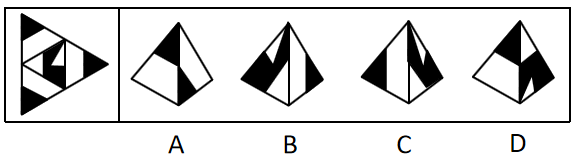
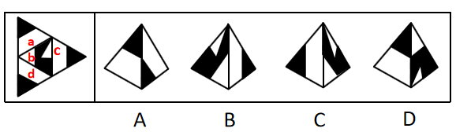
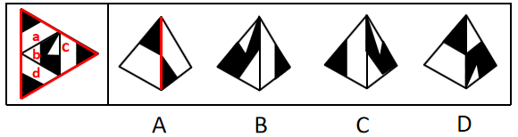
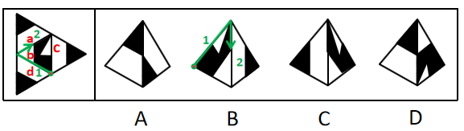

# 空间重构-四面体折叠（相邻面公共边特征）

考点：[[20-考点/判断推理/图形推理/空间重构-四面体折叠（相邻面公共边特征）|图形推理 / 空间重构-四面体折叠（相邻面公共边特征）]]

**问法模型**：给出四面体展开图问折叠后是哪一项 → 用'公共边法'比对相邻面交界处黑三角形的并排/错位及与顶角黑三角是否挨着，逐项排除

## 推理链
1. 第1步：题干为大三角形含中三角的四面体展开图，四个面（a、b、c、d）均带有位于角部的小黑三角形及黑白图案，选项为折叠后的立体视图
2. 第2步：采用公共边特征法——在展开图中定位选项所示两面的公共边，观察公共边两侧小黑三角是'并排'还是'错位'、是否与顶角黑三角挨着、描边经过的角的颜色
3. 第3步：A项由面a、c、d中两面构成：展开图中面a-c、面a-d、面c-d三组公共边（红线）两侧均为两个小黑三角并排挨着，而A项公共边处两个小黑三角错位挨着，不一致，排除
4. 第4步：B项由面b、c构成：展开图中面b从黑尖开始顺时针画边，边1到边2（绿线）中间经过白色的角，而B项中同位置经过的是半黑半白的角，不一致，排除
5. 第5步：D项由面b与面a/c/d之一构成：展开图中面b与面a、面b与面c、面b与面d的公共边（蓝线）均不与顶角小黑三角形挨着，而D项公共边与顶角小黑三角形挨着，不一致，排除
6. 第6步：C项各面图案方向及公共边处黑三角的相对位置均与展开图一致，当选

**最快解法**：⚡ 公共边法（描边比对）：抓住公共边两侧小黑三角的三个特征——并排vs错位、是否挨顶角黑三角、描边经过的角的颜色，A错位排除、B角色不对排除、D挨着顶角黑三角排除，锁定C

## 易错点
- ⚠ 并排挨着与错位挨着区分不清，误选A
- ⚠ 面b顺时针描边时忽略经过的角是白色而非半黑半白，误选B
- ⚠ 忽略公共边是否与顶角小黑三角形相邻这一细节，误选D

## 母题抽象
> 🧩 当题干给出四面体展开图且各面以角部小黑三角、黑白角为特征图案时，用公共边特征法（并排/错位、挨不挨顶角黑三角、顺时针描边经过的角色）逐项排除定答案

**同类特征**：四面体展开图、四个面均含角部小黑三角形、白色角与半黑半白角、公共边两侧图案关系、并排vs错位、顺时针描边定向

## 相关题
- [[10-真题/判断推理/图形推理/1789614 空间重构-四面体展开图（画边法-唯一点法）|1789614]]（江苏 2016，相关度1）
- [[10-真题/判断推理/图形推理/2042726 空间重构-四面体折叠（相邻面相对位置-画箭头法）|2042726]]（江苏 2017，相关度1）
- [[10-真题/判断推理/图形推理/2144543 空间重构-四面体折叠（唯一点顺时针描边法）|2144543]]（选调 2018，相关度1）
- [[10-真题/判断推理/图形推理/2367814 空间重构-四面体折叠（相邻面公共边与特征线-箭头指向检验）|2367814]]（江苏 2019，相关度1）
- [[10-真题/判断推理/图形推理/2367987 空间重构-四面体展开图折叠（画边法-公共边法）|2367987]]（江苏 2019，相关度1）

---

### 题干

下面给定的是纸盒外表面的展开图，右边哪一项能由它折叠而成？请把它找出来。

### 选项
- A. A
- B. B
- C. C　✅
- D. D

### 官方解析

将题干展开图中的面依次标注为面a、b、c、d，如下图：

A项：选项由面a、c、d这三个面其中两个面构成，题干展开图中面a和面c，面a和面d，面c和面d，这三组面的公共边（红色的线）都是两个小黑三角并排挨着，选项中的公共边（红色的线）两个小黑三角是错位挨着，选项与题干不一致，排除；

B项：选项由面b、c构成，题干中面b从黑尖开始顺时针画边，边1到边2（绿色的线）中间经过白色的角，而选项中以此为顶点顺时针画边，边1到边2（绿色的线）中间经过的是半黑半白的角，选项与题干不一致，排除；

C项：与题干一致，当选；

D项：选项由面b和面a、c、d其中的一个面构成，题干展开图中面b和面a，面b和面c，面b和面d，这三组面的公共边（蓝色的线）都没有与顶角的小黑三角形挨着，而选项中的公共边（蓝色的线）与顶角的小黑三角形挨着，选项与题干不一致，排除。

故正确答案为C。

### 给定材料
（无）
