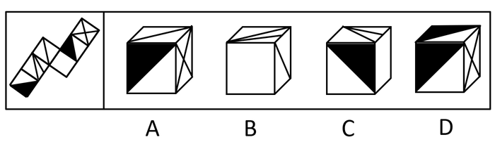
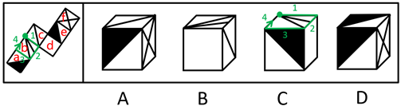

# 空间重构-折纸盒（公共点画线法+相邻边顺时针描边法）

考点：[[20-考点/判断推理/图形推理/空间重构-折纸盒（公共点画线法+相邻边顺时针描边法）|图形推理 / 空间重构-折纸盒（公共点画线法+相邻边顺时针描边法）]]

**问法模型**：题干为纸盒外表面展开图、问'哪一项能由它折叠而成'→对面有线条/三角形图案时，用公共点画线法与顺时针描边法逐一核对相邻关系并排除。

## 推理链
1. 第1步：将展开图六个面依次标号为a、b、c、d、e、f，各面图案为对角线、交叉线及黑/白三角形，四个选项各自呈现三个相邻面。
2. 第2步：对每个选项先确认其可见面对应展开图中的哪三个面，再用'公共点引线数'与'从特征点顺时针描边'两种方法核对相邻关系与图案方向。
3. 第3步：A项由面c、e、f构成——展开图中三面公共点在面c和面f上各引出两根线，而A项中该公共点在面f上只引出一根线，引线数不符，排除。
4. 第4步：B项由面b、c、d构成——以面b内两根线的交点（绿点）为起点在面b内顺时针描边，展开图中边3应挨着面a，B项中边3却挨着面c，相邻面错位，排除。
5. 第5步：C项由面a、b、d构成——同样以面b交点为起点顺时针描边，展开图中边3挨着面a的白三角，C项中边3却挨着面a的黑三角，图案颜色错位，排除。
6. 第6步：D项三个面的组合、公共点引线数及相邻图案方向均与展开图一致，当选。

**最快解法**：⚡ 公共点画线法：先锁定每个选项三个面的公共顶点，数清展开图中该点在各面引出的线条数与相邻图案（如黑/白三角），与选项逐一比对；对引线无法区分的（如B、C项），改用以面b交点为起点的顺时针描边法核对边3相邻面及图案颜色，快速排除A、B、C锁定D。

## 易错点
- ⚠ 只核对'哪三个面拼在一起'而忽略公共点上每根线的引出面与数量（A项的坑）
- ⚠ 顺时针描边时起点选错（必须选面b两线交点这一特征点）或方向画反，导致边3相邻面判断失误
- ⚠ 面a中黑白三角形位置相近，仅凭轮廓不看颜色就误判相邻内容（C项的坑）

## 母题抽象
> 🧩 当题干出现'展开图折叠成纸盒'且各面带线条/三角形等方向性图案时，用公共点画线法核对公共顶点引线数与相邻图案，再用特征点顺时针描边法核对相邻面，验证一致者即为答案。

**同类特征**：纸盒外表面展开图、面内含对角线与交叉线、面内含黑白三角形区分、选项三个面的公共顶点、以特征点顺时针描边核对相邻面、排除法确定唯一一致项

## 相关题
- [[10-真题/判断推理/图形推理/12536419 空间折叠（六面体）-相对面排除与相邻面位置关系（画边法-公共点法）|12536419]]（四川 2024，相关度1）
- [[10-真题/判断推理/图形推理/16593173 空间重构-展开图折叠（相邻面公共边特征）|16593173]]（海南 2024，相关度1）
- [[10-真题/判断推理/图形推理/1805286 空间重构-立体折叠（五棱柱展开图，相邻面黑白关系排除）|1805286]]（上海 2016，相关度1）
- [[10-真题/判断推理/图形推理/18643899 空间重构-纸盒折叠（相邻面公共边定位法）|18643899]]（四川 2026，相关度1）
- [[10-真题/判断推理/图形推理/18650003 空间重构-六面体折叠（相对面关系判定）|18650003]]（选调 2025，相关度1）

---

### 题干

下面给定的是纸盒外表面的展开图，右边哪一项能由它折叠而成？请把它找出来。

### 选项
- A. A
- B. B
- C. C
- D. D　✅

### 官方解析

将题干展开图中的面依次标号，如下图：

A项：选项由面c、e、f构成，题干中三个面的公共点（红色的点）引出面c和面f的两根线，选项中这三个面的公共点（红色的点）只引出面f的一根线，选项与题干不一致，排除；

B项：选项由面b、c、d构成，以面b中两根线的交点（绿色的点）为起点在面b中顺时针画边，题干中边3挨着面a，选项中边3挨着面c，选项与题干不一致，排除；

C项：选项由面a、b、d构成，以面b中两根线的交点（绿色的点）为起点在面b中顺时针画边，题干中边3挨着面a的白三角，选项中边3挨着面a的黑三角，选项与题干不一致，排除；

D项：选项与题干一致，当选。

故正确答案为D。

### 给定材料
（无）
