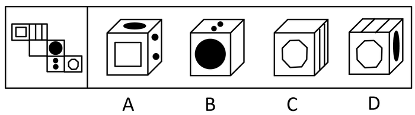

# 空间重构-六面体折叠（相对面排除+画边法判定相邻面）

考点：[[20-考点/判断推理/图形推理/空间重构-六面体折叠（相对面排除+画边法判定相邻面）|图形推理 / 空间重构-六面体折叠（相对面排除+画边法判定相邻面）]]

**问法模型**：给出纸盒外表面展开图，问哪一项能由它折叠而成 → 先给六面标号找三组相对面做排除，再对无相对面冲突的选项用公共边画边法验证相邻关系

## 推理链
1. 第1步：给展开图六个面标号：面a（小正方形嵌套面）、面b（竖条纹面）、面c（空白面）、面d（黑圆面）、面e（双黑点面）、面f（小八边形面）
2. 第2步：按2-2-2阶梯形展开图的相对面规律（Z字两端式相对）确定三组相对面：a-d、b-e、c-f，相对面在立体图中不能同时出现
3. 第3步：A项出现面a、面d、面e，其中a与d为相对面却同时出现，排除；C项出现面b、面c、面f，其中c与f为相对面却同时出现，排除
4. 第4步：B项出现面c、面d、面e，无相对面冲突；展开图中面c与面d左右相邻、面d与面e上下相邻，三面两两相邻可共顶点，且面c为空白面无方向限制，与选项中e（顶面）、d（前面）、c（右面）的位置关系一致，当选
5. 第5步：D项出现面b、面d、面f，无相对面冲突，需用画边法进一步检验相邻边的对应关系
6. 第6步：以面b为唯一面、面b与面d的公共边为唯一边（起始边1），在展开图和选项的面b上沿顺时针方向同时画边：展开图中边2所对的面为面c，而D项中边2所对的面不是面c，相邻关系不符，排除
7. 第7步：综上，只有B项能由展开图折叠而成，故正确答案为B

**最快解法**：⚡ 相对面排除法+画边法：先锁定三组相对面a-d、b-e、c-f，一票排除A（a、d同现）与C（c、f同现）；B项三面两两相邻且含空白面，直接验证通过；D项从面b与面d的公共边起顺时针画边，边2所对面应为面c而选项不是，排除，锁定B

## 易错点
- ⚠ 阶梯形展开图相对面误判：a-d、b-e、c-f为'Z字两端'式相对，易误把同排紧邻的a-b、c-d当成相对面
- ⚠ 相对面排除后放松警惕：D项三面无相对面冲突但相邻边对应关系错误，必须用画边法/公共边法二次检验
- ⚠ 画边法起始边（唯一边）选错或时针方向绕反，导致'边2所对面'比对失误

## 母题抽象
> 🧩 当题干给出六面体外表面展开图且各面图案互不相同时，先标号找出三组相对面用'不能同时出现'排除两项，再对无冲突选项以'唯一面+唯一边（公共边）'顺时针画边，比对边2所对的面是否一致

**同类特征**：纸盒外表面展开图、六个面图案各不相同、2-2-2阶梯形展开、相对面不能同时出现、公共边/画边法、问哪一项能由它折叠而成

## 相关题
- [[10-真题/判断推理/图形推理/2022314 空间重构-六面体折叠（相对面排除+相邻面公共边指向）|2022314]]（吉林 2016，相关度2）
- [[10-真题/判断推理/图形推理/2136764 空间重构-六面体折叠（相对面排除+公共边画边法）|2136764]]（河南 2017，相关度2）
- [[10-真题/判断推理/图形推理/2172377 空间重构-六面体折叠（相对面排除＋相邻面特征定位）|2172377]]（江苏 2018，相关度2）
- [[10-真题/判断推理/图形推理/2367800 空间重构-六面体折叠（折纸盒：相对面排除+相邻面公共边特征）|2367800]]（江苏 2019，相关度2）
- [[10-真题/判断推理/图形推理/2376503 空间重构-纸盒折叠（相对面排除法）|2376503]]（吉林 2019，相关度2）

---

### 题干

下面给定的是纸盒外表面的展开图，右边哪一项能由它折叠而成？请把它找出来。

### 选项
- A. A
- B. B　✅
- C. C
- D. D

### 官方解析

将原展开图标上序号如下图，逐一进行分析。

A项：选项出现了面a和面d，面e，而面a和面d为相对面，不能同时出现，选项与题干不一致，排除；

B项：选项出现了面c，面d，面e，选项与题干一致，当选；

C项：选项出现了面b，面c，面f，而面c和面f为相对面，不能同时出现，选项与题干不一致，排除；

D项：选项出现了面b，面d，面f，以面b为唯一面，以面b和面d的公共边为唯一边（如图中绿线所示）。在展开图和选项的面b上，以唯一边为起始边，沿着顺时针方向同时进行画边，展开图中边2所对的面为面c，选项中边2所对的面不是面c，选项与题干不一致，排除。

故正确答案为B。

### 给定材料
（无）
