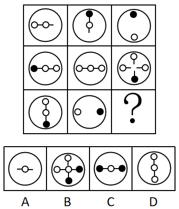

# 样式规律-加减同异（去同存异）与位置规律（逆时针旋转90°）复合

考点：[[20-考点/判断推理/图形推理/样式规律-加减同异（去同存异）与位置规律（逆时针旋转90°）复合|图形推理 / 样式规律-加减同异（去同存异）与位置规律（逆时针旋转90°）复合]]

**问法模型**：九宫格'？'处填入图形使呈现规律 → 元素相似且相同线条重复出现，优先按横行找'旋转+去同存异'的叠加公式并验证两行后套用第三行

## 推理链
1. 第1步：九宫格各图外框（大圆）一致，内部由线条与实心/空心小圆圈组成、相同线条重复出现，定位样式规律中的'加减同异'，且外框保留、仅对内部元素求异
2. 第2步：第一行提取：图1为'横线+左端空心圈+中间空心圈'，图2为'竖线+顶端实心圈+中间空心圈'，图3为'顶端实心圈+底端空心圈'
3. 第3步：验证规律：图1逆时针旋转90°得'竖线+底端空心圈+中间空心圈'，与图2去同存异（相同的竖线、中间空心圈去掉），剩下'顶端实心圈+底端空心圈'，与图3完全吻合
4. 第4步：第二行再次验证：图1（横线+左实心+中空+右空）逆时针旋转90°得'竖线+顶端空心+中空+底端实心'，与图2（横线+左、中、右三个空心圈）求异，得'十字线+顶端空+左空+右空+底端实心'，与图3吻合，规律成立
5. 第5步：第三行套用：图1（竖线+顶端空心+中间空心+底端实心）逆时针旋转90°，竖线变横线，得'横线+左端空心圈+中间空心圈+右端实心圈'
6. 第6步：与图2（仅'左空心圈+右实心圈'、无连线）求异：两图共有的'左端空心圈''右端实心圈'去掉，保留只在旋转图1中出现的'横线'和'中间空心圈'
7. 第7步：所得图形为'外框圆+横线+中间空心圈'，对照四个选项，仅A项符合，故选A

**最快解法**：⚡ 横行套公式法（验证法）：记住'图1逆时针旋转90°→外框保留、内部与图2去同存异→图3'，前两行验证后直接用于第三行：图1转后为'横线+左空+中空+右实'，图2只含'左空+右实'，去同后剩'横线+中空圈'，秒选A

## 易错点
- ⚠ 忘记先旋转就与图2求异：未旋转的图1（横线结构）与图2（无连线或竖线结构）找不出相同元素，去同存异无法进行
- ⚠ 旋转方向搞反：若误用顺时针90°，实心/空心端点的方位对调，第三行会得到竖线结构而误选D
- ⚠ 求异时把外框也纳入运算或漏掉'线'这一元素：本规律是外框保留、内部（线条+小圆圈）整体参与去同存异，遗漏线条会导致选不出答案

## 母题抽象
> 🧩 当九宫格图形元素组成相似且相同线条（含实心/空心小元素）重复出现时，优先用'图1旋转90°（方向以前两行验证为准）后与图2去同存异=图3'的复合公式，验证两行后套用到问号行

**同类特征**：九宫格、元素组成相似、相同线条重复出现、外框（大圆）每图保留、内部小圆圈分实心/空心、单看样式或位置均不成立需复合规律

## 相关题
- [[10-真题/判断推理/图形推理/12019768 样式规律-加减同异（求同）与位置旋转的复合规律|12019768]]（浙江 2026，相关度3）
- [[10-真题/判断推理/图形推理/16070178 样式规律-加减同异（翻转+去同存异）|16070178]]（重庆 2026，相关度3）
- [[10-真题/判断推理/图形推理/17056529 样式规律-求同求异（分元素：直线求同、小圆圈求异）|17056529]]（上海 2026，相关度3）
- [[10-真题/判断推理/图形推理/18643914 样式规律-去同存异（求异）与位置旋转的复合规律|18643914]]（四川 2026，相关度3）
- [[10-真题/判断推理/图形推理/18649984 样式规律-加减同异（求异-去同存异）|18649984]]（选调 2025，相关度3）

---

### 题干

请从所给的四个选项中，选出最恰当的一项填入问号处，使之呈现一定的规律性。

### 选项
- A. A　✅
- B. B
- C. C
- D. D

### 官方解析
元素组成相似，优先考虑样式规律，且相同线条重复出现，故考虑样式规律中的加减同异。九宫格优先看横行，第一行中，图1逆时针旋转90˚，外框保留，内部元素与图2求异得到图3；经验证，第二行也满足此规律；第三行，应用此规律，选择一个图1逆时针旋转90˚，外框保留，内部元素与图2求异得到的图形，因此“？”处应该选择A项。
故正确答案为A。

### 给定材料
（无）
