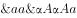
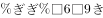
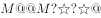
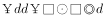

# 符号规律-相同符号的位置对应关系

考点：[[20-考点/判断推理/图形推理/符号规律-相同符号的位置对应关系|图形推理 / 符号规律-相同符号的位置对应关系]]

**问法模型**：题干给出一串符号，问哪个选项的特征或规律与之最相符 → 采用'相同符号位置编号对照'模型：只记录各符号出现的位置组，不关心符号具体形状

## 推理链
1. 第1步：将题干符号串按位置编号1~9，从相同符号出现的位置入手提取规律
2. 第2步：归纳出四组位置对应关系：位置1、4同符；位置2、3、9同符；位置5、7同符；位置6、8同符
3. 第3步：逐项对照：A项位置2、3符号相同但与位置9不同，排除；B项位置2、3与位置9不同且位置6、8也不同，排除；D项位置6、8符号不同，排除
4. 第4步：C项四组位置对应关系与题干完全一致，当选

**最快解法**：⚡ 位置标号法：将9个符号按位编号，只比对'哪些位置符号相同'，先验证信息量最大的组（位置2、3、9），再依次验证1、4、5、7、6、8，快速排除

## 易错点
- ⚠ 只数符号种类数或重复次数，忽略'相同符号必须落在相同位置组'这一核心规律
- ⚠ 验证不完整：只看到位置2、3相同就误选A或B，漏验位置9
- ⚠ 将形状相近但实际不同的符号误判为'相同'，或漏看细微差异导致D项误判

## 母题抽象
> 🧩 当题干出现'一串符号/字符序列，求规律最相符项'时，给每个符号按位置编号，提取'相同符号的位置组'模式（如1、4同符；2、3、9同符），再逐项对照位置组是否完全一致

**同类特征**：一串符号、符号位置规律、相同符号位置组、九个位置编号、逐项位置对照

## 相关题
（暂无）

---

### 题干

请从四个选项中选出恰当的一项，其特征或规律与题干给出的一串符号的特征或规律最为相符。

### 选项
- A. 

- B. 

- C. 

　✅
- D. 

### 官方解析
第一步：分析题干符号间关系。
从相同符号的位置入手：位置1、4的符号相同；位置2、3、9的符号相同；位置5、7的符号相同；位置6、8的符号相同。
第二步：判断选项符号间关系。
A项：位置2、3符号相同，但和位置9符号不相同，与题干不一致，排除； 
B项：位置2、3符号相同，但和位置9符号不相同，并且位置6、8符号不相同，与题干不一致，排除；
C项：位置1、4的符号相同；位置2、3、9的符号相同；位置5、7的符号相同；位置6、8的符号相同，与题干一致，当选；
D项：位置6、8符号不相同，与题干不一致，排除。
故正确答案为C。

### 给定材料
（无）
