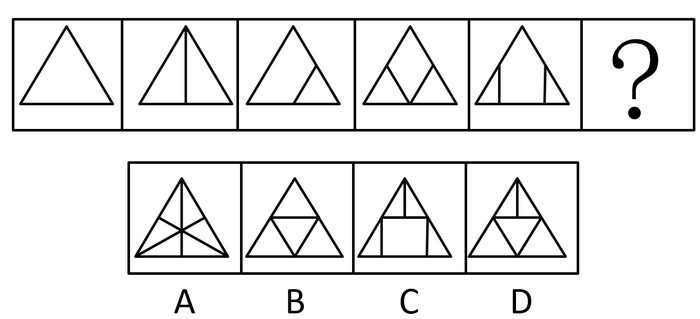

# 数量规律-点数量（交点数）

考点：[[20-考点/判断推理/图形推理/数量规律-点数量（交点数）|图形推理 / 数量规律-点数量（交点数）]]

**问法模型**：问号处填入使图形序列呈现规律 → 数量规律递推模型：先数面、再数点，找等差数列后递推下一项

## 推理链
1. 第1步：题干五幅图均为同一大三角形外框、内部添加线条逐图增多，元素组成不同且属性（对称、曲直等）无明显规律，转向数量规律
2. 第2步：题干图形'窟窿'（封闭区域）明显，优先数面数量：依次为1、2、2、3、3，不成规律，排除面规律
3. 第3步：观察到三角形内部线条交叉明显（有内线与边框相接、有内线相互交叉），改数交点：第1图仅3个顶点=3个，第2图竖线接底边=4个，第3图内线接底边与右边=5个，第4图两内线交叉=6个，第5图两条竖线接底边与两侧边=7个
4. 第4步：交点数3、4、5、6、7构成公差为1的等差数列，故'？'处图形交点数应为8
5. 第5步：逐项数交点：A项7个，B项6个，C项8个，D项7个
6. 第6步：只有C项为8个交点，符合等差递推规律

**最快解法**：⚡ 数交点法+等差递推：面数量1、2、2、3、3无规律后立即转数交点（顶点+线与边框交点+内部交叉点全算），得3、4、5、6、7等差数列，锁定'？'为8个交点，排除A(7)、B(6)、D(7)选C

## 易错点
- ⚠ 被明显'窟窿'带偏只数面数量，面数不成规律后未及时切换到点数量
- ⚠ 数交点时漏掉大三角形的三个顶点，或漏数内部线条与外框边相接的交点，导致数列断裂
- ⚠ 误将'交点'仅理解为内部线条交叉点，忽略'线与线相接'（如顶点、边框触点）同样是交点

## 母题抽象
> 🧩 当题干图形为同一外框、内部线条逐图递增且属性无规律时，先数面，面数不成规律则数交点（顶点+线框交点+内部交叉点全计入），若构成等差数列则按公差递推选下一项

**同类特征**：同一外框（大三角形）内部线条递增、元素组成不同、属性无规律、封闭区域（窟窿）明显但面数无规律、内部线条交叉/相接明显、交点数成等差数列3、4、5、6、7、问号处求序列下一项

## 相关题
- [[10-真题/判断推理/图形推理/2185027 数量规律-点数量（交点数）|2185027]]（广东 2018，相关度2）
- [[10-真题/判断推理/图形推理/2444034 数量规律-交点数（辅以'线数量−面数量=常数'复合规律验证）|2444034]]（江西 2019，相关度1）
- [[10-真题/判断推理/图形推理/5893606 数量规律-黑白块面积占比（等分图形求比例递变）|5893606]]（国考 2024，相关度1）

---

### 题干

请从所给的四个选项中，选出最恰当的一项填入问号处，使之呈现一定的规律性。

### 选项
- A. A
- B. B
- C. C　✅
- D. D

### 官方解析
图形元素组成不同，属性无明显规律，考虑数量规律。题干“窟窿”明显，优先考虑面数量，题干面数量分别是1、2、2、3、3，不成规律。继续观察图形特征，发现三角形内部线条交叉明显，考虑点数量，题干交点数分别是3、4、5、6、7，所以“？”处应选择8个交点的图形。A项7个交点，B项6个交点，C项8个交点，D项7个交点，只有C项符合。
故正确答案为C。

### 给定材料
（无）
