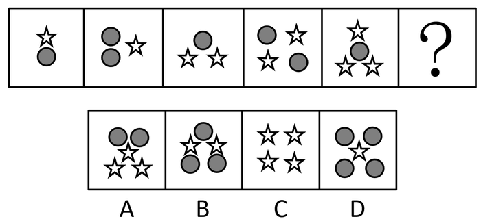

# 元素换算（两种小元素等价替换，1个五角星=2个圆形）

考点：[[20-考点/判断推理/图形推理/元素换算（两种小元素等价替换，1个五角星=2个圆形）|图形推理 / 元素换算（两种小元素等价替换，1个五角星=2个圆形）]]

**问法模型**：问号处填入使之呈现规律性 → 两种小元素直接数个数无规律时，建立方程做元素等价换算，统一成一种元素后看数量规律

## 推理链
1. 第1步：题干五幅图均由'五角星'和'灰色圆形'两种小元素构成，每图都是2种元素，C项只有五角星1种元素，先排除
2. 第2步：数小元素总个数依次为2、3、3、4、4，不构成规律，转而考虑两种元素之间的等价换算
3. 第3步：按'图1+图3=2×图2'列式：图1（1星+1圆）+图3（2星+1圆）=2×图2（1星+2圆），即3星+2圆=2星+4圆，解得1个五角星=2个圆形
4. 第4步：将各图统一换算成圆形：3、4、5、6、7个，呈公差为1的等差数列，问号处应为换算后8个圆形
5. 第5步：对照选项换算——A项2圆+3星=8个圆，B项3圆+2星=7个圆，D项4圆+1星=6个圆，只有A项为8

**最快解法**：⚡ 元素换算法：先排C（仅1种元素），再用'图1+图3=2×图2'解出1星=2圆，五图换算为3/4/5/6/7个圆的等差数列，直接选换算后等于8个圆的A项

## 易错点
- ⚠ 只数每幅图元素总个数（2、3、3、4、4）见无规律便放弃，想不到两种元素间需做等价替换
- ⚠ 换算后发现C项4个星也相当于8个圆而误选C，忽略题干每幅图均含2种元素、C项只有1种元素须先排除
- ⚠ 代换方向设反（误设1圆=2星），代回各图数列不成规律，应验证使等式成立的代换比

## 母题抽象
> 🧩 当题干每幅图都由两种小元素构成且直接数个数无规律时，用'图1+图3=2×图2'（或相邻图递变）建立方程做等价替换，将两种元素统一换算为一种后验证是否构成等差数列

**同类特征**：每幅图均含2种小元素（五角星+灰色圆形）、元素总个数2/3/3/4/4不成规律、小元素只有两种、适合等价换算、换算后呈公差为1的等差数列、选项设置单种元素干扰项（C项仅四角/五角星）

## 相关题
（暂无）

---

### 题干

请从所给的四个选项中，选出最恰当的一项填入问号处，使之呈现一定的规律性。

### 选项
- A. A　✅
- B. B
- C. C
- D. D

### 官方解析
题干图形中出现多个小元素，优先考虑元素的种类和个数。题干每幅图中均有2种小元素，排除C项。小元素个数依次为2、3、3、4、4，无规律。继续观察，题干图形和剩余选项都由两种元素构成，考虑元素换算。根据“第一个图形+第三个图形=2x第二个图形”的原则，换算后可知1个五角星=2个圆形，将五角星全部换算成圆形圆形个数分别是3、4、5、6、7，所以问号处应选一个换算后有8个圆形的选项。A项有8个圆形，B项有7个圆形，D项有6个圆形，只有A项符合。
故正确答案为A。

### 给定材料
（无）
