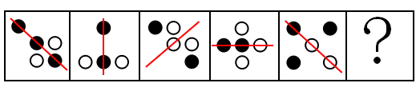

# 属性规律-对称性（对称轴方向旋转）

考点：[[20-考点/判断推理/图形推理/属性规律-对称性（对称轴方向旋转）|图形推理 / 属性规律-对称性（对称轴方向旋转）]]

**问法模型**：'选出最恰当的一项填入问号处，使之呈现一定的规律性'→元素组成不同时优先找属性规律，本题用'轴对称+对称轴方向逐图旋转'模型外推下一图

## 推理链
1. 第1步：题干五图均由小黑圆、小白圆两种小元素组成，'元素组成不同'，且图形排布规整，优先考虑属性规律而非位置/数量规律
2. 第2步：逐一验证对称性——图1(●左上、●中、○右上、○下、●右下)关于'\'对角线对称，图2(●上、○●○一排)关于竖直线对称，图3(●左上、○○○、●右下)关于'/'对角线对称，图4(●左、●中、○右、○上、○下)关于水平线对称，图5(●●上排、○中、●○下排)又关于'\'对角线对称，即题干均为轴对称图形
3. 第3步：归纳对称轴方向变化：'\'→'|'→'/'→'—'→'\'，每幅图对称轴顺时针旋转45°
4. 第4步：按规律外推，第6幅（问号处）图形的对称轴应为竖直方向'|'
5. 第5步：逐项验证选项对称轴——A项左右两列颜色为'●/○'与'○/●'，其对称轴是'\'方向；B、D项圆点排布无法沿竖直轴逐点镜像重合；C项上排'●●'、中间'●'在轴上、下排'○○'，左右严格镜像，对称轴为竖直方向
6. 第6步：只有C项对称轴为竖直方向，与外推规律吻合，故选C

**最快解法**：⚡ 对称轴方向口诀法：先快速确认题干各图均轴对称，再只盯对称轴方向——'\、|、/、—、\'顺时针每次转45°，下一轴必为竖直'|'，直接扫选项找竖直对称轴者，仅C符合（A为'\'轴，B、D非竖直轴对称），秒选C

## 易错点
- ⚠ 看到小黑圆小白圆就优先数黑白个数或找移动轨迹，忽略'元素组成不同→先看属性（对称性）'的优先级
- ⚠ 对称轴旋转方向判断失误（误以为逆时针或一次转90°），外推出'\'轴而错选A
- ⚠ B、D项排布'看似对称'，未对每个圆点做严格镜像对应验证就凭感觉排除或误选

## 母题抽象
> 🧩 当题干图形由规整小元素构成且元素组成不同时，先验证对称性；若各图均为轴对称且对称轴方向逐图变化，则按旋转方向和角度（常为45°或90°）外推问号处对称轴方向，直接选对称轴吻合的选项

**同类特征**：元素组成不同、小黑圆+小白圆两种元素、图形排布规整、均为轴对称图形、对称轴依次顺时针旋转45°（\→|→/→—）、问号处应对称轴为竖直方向

## 相关题
- [[10-真题/判断推理/图形推理/16095265 属性规律-对称性（轴对称+对称轴方向旋转）|16095265]]（江苏 2024，相关度2）
- [[10-真题/判断推理/图形推理/2031008 属性规律（轴对称+对称轴旋转）与数量规律（直线数）综合考查|2031008]]（北京 2017，相关度2）
- [[10-真题/判断推理/图形推理/2045700 属性规律（轴对称、曲直性）+数量规律（面数量等差递增）综合|2045700]]（广州市考 2017，相关度2）
- [[10-真题/判断推理/图形推理/2049850 属性规律-对称性（对称轴与图形线条的 重合-不重合）|2049850]]（山东 2017，相关度2）
- [[10-真题/判断推理/图形推理/2136980 属性规律-轴对称（对称轴数量+对称轴与图形中线条重合的二级辨析）|2136980]]（北京 2018，相关度2）

---

### 题干

请从所给的四个选项中，选出最恰当的一项填入问号处，使之呈现一定的规律性。

### 选项
- A. A
- B. B
- C. C　✅
- D. D

### 官方解析

元素组成不同，优先考虑属性规律。观察发现，题干中的图形均由小黑圆、小白圆组成，且所有图形都比较规整，优先考虑对称性，发现题干均为轴对称图形，且对称轴依次顺时针旋转，如下图：

故问号处图形对称轴应为竖直方向，只有C项符合。

故正确答案为C。

### 给定材料
（无）
