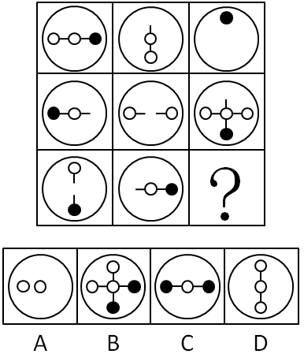

# 样式规律-旋转+去同求异（加减同异）

考点：[[20-考点/判断推理/图形推理/样式规律-旋转+去同求异（加减同异）|图形推理 / 样式规律-旋转+去同求异（加减同异）]]

**问法模型**：九宫格'？'处填入使横行呈现规律 → 优先横行找'图1旋转后与图2去同求异=图3'的叠加模型

## 推理链
1. 第1步：九宫格各图均由'外框大圆+内部线段和黑白圆圈'构成，元素组成相似且相同线条重复出现，优先考虑样式类加减同异，横行观察
2. 第2步：第一行验证——图1（横排○-○-●）逆时针旋转90°变竖排（●在顶、○在中下），再与图2外框保留、内部去同求异，公共的竖线与白圈抵消，只剩顶部黑圈，恰为图3
3. 第3步：第二行验证——图1（●-○-横排）逆时针旋转成'上段竖线+中心○+底部●'，与图2（○- -○横排）去同求异：横竖线均保留成十字，左、右、中心白圈及底部黑圈保留，得到图3的十字形，规律成立
4. 第4步：第三行应用——图1（顶部小○、竖线、底部大●）逆时针旋转90°后变横向：小○转至左端、大●转至右端、竖线转成横线
5. 第5步：将旋转后的图1与图2（横线+大○+大●）外框保留、内部去同求异：横线同有则消，右端大●同位则消，剩余左端小○与中部大○两个白圈
6. 第6步：对照选项，仅A项为外框圆内并排两个白圈，故选A

**最快解法**：⚡ 九宫格横行样式口诀'旋转+去同存异'：第一行确认'图1逆时针转90°再与图2求异=图3'，第二行验证后，第三行直接执行——图1转横后与图2同位的横线、黑圈全部相消，只剩两个白圈，秒选A

## 易错点
- ⚠ 漏掉'图1需先逆时针旋转90°'这一步，直接对图1图2去同求异，导致无选项可配或误选C
- ⚠ 旋转方向搞反（误用顺时针），黑白圈端点位置对调，易误选B或D
- ⚠ 把外框大圆也纳入去同求异，或只数黑白圆圈数量找规律，偏离'位置对应的线条求异'这一本质

## 母题抽象
> 🧩 当九宫格图形由'外框+内部线段/圆圈'构成且相同线条反复出现时，优先横行验证'图1旋转90°后与图2去同求异=图3'，第三行直接套用该模型对照选项

**同类特征**：九宫格、元素组成相似、相同线条重复出现、外框大圆始终保留、内部圆圈黑白之分且位置对应、需先旋转90°再叠加、去同求异（求异）规律

## 相关题
- [[10-真题/判断推理/图形推理/10204610 样式规律-加减同异（去同存异），九宫格列规律|10204610]]（辽宁 2024，相关度1）
- [[10-真题/判断推理/图形推理/10297349 样式规律-黑白运算|10297349]]（浙江 2025，相关度1）
- [[10-真题/判断推理/图形推理/10297407 样式规律-黑白运算（定义叠加）|10297407]]（四川 2025，相关度1）
- [[10-真题/判断推理/图形推理/10975255 数量规律-元素个数与部分数（黑白球连通堆数）|10975255]]（江苏 2024，相关度1）
- [[10-真题/判断推理/图形推理/11367791 属性类-对称性（对称轴方向与条数、轴对称+中心对称）＋数量类-面数量（九宫格横行复合规律）|11367791]]（江苏 2025，相关度1）

---

### 题干

请从所给的四个选项中，选出最恰当的一项填入问号处，使之呈现一定的规律性。

### 选项
- A. A　✅
- B. B
- C. C
- D. D

### 官方解析

元素组成相似，且相同线条重复出现，优先考虑样式规律中的加减同异。九宫格优先横行看，观察发现，第一行中，图1逆时针旋转后和图2外框保留、内部元素去同求异，可以得到图3；经验证，第二行图1逆时针旋转后和图2外框保留、内部元素去同求异，可以得到图3，满足此规律；第三行应用此规律，故“？”处应选择一个图1先逆时针旋转再和图2外框保留、内部元素去同求异得到的图形，观察选项发现，A项符合要求。 故正确答案为A。 

### 给定材料
（无）
