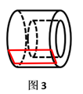
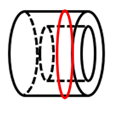

# 截面图（立体剖切，实体-空心阴影分布）

考点：[[20-考点/判断推理/图形推理/截面图（立体剖切，实体-空心阴影分布）|图形推理 / 截面图（立体剖切，实体/空心阴影分布）]]

**问法模型**：给定立体问'从任意角度剖开，哪项不可能是截面图' → 先明确立体的实心/空心分布，再用'阴影=剖到的实体、空白=空心'逐项验证剖切方式，锁定不可能项

## 推理链
1. 第1步：提取立体特征——外部是实体圆筒壁，中间圆柱是空心体（立体图中虚线示内孔），轴线水平放置
2. 第2步：确立截面图判定规则——截面中阴影部分=剖切面切到的实体，空白部分=剖切面经过的空心处，未切到实体处不画阴影
3. 第3步：验证A项——按图1方式，用与轴线斜交的平面斜切，可截出椭圆，A可截出
4. 第4步：验证B项——按图2方式，用平行于轴线的平面纵向剖切并穿过空心部位，实体部分呈'C'形，B可截出
5. 第5步：验证D项——按图3方式，用平行于轴线的平面切取一侧管壁，可截出矩形，D可截出
6. 第6步：分析C项——垂直于轴线横截空心部位时，剖切面切到的是外圈实体壁，中间空心处切不到实体，截面应为'外圈有阴影、中间空白'的圆环
7. 第7步：对照C项——C画成'中间有阴影、外圈空白'，阴影内外位置颠倒，与空心体的正截面特征相反，不可能截出，故选C

**最快解法**：⚡ 正截面阴影检验法：垂直于轴线横截圆筒，截面必为'外圈有阴影、中间空白'的圆环（阴影=实体壁，空白=空心）；C项阴影内外颠倒，直接锁定C

## 易错点
- ⚠ 忽略'截面阴影只画剖到的实体'：误把C（内圈阴影同心圆）当作圆筒的正截面，实际正截空心处应外圈阴影、中间空白
- ⚠ 误以为带孔立体的每个截面都必须留下孔的痕迹，错杀A（按图1斜切方式可截出实心椭圆）
- ⚠ 混淆截面图与外观投影/剖视图，凭图形复杂度直觉排除B、D，而真正不可截出的是阴影分布颠倒的C

## 母题抽象
> 🧩 当题干给定为空心（带孔）立体并问'哪项不可能是截面图'时，用'阴影=实体、空白=空心'模型，优先对准空心部位做正截面检验内外阴影分布是否颠倒，再逐一验证其余项的斜切/纵切可行性

**同类特征**：空心圆柱（圆筒）立体图、从任意角度剖开、求不可能是截面图的选项、阴影表示剖到的实体、选项含椭圆、C形、同心圆、矩形、空心部位对应截面空白处

## 相关题
- [[10-真题/判断推理/图形推理/2367822 立体图形-截面图（镂空框架立体的可截性判断，选非题）|2367822]]（江苏 2019，相关度1）
- [[10-真题/判断推理/图形推理/2367947 截面图-空心圆柱（盲孔）可截与不可截判断|2367947]]（江苏 2019，相关度1）
- [[10-真题/判断推理/图形推理/2742190 截面图-圆锥组合体（沙漏状双圆锥）的剖切线型判断|2742190]]（江苏 2021，相关度1）

---

### 题干

左边为给定的立体，从任意角度剖开，右边哪一项不可能是它的截面图？

### 选项
- A. A
- B. B
- C. C　✅
- D. D

### 官方解析

本题考查截面图。逐一分析选项。如下图所示，A、B、D均可截出，具体剖切方式分别对应如下图1、图2、图3所示。

如下图所示，C项无法截出，因为中间圆柱是空心体，除此之外的外部是实体，所以C项中间应该是空白的，外侧应该是有阴影的。

 

故正确答案C。

### 给定材料
（无）
