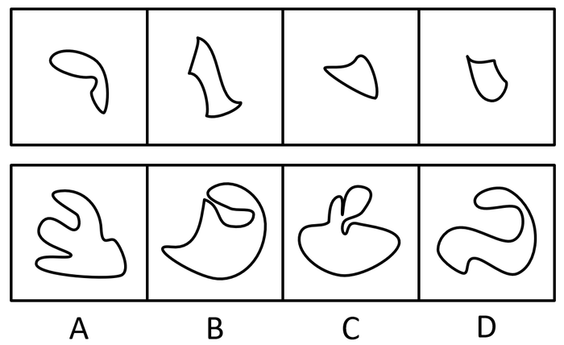

# 平面拼合-平行且等长相消

考点：[[20-考点/判断推理/图形推理/平面拼合-平行且等长相消|图形推理 / 平面拼合-平行且等长相消]]

**问法模型**：四个图形只能平移拼合、问拼合后的轮廓是哪个选项 → 采用平行且等长相消法，消去内部公共边后对照外围轮廓逐项排除

## 推理链
1. 第1步：题干给出四个不规则曲线小块，且明确限定'只能通过上、下、左、右平移'拼合，即各小块不可旋转、不可翻转，方向保持不变
2. 第2步：解题规则为'平行且等长相消'：两块拼合时重合的公共边必然平行且等长，拼合后互相抵消，剩余的外围边界之和即为目标轮廓
3. 第3步：观察四个小块的凹凸边缘，两两配对寻找平行且等长的边界线段作为拼接接触面，如弯钩形块的斜向弧边与另一块对应的凹弧边可嵌合抵消
4. 第4步：将四块按凹凸互补关系逐一嵌合，消去全部内部公共边，得到外围轮廓的预测形状
5. 第5步：对照选项排除：A的多指状分叉、C的双圆头凸起、D的环形回卷结构均无法由四块消去公共边后的外围边界得到，且受'只能平移'限制不能旋转补形
6. 第6步：B选项的外轮廓恰好等于四个小块平移拼合、消去平行且等长公共边后的剩余边界之和，凹凸走向逐段吻合，故为正确拼合图

**最快解法**：⚡ 平行且等长相消法＋凹凸互补目测：先找各小块上最独特的凹/凸弧边，在选项轮廓中找能与之'嵌合抵消'的对应边，快速锁定轮廓走向与四块剩余边界一致的B

## 易错点
- ⚠ 忽略题干'只能平移'的限定，误以为可旋转、翻转小块，从而把错误选项硬凑成答案
- ⚠ 相消时未严格核对'平行且等长'，把不等长或走向不同的弧线误当公共边消去，导致轮廓判断出错
- ⚠ 只凭整体轮廓'神似'粗选，未逐段核对凹凸互补关系，误选A或D等局部形状接近的干扰项

## 母题抽象
> 🧩 当题干出现'若干小块拼合成一个图形、只能平移（不可旋转）'的特征时，用平行且等长相消法，验证选项轮廓是否等于各小块消去内部公共边后的外围边界之和

**同类特征**：四个不规则曲线小块、只能上、下、左、右平移、拼合成一个轮廓图、平行且等长相消、凹凸互补嵌合、单选正确轮廓

## 相关题
- [[10-真题/判断推理/图形推理/11367796 平面拼合-平行且等长相消|11367796]]（江苏 2025，相关度3）
- [[10-真题/判断推理/图形推理/2172305 平面拼合-平行且等长相消|2172305]]（江苏 2018，相关度3）
- [[10-真题/判断推理/图形推理/2367804 平面拼合-平行且等长相消|2367804]]（江苏 2019，相关度3）
- [[10-真题/判断推理/图形推理/2742172 平面拼合-平行且等长相消|2742172]]（江苏 2021，相关度3）
- [[10-真题/判断推理/图形推理/10975247 图形推理-平面拼合（平行且等长相消法）|10975247]]（江苏 2024，相关度2）

---

### 题干

下面四个图形中，只有一个是由上面的四个图形拼合（只能通过上、下、左、右平移）而成的，请把它找出来。

### 选项
- A. A
- B. B　✅
- C. C
- D. D

### 官方解析

本题考查平面拼合，可采用平行且等长相消的方式解题。消去平行且等长的线段后进行组合即可得到轮廓图，即为B选项。平行且等长相消的方式如下图所示：

故正确答案为B。

### 给定材料
（无）
