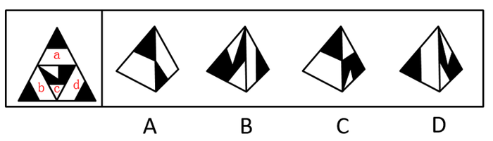
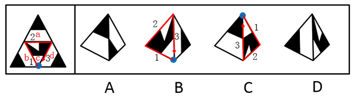

# 空间重构-四面体折叠（公共边对应+唯一点画边法）

考点：[[20-考点/判断推理/图形推理/空间重构-四面体折叠（公共边对应+唯一点画边法）|图形推理 / 空间重构-四面体折叠（公共边对应+唯一点画边法）]]

**问法模型**：‘左边给定纸盒外表面展开图，右边哪一项能由它折叠而成’→ 四面体空间折叠题，用公共边黑白对应关系与唯一点顺时针画边法逐项比对排除

## 推理链
1. 第1步：展开图是大三角形分出的四个小三角形面——三个角部面a、b、d（顶角面为全黑三角形，底边两角面各含贴边黑色三角形）与中心倒三角面c（黑白复合图案且含一个可唯一确定的顶点，即‘唯一点’）。
2. 第2步：所用规则：四面体任意两面折叠后只有一条公共边，公共边两侧图案的黑白色对应关系不变；对含唯一点的面c，以唯一点为起点顺时针画边，可逐边比对相邻面关系。
3. 第3步：A项出现面a、b、d中任意两个——展开图中这三面任意两面的公共边均为‘黑色部分对应黑色部分，白色部分对应白色部分’，而A项公共边是黑色对应白色，与题干不一致，排除。
4. 第4步：B项含面c——以唯一点为起点沿顺时针画边，展开图中边1和边2的夹角是‘半黑半白的角’，B项中该夹角是‘黑色的角’，与题干不一致，排除。
5. 第5步：C项含面c——同样以唯一点顺时针画边，展开图中边3挨着面d的‘白色梯形底边’，C项中边3挨着左侧面的‘黑色三角形斜边’，与题干不一致，排除。
6. 第6步：D项由面b、面c构成，公共边位置及两侧黑白对应均与展开图一致，与题干一致，当选。

**最快解法**：⚡ 公共边法+画边法：先查A项公共边的黑白对应（黑对白直接排除）；再对含面c的B、C项，以面c唯一点为起点顺时针画边，比对夹角颜色与邻边图案（B夹角全黑排除、C边3邻接面错排除）；D项面b、c公共边黑白对应一致直接锁定。

## 易错点
- ⚠ 把四面体当六面体做，套用‘相对面排除法’——四面体四个面两两相邻，不存在相对面
- ⚠ 面c唯一点找错导致画边起点错位，边1、边2、边3的比对全部失真
- ⚠ 只看公共边两侧图案形状、忽略黑白色的对应关系（黑对黑/白对白还是黑对白）

## 母题抽象
> 🧩 当题干给出三角形（四面体）展开图问折叠结果时，先用公共边黑白/图案对应关系排除明显不符项，再对含唯一点的特征面以该点为起点顺时针画边，逐边核对邻接关系验证剩余选项。

**同类特征**：三角形展开图（四面体折叠）、角部面含贴边黑色三角形、中心面含唯一点、公共边黑白对应关系、半黑半白的角、顺时针画边法

## 相关题
- [[10-真题/判断推理/图形推理/4630374 空间重构-六面体折叠（相邻面关系+公共点画边法）|4630374]]（新疆 2021，相关度1）

---

### 题干

左边给定的是纸盒外表面的展开图，右边哪一项能由它折叠而成？请把它找出来。

### 选项
- A. A
- B. B
- C. C
- D. D　✅

### 官方解析

将原展开图标上序号如下图，逐一进行分析。

A项：选项出现的是面a、面b、面d中的任意两个，在展开图中面a、面b、面d三个面中的任意两个面的公共边都是黑色部分对应黑色部分，白色部分对应白色部分，而选项中两个面的公共边黑色部分对应白色部分，选项与题干不一致，排除；

B项：展开图和选项中均有面c，而面c是可以确定唯一点的（如下图中蓝点所示）。在展开图和选项的面c上，以唯一点为起始点，沿顺时针方向同时进行画边，题干展开图中边1和边2的夹角是半黑半白的角，而选项中边1和边2的夹角是黑色的角，选项与题干不一致，排除；

C项：展开图和选项中均有面c，而面c是可以确定唯一点的（如上图中蓝点所示）。在展开图和选项的面c上，以唯一点为起始点，沿顺时针方向同时进行画边，展开图中边3挨着面d的白色梯形底边，选项中边3挨着左侧面中黑色三角形斜边，选项与题干不一致，排除；

D项：选项由面b、c构成，选项与题干一致，当选。

故正确答案为D。

### 给定材料
（无）
