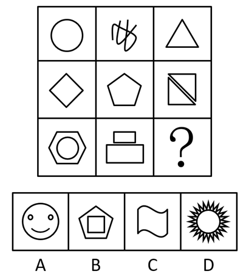

# 数量规律-线数量（线条数递增）

考点：[[20-考点/判断推理/图形推理/数量规律-线数量（线条数递增）|图形推理 / 数量规律-线数量（线条数递增）]]

**问法模型**：九宫格'填入问号处使之呈现规律性'且元素组成不同、属性规律不明显 → 优先横行数线条数，验证递增数列后选对应线数的选项

## 推理链
1. 第1步：九宫格各图元素组成不同（圆、涂鸦、三角形、菱形、五边形、带对角线的方形、六边形套圆、双矩形），无对称/曲直/封闭等明显属性规律，转向数量规律
2. 第2步：题干图形呈现'明显多边形+单一曲线'特征，确定考点为数线条数（直线、曲线均按1条计）
3. 第3步：横行观察第一行：圆=1条线、涂鸦曲线=2条、三角形=3条
4. 第4步：第二行：菱形=4条、五边形=5条、方形含对角线共6条，验证递增规律成立
5. 第5步：第三行：外六边形+内圆=6+1=7条、上小矩形+下大矩形=4+4=8条，故全图线条数依次为1~9递增，问号处应为9条线
6. 第6步：对照选项：B项外五边形5条+内正方形4条=9条，符合；A项线条数不足9且实心圆点非线条，C项仅2条曲线，D项太阳射线远超9条，排除

**最快解法**：⚡ 数线法：九宫格横行数线，发现1、2、3、4、5、6、7、8递增规律，问号选9条线；直接数B项=外五边形5条+内正方形4条=9条，锁定B

## 易错点
- ⚠ 复合图形漏数内部线条：如B项内正方形的4条边、第三行'六边形套圆'中的圆，漏数即选错
- ⚠ A项两个实心圆点易被误当作线条计入总线条数而误选A（圆点为涂黑部分，不计为线）
- ⚠ 第二行第三个图形的对角线易漏数，把6条数成5条，误判递增规律断裂而转向其他考点

## 母题抽象
> 🧩 当九宫格图形元素组成不同、对称/曲直/封闭等属性规律均不成立，且图形由多边形与单一曲线混合构成时，优先横行数线条数；若呈1~9递增数列，问号处选线数为9的选项，复合图形线条数=内外图形线条数之和

**同类特征**：九宫格、元素组成不同、无明显属性规律、多边形与单一曲线混合、线条数横行递增1~9、复合图形内外叠加

## 相关题
- [[10-真题/判断推理/图形推理/14993416 数量规律-点数量（黑点个数按行求和恒值）|14993416]]（选调 2024，相关度3）
- [[10-真题/判断推理/图形推理/17467550 数量规律-交点数（九宫格按行等差递增）|17467550]]（湖北 2026，相关度3）
- [[10-真题/判断推理/图形推理/19889518 数量规律-数面（封闭区域数）及行内加减运算|19889518]]（上海 2021，相关度3）
- [[10-真题/判断推理/图形推理/2139602 数量规律-面数量（封闭区域计数）|2139602]]（天津 2017，相关度3）
- [[10-真题/判断推理/图形推理/2172865 数量规律-角（每图含两个相同的角）|2172865]]（广州市考 2018，相关度3）

---

### 题干

从所给的四个选项中，选择最合适的一个填入问号处，使之呈现一定的规律性：

### 选项
- A. A
- B. B　✅
- C. C
- D. D

### 官方解析
元素组成不同，且无明显属性规律，考虑数量规律。题干图形出现明显的多边形以及单一曲线，考虑数线条数。九宫格优先横着观察，三行图形依次由1，2，3，4，5，6，7，8，“？”条线组成。故“？”处应该选择由9条线组成的
图形，对应B选项。
故正确答案为B。

### 给定材料
（无）
