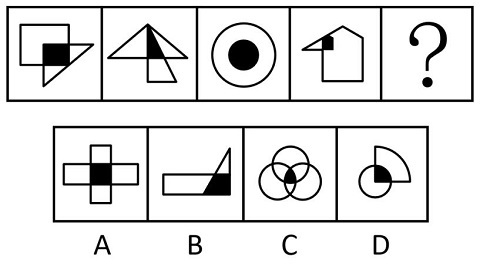

# 图形间关系（两图相交+阴影与其中一图形状相同）

考点：[[20-考点/判断推理/图形推理/图形间关系（两图相交+阴影与其中一图形状相同）|图形推理 / 图形间关系（两图相交+阴影与其中一图形状相同）]]

**问法模型**：选择最合适的一个填入问号处使之呈现规律性 → 题干均为两图组合且带黑色阴影，优先考虑图形间关系，归纳'相交阴影与其中一个组成图形形状相同'的规律并逐项验证

## 推理链
1. 第1步：题干四幅图均由两个图形组合而成且都含黑色阴影，优先考虑图形间关系（相交与阴影）
2. 第2步：归纳规律——两图相交形成的黑色阴影，其形状与组成图形之一相同：图1三角形与四边形相交、阴影为三角形；图2两三角形相交、阴影为三角形；图3两圆相含、阴影为圆形；图4五边形与三角形相交、阴影为小三角形
3. 第3步：验证A项——十字形由两个长方形相交而成，黑色阴影为正方形，正方形与长方形形状不同，排除
4. 第4步：验证B项——长方形与三角形相交，黑色阴影为四边形（梯形状），与长方形、三角形均不同形，排除
5. 第5步：验证C项——由三个圆相交而成，黑色阴影为三圆交叠的曲边区域，既非两图组合、阴影也与圆不同形，排除
6. 第6步：验证D项——圆形与扇形（四分之一圆）相交，黑色阴影为扇形，与组成图形之一的扇形形状相同，符合规律，当选

**最快解法**：⚡ 图形间关系口诀'两图相交看阴影形状'：快速扫一眼每幅图黑色阴影是否与其中一个组成图形同形——D项阴影为扇形、图中恰有扇形，直接锁定；B项阴影实为四边形而非三角形，秒排

## 易错点
- ⚠ B项最具迷惑性：阴影乍看像'三角形'，实为长方形与三角形相交形成的四边形（梯形），与三角形不同形，易误选B
- ⚠ A项阴影为正方形，易与长方形混同（正方形与长方形形状不同），误认为符合规律
- ⚠ 只看到'都有黑色阴影'的表象，忽略核心限制'阴影形状须与其中一个组成图形相同'；C项三圆相交也易被误判符合

## 母题抽象
> 🧩 当题干每幅图都由两个图形组合且含黑色阴影时，优先考虑'两图相交、阴影与其中一图形状相同'的规律，逐项核对选项阴影与组成图形是否同形

**同类特征**：每幅图由两个图形组成、两图相交形成黑色阴影、阴影形状与其中一个组成图形相同、选项阴影形状各异（正方形/四边形/三圆交叠/扇形）、考查图形间关系而非数量、位置

## 相关题
- [[10-真题/判断推理/图形推理/2133622 图形间关系（相交-相切交替规律）|2133622]]（国考 2018，相关度1）
- [[10-真题/判断推理/图形推理/4817912 图形间关系-两图相交（相交于边 vs 相交于点）|4817912]]（青海 2022，相关度1）

---

### 题干

从所给的四个选项中，选择最合适的一个填入问号处，使之呈现一定的规律性：

### 选项
- A. A
- B. B
- C. C
- D. D　✅

### 官方解析
题干图形都是由两个图形组成，优先考虑图形间关系。观察发现每个图形当中的两个图形相交形成黑色阴影，并且每个图形中的黑色阴影部分与其中一个图案的形状相同，只有D项符合这一规律。
故正确答案为D。

### 给定材料
（无）
