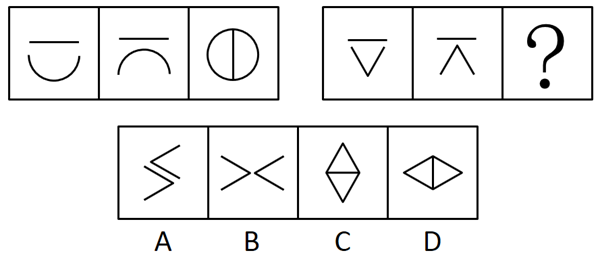

# 样式规律-求同-相加结合旋转（样式+位置复合规律）

考点：[[20-考点/判断推理/图形推理/样式规律-求同-相加结合旋转（样式+位置复合规律）|图形推理 / 样式规律-求同/相加结合旋转（样式+位置复合规律）]]

**问法模型**：两组图各给前两幅求第三幅（问号在第二组末位）→ 元素组成相似，按'上部直线/下部弧线折线'拆分部位，分别套'求同→旋转'与'旋转→相加'复合规律并迁移到第二组

## 推理链
1. 第1步：第一组三图均由'上部一条横线＋下部一条弧线'拼成；图1下部为开口向上的∪，图2下部为开口向下的∩，图3为圆＋竖直中线，提示需拆部位找复合规律
2. 第2步：上部直线规律——图1、图2的横线先'求同'保留一条，再旋转90°变成竖线，对应图3圆中间的竖直中线
3. 第3步：下部弧线规律——图1的∪顺时针旋转90°变为开口向右的'('，图2的∩顺时针旋转90°变为开口向左的')'，二者'相加'拼合成完整圆形，即图3的外圆
4. 第4步：迁移到第二组上部——图1、图2上部同为横线，求同后旋转90°必得竖线，故问号处图形内部应为竖线，排除内部为横线的C项
5. 第5步：第二组下部折线——图1的倒三角'▽'与图2的尖角'∧'各自顺时针旋转90°后再相加，拼合成菱形外框
6. 第6步：与选项对照：'菱形外框＋竖直中线'只有D项符合，故选D

**最快解法**：⚡ 拆部位排除法：先只看上部直线——两图求同再旋转90°必为竖线，C项内部是横线，一票排除；再看下部折线顺时针旋转90°后叠加成菱形轮廓，直接锁定D

## 易错点
- ⚠ 未按'上部直线/下部弧线折线'拆分部位，看到直线曲线混合就误入数线、数面等数量规律
- ⚠ 只做'求同/相加'漏掉'旋转'步骤（或把横线转成的竖线看成横线），误选内部为横线的C项
- ⚠ 下部图形旋转方向搞反（误用逆时针），拼不出菱形外框，在A、B中纠结浪费时间

## 母题抽象
> 🧩 当两组图均由'上部直线＋下部弧线/折线'上下拼接、且前两图同部位元素相似时，按部位拆分：直线走'求同→旋转90°'，弧线/折线走'顺时针旋转→相加'，再整体对照选项验证

**同类特征**：两组三图式、问号在第二组第三幅、每幅图均为上部横线＋下部弧线（折线）的拼接结构、元素组成相似指向样式规律、规律为'求同＋旋转'与'旋转＋相加'的复合操作、选项C、D仅内部横竖线互斥，可据此一票定答案

## 相关题
（暂无）

---

### 题干

从所给的四个选项中，选择最合适的一个填入问号处，使之呈现一定的规律性：

### 选项
- A. A
- B. B
- C. C
- D. D　✅

### 官方解析

元素组成相似，优先考虑样式规律。第一组图形中，图1和图2上面的横线先求同，再旋转，下面的弧线先顺时针转，再相加，得到图3。第二组图形运用此规律，图1与图2上面的横线先求同，再旋转，下面的折线先顺时针转，再相加，得到图3，故只有D项符合此规律。

故正确答案为D。

### 给定材料
（无）
