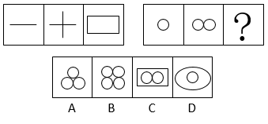

# 数量规律-数线（第一组数直线、第二组数曲线，等比×2规律）

考点：[[20-考点/判断推理/图形推理/数量规律-数线（第一组数直线、第二组数曲线，等比×2规律）|图形推理 / 数量规律-数线（第一组数直线、第二组数曲线，等比×2规律）]]

**问法模型**：两组式'填入问号使呈现规律'且元素组成不同、无属性规律 → 分组套用数量规律，按各组图形线条特征分别计数（直线数/曲线数）

## 推理链
1. 第1步：观察第一组图——单一直线'—'、十字'+'、矩形，全部由直线构成，无统一属性规律，转向数量规律
2. 第2步：数第一组直线数：1条、2条、4条，构成×2等比规律
3. 第3步：观察第二组图——一个圆、两个相切圆，全部由曲线构成，与第一组'纯直线'形成对应，故数曲线数：1条、2条
4. 第4步：按第一组×2规律递推，第二组第三个图（问号处）应含4条曲线
5. 第5步：逐项数曲线——A项3个圆共3条曲线；B项4个圆共4条曲线；C项2个圆共2条曲线（外框矩形由直线构成，不计入曲线）；D项椭圆+圆共2条曲线
6. 第6步：只有B项为4条曲线，与问号处应有数量吻合，锁定答案B

**最快解法**：⚡ 特征计数法（数线口诀：直线图形数直线、曲线图形数曲线）——第一组数直线得1、2、4，第二组数曲线得1、2，按×2推问号处需4条曲线；选项中直接数圆的个数：A为3、B为4、C为2、D为2，秒选B

## 易错点
- ⚠ 误将C项外框矩形计入曲线数（矩形由直线构成，数曲线时不得计入，否则C也凑数失真）
- ⚠ 试图在两组之间找统一数量规律（如总数守恒），忽略'第一组全直线、第二组全曲线'的分类计数特征
- ⚠ D项椭圆易被误看作'两条曲线'以外的复杂结构，或被外形干扰误认为曲线数更多

## 母题抽象
> 🧩 当两组图元素组成不同、且第一组呈'纯直线图形'、第二组呈'纯曲线图形'时，分组分别数直线数与曲线数，用第一组的数量规律（如1、2、4等比）去验证第二组并匹配选项

**同类特征**：两组式图形推理、元素组成不同、无明显属性规律、第一组出现单一直线与多边形（矩形）、第二组全为曲线图形（圆）、数量呈1、2、4递增

## 相关题
- [[10-真题/判断推理/图形推理/2097182 数量规律-面数量（封闭区域数）|2097182]]（四川 2017，相关度3）
- [[10-真题/判断推理/图形推理/2376458 数量规律-阴影面积占比|2376458]]（吉林 2019，相关度3）
- [[10-真题/判断推理/图形推理/10204454 数量规律-部分数（黑白球连通区域数做和）|10204454]]（甘肃 2024，相关度2）
- [[10-真题/判断推理/图形推理/10297050 数量规律-特殊计数（线条穿过小白球的数量）|10297050]]（天津 2025，相关度2）
- [[10-真题/判断推理/图形推理/10297262 数量规律-面的形状种类（封闭面种类数分组）|10297262]]（浙江 2025，相关度2）

---

### 题干

从所给的四个选项中，选择最合适的一个填入问号处，使之呈现一定的规律性：

### 选项
- A. A
- B. B　✅
- C. C
- D. D

### 官方解析
元素组成不同，且无明显属性规律，优先考虑数量规律。第一组图中出现单一直线以及多边形，优先考虑数直线，第一组图中直线的数量依次是1、2、4；第二组中出现的均为曲线图形，考虑数曲线，曲线数量依次是1、2，故问号处曲线出现应为4条，A项3条，B项4条，C项2条，D项2条，只有B项符合要求。
故正确答案为B。

### 给定材料
（无）
