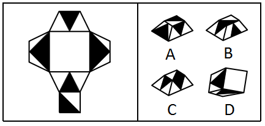

# 空间重构-折纸盒（相对面排除+查无此面排除）

考点：[[20-考点/判断推理/图形推理/空间重构-折纸盒（相对面排除+查无此面排除）|图形推理 / 空间重构-折纸盒（相对面排除+查无此面排除）]]

**问法模型**：给定平面展开图折叠后的立体图形是 → 折纸盒模型：先标号，用『相对面不能同时出现』和『展开图中没有的面不能出现』排除错误选项

## 推理链
1. 第1步：从展开图提取面的构成：中央正方形（空白面）、上方带黑色三角形的三角面、下方带黑色三角形的三角面、左右两个带黑色四边形图案的面、最下方带黑色直角三角形的正方形面，官方解析将各面标号（含面e、f、h、i、k等）逐一分析
2. 第2步：所用规则——①立体图形中不能出现展开图中不存在的面；②展开图中呈相对位置的两面互为相对面，折叠后相对面有且仅能看到一个，不能同时出现
3. 第3步：B项中出现面k，而展开图中根本没有面k，属于『无中生有』，与题干不一致，排除
4. 第4步：C项中同时出现面e和面i，而面e与面i为相对面，折叠后不能同时可见，与题干不一致，排除
5. 第5步：D项中同时出现面f和面h，而面f与面h为相对面，折叠后不能同时可见，与题干不一致，排除
6. 第6步：A项各面均来自展开图、无相对面同时出现，图案及相邻位置关系与展开图一致，当选

**最快解法**：⚡ 排除法三步走：①查『无中生有』——B项含展开图中没有的面k，先排B；②找相对面——面e/i相对排C，面f/h相对排D；③剩余A即为答案

## 易错点
- ⚠ 只比对黑白图案的相似度，漏看B项出现了展开图中根本不存在的面（无中生有）
- ⚠ 本题展开图不是正方体而是不规则多面体，套用正方体相对面口诀容易把面e/i、面f/h的相对关系找错
- ⚠ 误以为含黑白图案的面之间不能相邻，而忽略排除的真正依据是『相对面不同时出现』

## 母题抽象
> 🧩 当题干为不规则多面体展开图、选项立体图形图案高度相似时，用『排除法』：先排除含展开图中不存在面的选项，再排除同时出现相对面的选项，剩余即为答案

**同类特征**：问法：给定平面图折叠后的立体图形、展开图为不规则多面体（非正方体六面体）、各面含黑白三角/四边形图案、选项为四个立体图形、官方解析采用逐面标号分析、排除依据：无中生有面+相对面不同时出现

## 相关题
（暂无）

---

### 题干

下图给定的平面图折叠后的立体图形是<u>      </u>。

### 选项
- A. A　✅
- B. B
- C. C
- D. D

### 官方解析

将原展开图标上序号，如下图，逐一进行分析。

A项：选项与题干一致，当选；

B项：选项中的面k在展开图中没有出现，选项与题干不一致，排除；

C项：选项中包括面e和面i，而面e和面i为相对面，不能同时出现，选项与题干不一致，排除；

D项：选项中包括面f和面h，而面f和面h为相对面，不能同时出现，选项与题干不一致，排除。

故正确答案为A。

### 给定材料
（无）

> [!warning] 疑点（官方解析可能有误，待人工复核）
> 官方解析依赖的面标号图（面k、面e/i、面f/h）未随题面给出，需考生自行标号定位相对面；且对A项仅断言『与题干一致』，未给出公共边、图案指向等正面验证细节，正面锁定论证略简（但排除B/C/D的理由成立，不影响答案A的正确性）
