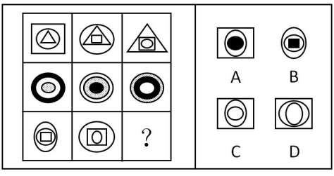

# 图形推理-样式规律（遍历）

考点：[[20-考点/判断推理/图形推理/图形推理-样式规律（遍历）|图形推理 / 图形推理-样式规律（遍历）]]

**问法模型**：九宫格嵌套图形问'符合变化规律的是'→样式遍历：优先横行，将每个图形拆为外、中、内三层，逐层找该行缺失的形状，再对照选项

## 推理链
1. 第1步：九宫格元素组成相似，均为'大图形套小图形'的嵌套结构，且三角形、圆、正方形、椭圆等相同元素反复出现→优先样式规律，考虑形状遍历
2. 第2步：九宫格优先横行看：把每个图形拆成外、中、内三层，分别检验每层形状是否在本行内遍历
3. 第3步：第一行验证：三个图形分三层，每层均是三角形、圆、正方形各出现一次完成遍历（如左上格外层正方形套三角形、右上格外层三角形套圆）
4. 第4步：第二行再验证：各层元素同样在本行内完成一次遍历，'逐层遍历'规律成立
5. 第5步：第三行应用：第三行前两格外层已出现椭圆和圆，故？外层应补'正方形'；第二格中层为正方形、内层为竖椭圆，故？中层应补'竖椭圆'、最内层应补'横椭圆'
6. 第6步：逐项对照：A、B外层均为椭圆，与？外层应为正方形不符，排除；D最内层仍是竖椭圆，不满足遍历，排除；C为外层正方形、中层竖椭圆、内层横椭圆，完全吻合

**最快解法**：⚡ 遍历法+选项对照：先看最外层——第三行外层已有椭圆、圆，？外层必为正方形，直接排除外层为椭圆的A、B；再比对C、D仅有的差别（最内椭圆横 vs 竖），按遍历取'横椭圆'锁定C

## 易错点
- ⚠ C、D仅差最内层椭圆的横竖朝向，只辨形状种类不辨方向会误选D
- ⚠ 被第二行粗黑环、阴影环等复杂元素干扰，误判层数或放弃遍历思路
- ⚠ 未优先按横行观察，强行按列找规律浪费时间（本题规律按行成立）

## 母题抽象
> 🧩 当九宫格出现嵌套多层图形且元素组成相似时，优先按行逐层（外/中/内）找每层缺失的形状补遍历，剩余选项再从方向、阴影等细节做二级辨析

**同类特征**：九宫格、嵌套多层图形、元素组成相似、相同元素重复出现、逐层遍历、横竖方向辨析

## 相关题
- [[10-真题/判断推理/图形推理/10204610 样式规律-加减同异（去同存异），九宫格列规律|10204610]]（辽宁 2024，相关度2）
- [[10-真题/判断推理/图形推理/10297349 样式规律-黑白运算|10297349]]（浙江 2025，相关度2）
- [[10-真题/判断推理/图形推理/10297407 样式规律-黑白运算（定义叠加）|10297407]]（四川 2025，相关度2）
- [[10-真题/判断推理/图形推理/12019768 样式规律-加减同异（求同）与位置旋转的复合规律|12019768]]（浙江 2026，相关度2）
- [[10-真题/判断推理/图形推理/12101004 样式规律-黑白运算（九宫格逐位置叠加）|12101004]]（江苏 2025，相关度2）

---

### 题干

下列选项中，符合所给图形的变化规律的是<u>      </u>。

### 选项
- A. A
- B. B
- C. C　✅
- D. D

### 官方解析
元素组成相似，优先考虑样式规律。相同元素重复出现，考虑形状的遍历，九宫格优先横行看，第一行每个图形分为三层，每层均是三角形、圆、正方形遍历，第二行验证规律成立，第三行？处应补最内圈为横着的椭圆，中间为竖着的椭圆，外圈为正方形的图形，只有C项符合。
故正确答案为C。

### 给定材料
（无）
