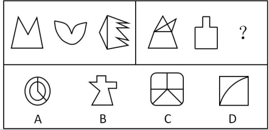

# 数量规律-面数量（图1+图2=图3的求和运算）

考点：[[20-考点/判断推理/图形推理/数量规律-面数量（图1+图2=图3的求和运算）|图形推理 / 数量规律-面数量（图1+图2=图3的求和运算）]]

**问法模型**：两组图各含三个图形、第二组末位为'？'→ 先找第一组数量规律（面数相加），再将同一运算套用到第二组选出对应面数的选项

## 推理链
1. 第1步：两组图元素组成不同，且无对称、曲直、开闭等明显属性规律，按'属性不行找数量'转向数量规律
2. 第2步：题干图形均被线条切割出封闭白色区域，优先考虑数面数量
3. 第3步：数第一组：M形下方封闭区为1个面，叶片形整体封闭为1个面，锯齿形被分割为2个面，得1、1、2，验证'图1面数+图2面数=图3面数'
4. 第4步：数第二组：三角形被内部线分割为4个面，葫芦轮廓封闭为1个面，按相同规律'？'处应有4+1=5个面
5. 第5步：逐项数面：A项同心圆加一条半径线约3个面，B项整体仅1个面，D项曲线把正方形分成2个面，C项外框被线分割恰为5个面
6. 第6步：只有C项满足5个面，与规律对照锁定答案C

**最快解法**：⚡ 数面法+求和口诀：第一组数面得1、1、2，确认'前两图相加=第三图'；第二组数得4、1，直接在选项中找5个面的图形——快速排除A(3面)、B(1面)、D(2面)，秒选C

## 易错点
- ⚠ A项同心圆加线的结构面数易数错（内圆被线分成2块、环形部分易误数成多块），误以为A符合
- ⚠ 只找'面数量递增/恒定'规律，没想到两组之间是'图1+图2=图3'的运算关系
- ⚠ 数C项时漏数被分割出的某个小区域或把外框整体误当一个面，导致面数数错而排除正确项

## 母题抽象
> 🧩 当两组三图式图形元素组成不同、无属性规律且含明显封闭区域时，优先数面数量；若第一组呈'图1+图2=图3'的数量运算，则对第二组套用同一运算，直接选面数等于前两图之和的选项

**同类特征**：两组三图式布局且第二组末位为问号、图形被线条切割出封闭白色区域、元素组成不同、无明显对称/曲直等属性规律、面数量存在加法运算关系、选项面数互不相同可唯一确定

## 相关题
- [[10-真题/判断推理/图形推理/10204454 数量规律-部分数（黑白球连通区域数做和）|10204454]]（甘肃 2024，相关度1）
- [[10-真题/判断推理/图形推理/10204604 数量规律-线数量（汉字横线数）|10204604]]（辽宁 2024，相关度1）
- [[10-真题/判断推理/图形推理/10297050 数量规律-特殊计数（线条穿过小白球的数量）|10297050]]（天津 2025，相关度1）
- [[10-真题/判断推理/图形推理/10297127 图形间关系-相交图形中不相交边数量（黑白图形相交）|10297127]]（天津 2025，相关度1）
- [[10-真题/判断推理/图形推理/10297148 数量规律-线的细化（端点连线穿过线条数；备选：平行线组数）|10297148]]（天津 2025，相关度1）

---

### 题干

下列选项中，符合所给图形的变化规律的是<u>      </u>。

### 选项
- A. A
- B. B
- C. C　✅
- D. D

### 官方解析
元素组成不同，且无明显属性规律，优先考虑数量规律。出现图形被切割出封闭白色区域，优先考虑数面数量，第一组中面数量依次为1、1、2，图1与图2的面的数量相加等于图3，第二组中面数量依次为4、1、？，？处应选择有5个面的图形，只有C项符合。
故正确答案为C。

### 给定材料
（无）
