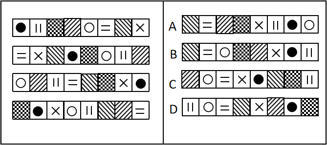
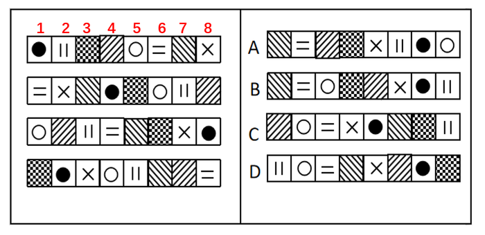

# 位置规律-位置重排（固定置换映射）

考点：[[20-考点/判断推理/图形推理/位置规律-位置重排（固定置换映射）|图形推理 / 位置规律-位置重排（固定置换映射）]]

**问法模型**：问'符合所给图形的变化规律'且四幅图元素组成完全相同、仅位置改变 → 建立相邻图形间固定的'前图第i位→后图第j位'位置映射，套用到最后一幅图筛选项

## 推理链
1. 题干四行图形每行8格，元素均为●、‖、○、＝、×加阴影底纹共8个，只是位置不同——元素组成相同，优先考虑位置规律
2. 逐格比对图1→图2，建立固定映射：前图1号位变后图4号位，2→7，3→5，4→8，5→6，6→1，7→3，8→2（如●由1号位到4号位、‖由2号位到7号位、＝由6号位到1号位，全部吻合）
3. 用图2→图3、图3→图4验证映射不变：●依次在4→8→2号位，○依次在6→1→4号位，＝依次在1→4→8号位，均严格遵循同一映射
4. 将映射套到图4（1号位阴影、2号位●、3号位×、4号位○、5号位‖、6/7号位阴影、8号位＝）：6号位阴影→新图1号位，8号位＝→2号位，7号位→3号位，1号位→4号位，3号位×→5号位，5号位‖→6号位，2号位●→7号位，4号位○→8号位
5. 得新图结构为：阴影、＝、阴影、阴影、×、‖、●、○，与A（斜纹、＝、斜纹、棋盘格、×、‖、●、○）完全一致
6. 对照排除：B中○在3号位（应在8号位）、‖在8号位（应在6号位）；C中＝在3号位、●在5号位；D中‖在1号位、○在2号位，均不符，仅A符合

**最快解法**：⚡ 特征元素追踪法：只盯两个符号——'●'依次落在1→4→8→2→(7)号位，'○'依次落在5→6→1→4→(8)号位；选项中●在7号位的有A/B/D，再看○须在8号位，仅A满足，秒选A

## 易错点
- ⚠ 误找'每格移动相同步数'的平移规律，因各元素位移步长不一（+3、+5、+2、+4…）而误判为无规律，实为固定置换映射
- ⚠ 映射方向搞反：是'前图第i位的元素跑到后图第f(i)位'，若反向理解会整行错位、选错
- ⚠ 只追踪●一个元素不够锁定答案（B、D中●同样在7号位），必须用第二个特征元素（○在8号位、＝在2号位）交叉验证

## 母题抽象
> 🧩 当一组条形图形元素组成相同、仅位置改变且位移步长不统一时，用特征元素（如●、○）标定出相邻图间的固定位置映射，再把映射套到最后一幅图上筛选选项

**同类特征**：元素组成相同仅位置变、一行8格条形图、四幅图连续递变求下一幅、位移步长不一致、含●○＝×等特征符号加阴影底纹、相邻图位置映射固定

## 相关题
（暂无）

---

### 题干

下列选项中，符合所给图形的变化规律的是：

### 选项
- A. A　✅
- B. B
- C. C
- D. D

### 官方解析

元素组成相同，优先考虑位置规律。观察发现， 题干前一幅图的1变为下一幅图的4，2变为7，3变为5，4变为8，5变为6，6变为1，7变为3，8变为2。只有A项符合。

故正确答案为A。

### 给定材料
（无）
