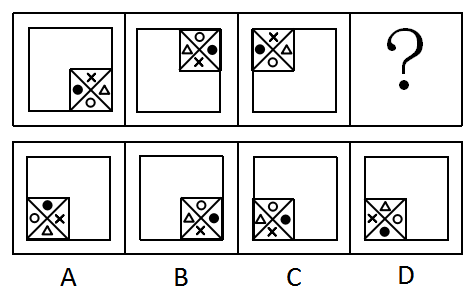

# 位置规律-平移（内外分层：外层沿边框角点移动+内层元素循环平移）

考点：[[20-考点/判断推理/图形推理/位置规律-平移（内外分层：外层沿边框角点移动+内层元素循环平移）|图形推理 / 位置规律-平移（内外分层：外层沿边框角点移动+内层元素循环平移）]]

**问法模型**：“符合所给图形的变化规律”且四图元素组成相同 → 优先考虑位置规律，将内外嵌套结构拆层分别找移动路径，再叠加比对选项

## 推理链
1. 第1步：四幅图元素组成相同（大正方形+带对角线的小正方形+内部×、●、○、△四个小元素完全一致），优先考虑位置规律而非样式规律
2. 第2步：图形为内外嵌套结构，拆成两层分别找规律：外层看小正方形在大边框上的落位，内层看小正方形内四个小元素的排布
3. 第3步：外层规律——小正方形位置为图1右下角→图2右上角→图3左上角，沿外边框四个角每次逆时针移动一步，故图四应移动到左下角位置，排除B项（小正方形仍在右下角）
4. 第4步：内层规律——小正方形被对角线分为上、右、下、左四格，小元素每次顺（逆）时针平移2格（四格循环中平移2格等价于对角位置互换）；追踪特征元素小黑点●：图1在左格→图2在右格→图3在左格→图四应回到最右侧
5. 第5步：逐项对照剩余选项的●位置：A项黑点在上、D项黑点在下、C项黑点在最右侧，只有C符合
6. 第6步：外层位置与内层●位置双重验证均指向C，故选C

**最快解法**：⚡ 两层拆分+特征元素跟踪法（排除法）：先用小正方形沿外框四角逆时针走（右下→右上→左上→左下）锁定图四在左下角，排除B；再只盯最易识别的小黑点●，“平移2格”即对角互换，图3在左→图4必在右（最右侧），A上D下直接排除，秒选C

## 易错点
- ⚠ 只用小正方形位置排除B后，在A/C/D中凭感觉挑，忽略小正方形内部小元素仍有独立的平移规律（内外两层必须分开找规律再叠加验证）
- ⚠ 对内部四个元素逐个跟踪容易混乱，应抓特征最明显的小黑点●；且“平移2格”在四格循环中等价于对角互换，不必逐格死数
- ⚠ 小正方形移动方向误判为顺时针（误以为右下→左下），与图2在右上矛盾；应以已给图确定路径：右下→右上→左上→左下为逆时针

## 母题抽象
> 🧩 当题干图形“元素组成相同”且呈内外嵌套结构时，用分层找位置规律法：外层看整体沿边框角/边的移动路径确定下一位置，内层盯一个特征元素看循环平移格数（平移2格=对角互换），两层结论叠加比对选项

**同类特征**：元素组成相同、顺推型四图+问号、大正方形内嵌带对角线的小正方形、小正方形沿外框四角逆时针移动、小正方形内含×●○△四个小元素、内部元素每次平移2格（对角互换）

## 相关题
- [[10-真题/判断推理/图形推理/2172768 位置规律（旋转-翻转）|2172768]]（海南 2021，相关度1）
- [[10-真题/判断推理/图形推理/10204458 位置规律-平移（特征交点沿内圈循环平移）|10204458]]（甘肃 2024，相关度1）
- [[10-真题/判断推理/图形推理/10204614 图形推理-位置规律（旋转+翻转交替循环）|10204614]]（黑龙江 2024，相关度1）
- [[10-真题/判断推理/图形推理/10297399 位置规律—平移（多黑块分组循环平移）|10297399]]（四川 2025，相关度1）
- [[10-真题/判断推理/图形推理/11226892 位置规律-九宫格小元素沿固定循环链移动|11226892]]（上海 2025，相关度1）

---

### 题干

下列选项中，符合所给图形的变化规律的是：

### 选项
- A. A
- B. B
- C. C　✅
- D. D

### 官方解析
元素组成相同，优先考虑位置规律。内部的小正方形从图一开始沿着外边框四个角，每次逆时针移动一步，因此图四应该移动到左下角位置，排除B项；继续观察，小正方形内部的小元素依次按照顺（逆）时针平移2格，所以图四中小黑点应在最右侧，符合的只有C项。
故正确答案为C。

### 给定材料
（无）
