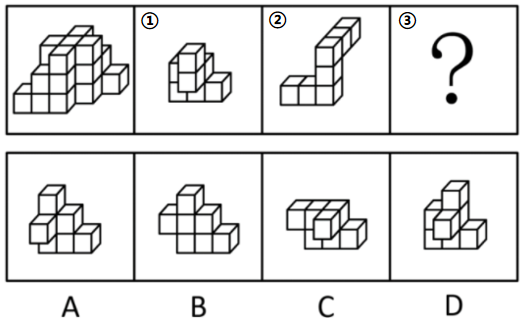
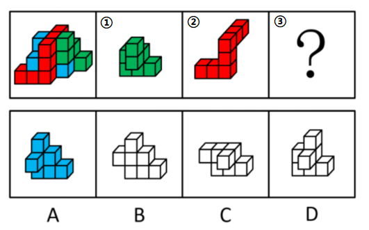

# 立体拼合（多面体拆分组合-凹凸对应）

考点：[[20-考点/判断推理/图形推理/立体拼合（多面体拆分组合-凹凸对应）|图形推理 / 立体拼合（多面体拆分组合-凹凸对应）]]

**问法模型**：题干给出主体多面体和①②两个部件、求剩余部件③ → 采用立体拼合模型：特殊块优先锁定唯一位置，再凹凸互补填充，剩余轮廓即答案

## 推理链
1. 第1步：题干主体由相同正方体堆叠，且“正视图和后视图完全相同”，提示主体前后层次对称，可按层与排定位各块的凹凸位置
2. 第2步：先数块数发现四个选项小方块数量相同，数块法无法排除，改用“最大块/特殊块优先”的拼合策略
3. 第3步：图②为折线（Z形）长条块，形状最特殊，对照主体只有上层斜向凹槽能容纳其折角结构，故②的位置唯一确定（红块位置）
4. 第4步：图①为阶梯状块，与主体右侧台阶状凸起的轮廓最相似，将其放入右侧（绿块位置）
5. 第5步：②、①就位后，主体剩余的凹陷区域轮廓唯一确定，与A项图形凹凸互补、可严丝合缝拼入
6. 第6步：逐项对照：B、C、D的凹凸走向与剩余缺口不吻合，故③对应A项

**最快解法**：⚡ 特殊块优先法+凹凸互补：先拼形状最特殊的②（折线长块）进主体唯一契合的凹槽，再把形状匹配的①放右侧台阶，剩余缺口轮廓与A项完全咬合，直接锁定A

## 易错点
- ⚠ 四个选项小方块数量相同，若只数块数不看形状则无法排除，浪费时间
- ⚠ 拼合时未对①②进行空间旋转/翻转，按原图方向硬套而找不到放置位置
- ⚠ 忽略“正视图与后视图完全相同”这一前后层次信息，误判主体后排结构导致剩余轮廓判断错误

## 母题抽象
> 🧩 当立体拼合题中各选项小方块数量相同时，用“特殊块优先+凹凸互补”法：先锁定形状最特殊块在主体中的唯一位置，再按形状相似度逐块填充，剩余缺口即为答案

**同类特征**：相同正方体堆叠的多面体、正视图与后视图完全相同、由三个多面体组合而成、求问号处剩余块③、各选项块数相同、图②形状特殊（折线长块）

## 相关题
- [[10-真题/判断推理/图形推理/2448496 立体拼合（三视图定位+逐层扣除求缺失块）|2448496]]（国考 2020，相关度1）
- [[10-真题/判断推理/图形推理/2448540 立体拼合（多视图还原+组件拼合互补）|2448540]]（国考 2020，相关度1）

---

### 题干

左图给定的是由相同正方体堆叠而成的多面体，其正视图和后视图完全相同。该多面体可以由①、②和③三个多面体组合而成，以下哪一项能填入问号处？

### 选项
- A. A　✅
- B. B
- C. C
- D. D

### 官方解析

本题考查立体拼合。

如下图所示，选项小方块数量相同，故优先在题干找最大块/特殊块拼合，题干图②（红块）比较特殊，在立体图形中只能拼在下图位置，图①（绿块）与右侧方块形状更为类似，故放在右侧，最后剩下的蓝块对应A项。

故正确答案为A。

### 给定材料
（无）
