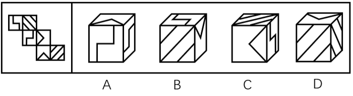
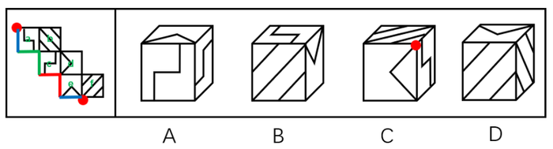

# 空间重构-六面体折叠（相对面排除+公共点-公共边画边法）

考点：[[20-考点/判断推理/图形推理/空间重构-六面体折叠（相对面排除+公共点-公共边画边法）|图形推理 / 空间重构-六面体折叠（相对面排除+公共点/公共边画边法）]]

**问法模型**：左边给定纸盒外表面展开图，右边哪一项能由它折叠而成 → 空间折叠题：先定三组相对面排除同现，再以公共边/公共点上的线条数量与指向逐项验证

## 推理链
1. 第1步：将展开图六面标号为a~f，提取各面图案特征（曲形折线面、三角形面、单斜线面、双斜线/阴影斜线面、带V形箭头面），并确定三组相对面：a与d、c与f、b与e
2. 第2步：折叠规则——相对面不能同时出现在立体图中；相邻面公共边上、公共点处发射的斜线数量与指向折叠后保持不变（画边法：以三角形底边等唯一边为起点顺时针画边标号定位相邻面）
3. 第3步：A项含面a与面c，因a与d是相对面，顶面三角形面只能是面e；以面e三角形底边为唯一边起点顺时针画边标号，题干中边4应挨着面f，而选项A该边位置不符，排除
4. 第4步：B项各相邻面的组合、公共边线条位置与展开图完全一致，当选
5. 第5步：C项分两种情况：(1)由面b、面c、面d组成，三者公共点在题干展开图发出两条斜线，选项只发出一条斜线；(2)由面a、面e、面f组成，三者公共点（相同颜色的边折合后重合为一点）在题干发出两条斜线，选项同样只发出一条，两种情况均不符，排除
6. 第6步：D项含面b与面f，因b与e是相对面，顶面三角形面只能是面d；三者公共点（蓝点）在题干展开图只发出面f上一条斜线，而选项发射出两条斜线，排除
7. 第7步：四个选项中仅B与展开图的相对位置及线条细节一致，故正确答案为B

**最快解法**：⚡ 相对面排除+公共点法：先标号定出a-d、c-f、b-e三组相对面，用相对面不同时出现锁定各选项顶面三角形面；再用公共点发射斜线数量比对（C项公共点题干发两条斜线、选项只一条；D项蓝点题干只发一条、选项发两条），快速排除C、D；A项用画边法（面e三角形底边为起点顺时针标号，边4应挨面f）排除，剩B当选

## 易错点
- ⚠ 忽略相对面不能同时出现：如A项中面a已出现，误判顶面三角形面为面d而非面e
- ⚠ 只核对图案形状、不核对公共点/公共边上斜线的数量与指向：C、D项图案看似合理，实为公共点发射线数不符
- ⚠ 画边法起点选错：必须以三角形底边等'唯一边'为起点顺时针标号，起点选错会导致相邻面定向全部错误

## 母题抽象
> 🧩 当展开图各面图案相近（多斜线、折线）难以直接辨认时，先给六面标号并定出三组相对面，用'相对面不同时出现'锁定组合，再验证相邻面公共点/公共边发射线条的数量与指向，不符者排除——公共点细节是此类题的最终裁决依据

**同类特征**：六面体外表面展开图折叠、各面含斜线、折线、三角形等相似图案、相对面判定与排除、公共点发射斜线数量、画边法定向相邻面、立体图三个可见面验证

## 相关题
- [[10-真题/判断推理/图形推理/2452792 空间重构-六面体折叠（相对面排除+公共点-公共边画边法）|2452792]]（江苏 2020，相关度2）
- [[10-真题/判断推理/图形推理/12101001 空间重构-六面体折叠（相对面排除＋相邻面公共点引线-公共边贴线特征）|12101001]]（江苏 2025，相关度1）

---

### 题干

左边给定的是纸盒的外表面，右边哪一项能由它折叠而成？

### 选项
- A. A
- B. B　✅
- C. C
- D. D

### 官方解析

将原展开图标上序号如下图，逐一进行分析。

A项：立体图包含面a和面c，而面a与面d为相对面，故上面三角形的面只能是面e，利用面e以三角形底边为唯一边起点出发顺时针画边标号如下图，题干边4挨着面f，选项A并不是，选项与题干不一致，排除；

B项：选项与题干一致，当选；

C项：若三角形面为面d，则面d的相对面面a不能出现，故右侧面为面c，而又因为面c与面f是相对面，故顶面只能是面b；同理若三角形面为面e，则顶面为面f，右面为面a。故C项可能是两种情况，（1）面b、面c、面d组成，此时三者公共点（如下图绿点）展开图发出两条斜线，而选项发出一条斜线，选项与题干不一致；

（2）面a、面e、面f组成，此时三者公共点（如下图红点，题干中相同颜色的边为一条边，折合后红点为三者公共点）在题干展开图发射两条斜线，而选项发出一条斜线，选项与题干不一致；

两种情况均与题干不一致，排除；

D项：立体图包含面b和面f，而面b与面e为相对面，故上面三角形的面只能是面d，三者公共点如下图蓝点，题干蓝点只发出面f上一条斜线，而选项发射出两条斜线，选项与题干不一致，排除。

故正确答案为B。

### 给定材料
（无）
