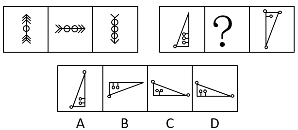

# 两组图类比-位置规律（整体顺时针旋转90°）+数量规律（圆圈-短线个数递变）综合

考点：[[20-考点/判断推理/图形推理/两组图类比-位置规律（整体顺时针旋转90°）+数量规律（圆圈-短线个数递变）综合|图形推理 / 两组图类比-位置规律（整体顺时针旋转90°）+数量规律（圆圈/短线个数递变）综合]]

**问法模型**：'两组图，问号居中，填入使之呈现规律性'→先从第一组归纳'旋转方向+元素数量'双规律，再迁移到第二组双重验证

## 推理链
1. 第1步：第一组图1为竖直方向双箭头夹1个圆，图2箭头变为水平方向且圆圈增至2个，图3箭头变为竖直向下且圆圈增至3个——箭头方向每次顺时针旋转90°，圆圈个数1→2→3递增，箭头个数递减
2. 第2步：把'主体图形整体顺时针旋转90°+内部附属小元素个数依次递变'的规律迁移到第二组：三角形每次顺时针旋转90°，内部'圆圈+短线'组数3→?→1递减，？处应为2圆2线
3. 第3步：第二组图1直角三角形直角在右下（窄高形），顺时针转90°后？处应为直角在左下、底边水平的宽扁三角形，排除仍竖直的A项和方向错误的B项
4. 第4步：数内部元素：图1三角形内为3个圆圈+3条短线，图3内为1个圆圈+1条短线，等差递变故？处应为2个圆圈+2条短线
5. 第5步：C项内部为1条短线带1圆、另1圆无线（仅1线2圆），D项为2个圆圈各带1条短线（2圆2线），与递变规律吻合的只有D项

**最快解法**：⚡ 双规律排除法：第一步只看三角形旋转方向（顺时针90°）排除A、B；第二步在C、D间数内部'短线'数量：图1三线→图3一线→？应为两线，D每圆配一线，直接锁定D

## 易错点
- ⚠ 排除A、B后在C、D间只数圆圈个数（都是2个圆），漏掉'短线与圆圈成对递减'这一细节而误选C
- ⚠ 旋转方向看反：若误判为逆时针旋转，会把方向不符的B项当作正确方向保留
- ⚠ 只盯主体三角形轮廓变化，忽略内部小元素（圆圈、短线）的数量规律，导致规律验证不完整

## 母题抽象
> 🧩 当两组图中同一主体图形逐幅改变朝向、且携带的小元素数量逐幅增减时，先用'整体旋转方向'排除一半选项，再用'附属元素数量等差递变'在剩余选项中锁定答案

**同类特征**：两组图对照类比、三角形整体旋转90°、内部小圆圈与短线成对出现、元素数量3→2→1等差递变、问号处为中间图、选项间仅方向或元素数量微差

## 相关题
- [[10-真题/判断推理/图形推理/17619288 图形推理-元素种类与个数（求同规律-公共元素保留）|17619288]]（上海 2021，相关度1）
- [[10-真题/判断推理/图形推理/2262897 样式规律-元素组合（上中下部位拼合：形状与阴影分源传递）|2262897]]（选调 2016，相关度1）
- [[10-真题/判断推理/图形推理/2374819 样式规律-黑白运算（阴影叠加求并）|2374819]]（广东 2019，相关度1）
- [[10-真题/判断推理/图形推理/2395215 图形推理-动态位置规律（元素以固定基点缩放，参照元素不变）|2395215]]（上海 2018，相关度1）

---

### 题干

从所给四个选项中，选择最合适的一个填入问号处，使之呈现一定规律性：

### 选项
- A. A
- B. B
- C. C
- D. D　✅

### 官方解析

观察发现，第一组图箭头方向依次顺时针旋转90，且圆圈个数在递增，箭头个数在递减；第二组图应用此规律，三角形整体顺时针旋转90，排除A、B两项，继续观察发现，第一个图三角形内部是三个圆圈三条短线，第三个图三角形内部是一个圆圈一条短线，故？处应该选择两个圆圈两条短线，只有D项符合。

故正确答案为D。

### 给定材料
（无）
