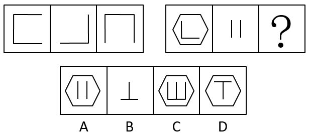

# 样式规律-求异（去同存异-线条叠加XOR）

考点：[[20-考点/判断推理/图形推理/样式规律-求异（去同存异-线条叠加XOR）|图形推理 / 样式规律-求异（去同存异/线条叠加XOR）]]

**问法模型**：两组图、每组前两图完整第三图待填 → 先用第一组验证'图一⊕图二=图三'的求异规律，再套用到第二组选答案

## 推理链
1. 第1步：两组图元素组成相似、线段有增有减，优先考虑样式规律（求同/求异/相加）而非数量规律
2. 第2步：验证第一组：图一为'上横线+左竖线+下横线'（形如'['），图二为'下横线+右竖线'（形如'┘'），图三为'上横线+左竖线+右竖线'（形如'冂'）
3. 第3步：比对发现共同的下横线在图三消失，图二独有的右竖线在图三出现——排除'求同'和'图一减图二'，确认为去同存异（求异）规律
4. 第4步：第二组套用：图一为'六边形+└形（左竖线+底部横线）'，图二为两条独立竖线'||'且无六边形
5. 第5步：逐位置求异：六边形仅在图一出现必须保留；'└'的左竖线、底部横线与'||'两条竖线位置互不重合，全部保留，得'六边形+底部横线+三条竖线'
6. 第6步：对照选项：B无六边形排除；A内部仅两条竖线；D内部为'T'形；只有C为'六边形+底部横线与三条竖线'，与求异结果一致，故选C

**最快解法**：⚡ 求异口诀'去同存异'+排除法：第一组一眼看到下横线消失即锁死规律；第二组先看外框——六边形只在图一出现、答案必带六边形，秒排B；再数内部竖线应为1(└的竖线)+2(||)=3条，直接锁定C

## 易错点
- ⚠ 忽略外部轮廓（六边形）同样参与求异运算：六边形仅在图一出现须保留，漏看外框会误选无六边形的B
- ⚠ 把规律误判为'求同'或'图一减图二'：第一组下横线消失易误判，但图三保留图二独有的右竖线，证明是求异而非相减/求同，误判会错选A或D
- ⚠ 内部竖线位置比对出错：'└'的竖线与'||'两条竖线位置不重合、无抵消，应保留3条竖线；错当重合抵消只剩2条会误选A

## 母题抽象
> 🧩 当两组图形元素相似、线条有增有减时，先在第一组用'去同存异（求异）'逐线段验证共同线条消失，再对第二组外框与内部线条分别按位置求异比对选项

**同类特征**：元素组成相似、线条有增有减、两组图对照出规律、第一组求异得图三、外框轮廓参与运算、线段位置一一对应

## 相关题
- [[10-真题/判断推理/图形推理/10204610 样式规律-加减同异（去同存异），九宫格列规律|10204610]]（辽宁 2024，相关度1）
- [[10-真题/判断推理/图形推理/10297349 样式规律-黑白运算|10297349]]（浙江 2025，相关度1）
- [[10-真题/判断推理/图形推理/10297407 样式规律-黑白运算（定义叠加）|10297407]]（四川 2025，相关度1）
- [[10-真题/判断推理/图形推理/11226895 图形推理-样式规律（叠加求同-保留相同部分）|11226895]]（上海 2025，相关度1）
- [[10-真题/判断推理/图形推理/11226896 样式规律-加减同异（分区域：上圆内部求异+下椭圆内部求同）|11226896]]（上海 2025，相关度1）

---

### 题干

从所给四个选项中，选择最合适的一个填入问号处，使之呈现一定规律性：

### 选项
- A. A
- B. B
- C. C　✅
- D. D

### 官方解析
元素组成相似，优先考虑样式规律。第一组图中，图一和图二求异可以得到图三；第二组图应用此规律，图一和图二求异，只有C项符合。
故正确答案为C。

### 给定材料
（无）
