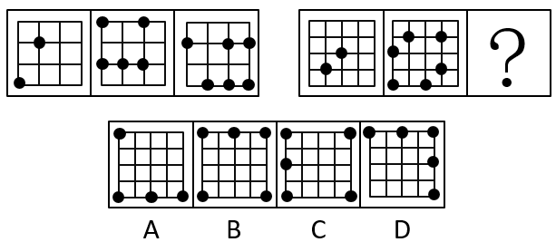

# 位置规律（小黑点位置分布——整组黑点位置不重合-去重）

考点：[[20-考点/判断推理/图形推理/位置规律（小黑点位置分布——整组黑点位置不重合-去重）|图形推理 / 位置规律（小黑点位置分布——整组黑点位置不重合/去重）]]

**问法模型**：两组图求问号处规律 → 先归纳第一组黑点的共同规律（所有黑点位置互不重合），第二组延续该规律，逐一检验选项黑点是否落在已占用格点上做排除。

## 推理链
1. 第1步：两组图形均为3×3网格上分布小黑点，黑点个数不一（2个、5个等），但黑点均整齐落在横竖线的交点（格点）上，出现'多个小黑点整齐分布'的特征，优先考虑黑点位置规律而非数量规律。
2. 第2步：观察第一组，图1黑点（内部交叉点、左下角）、图2黑点（左上角、顶边、底边诸点）、图3黑点（左边、中部、右边、底边诸点）全部落在互不相同的格点上，归纳规律：整组所有小黑点位置均不重合。
3. 第3步：将规律应用到第二组：图1黑点位于中部与左下区域的内部交叉点，图2黑点位于顶边、左侧、左下角、底边中部等位置，前两幅图之间已互不重合。
4. 第4步：故问号处图形的每个黑点都必须落在前两幅图未占用的格点上，以此为标准逐项检验。
5. 第5步：A、B、C三项均含'左下角'黑点，与第二组图2左下角的黑点位置重合（违反不重合规律），排除。
6. 第6步：D项黑点位于左上角、顶边中部、右上角、右边中部、右下角，均未在前两幅图中出现，全部为新的格点位置，唯一符合规律，故选D。

**最快解法**：⚡ 位置排除法：锁定第二组图2已占用的关键格点（尤其'左下角'），A、B、C三项都画有左下角黑点、直接排除，剩余D项即为答案，无需逐点比对。

## 易错点
- ⚠ 误把规律当成黑点数量的递变（如2、5、？），被只有3个黑点的A项误导，忽略本题考的是位置不重合。
- ⚠ 只与紧邻的前一幅图比对不重合，漏掉须与整组前两幅图的所有黑点位置比对。
- ⚠ 把黑点当成'平移移动'规律去凑轨迹，方向步数对不上而误选。

## 母题抽象
> 🧩 当题干图形中出现整齐分布的小黑点（或小元素）且数量无单调规律时，优先考虑'整组所有元素位置互不重合'，用排除法逐项验证选项元素是否落在已占用位置上。

**同类特征**：两组图、3×3网格、多个小黑点整齐分布、黑点落在格点/交叉点上、黑点数量不单一、问号处延续规律

## 相关题
- [[10-真题/判断推理/图形推理/11367773 数量规律-一笔画（奇点数）+面的形状（三角形面个数）双规律|11367773]]（江苏 2025，相关度1）
- [[10-真题/判断推理/图形推理/14403693 属性规律-对称性（轴对称且仅有1条对称轴）|14403693]]（山东 2025，相关度1）
- [[10-真题/判断推理/图形推理/17097243 数量规律-小元素种类（虚线圆内外元素种类一致）|17097243]]（山西 2024，相关度1）
- [[10-真题/判断推理/图形推理/2050886 对称性-轴对称与对称轴方向旋转（辅助规律：位置规律-小黑点沿外圈循环移动）|2050886]]（江西 2017，相关度1）
- [[10-真题/判断推理/图形推理/2137204 图形推理-位置规律（旋转-翻转）|2137204]]（上海 2018，相关度1）

---

### 题干

从所给四个选项中，选择最合适的一个填入问号处，使之呈现一定规律性：

### 选项
- A. A
- B. B
- C. C
- D. D　✅

### 官方解析
观察图形发现，出现了多个小黑点，小黑点整齐分布，优先考虑小黑点的位置。第一组图中所有的小黑点位置均不重合，故第二组图应用此规律，？处的图形的小黑点应与前两幅图形之间不存在重合，只有D项符合。
故正确答案为D。

### 给定材料
（无）
