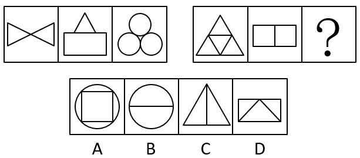

# 属性规律-对称性（对称轴数量）

考点：[[20-考点/判断推理/图形推理/属性规律-对称性（对称轴数量）|图形推理 / 属性规律-对称性（对称轴数量）]]

**问法模型**：两组对照式图形推理，问号填入使呈现规律 → 依次数各图对称轴条数，比较两组对应位置的数量关系

## 推理链
1. 第1步：第一组图1为两个对顶三角形（蝴蝶结形），为轴对称图形，横、竖各一条对称轴，共2条
2. 第2步：第一组图2为三角形叠于矩形上方的‘房屋形’，仅竖直对称轴1条；图3为三个圆品字形排列，对称轴3条，故第一组为2、1、3
3. 第3步：第二组图1为大三角形内嵌倒置三角形，3条对称轴；图2为矩形中间加一条竖线，2条对称轴，即第二组前两图为3、2
4. 第4步：对应位置比较：2→3、1→2，第二组均比第一组多1条，故？处应为3+1=4条对称轴
5. 第5步：逐项检验：A圆内接正方形，横、竖、两条对角线共4条对称轴；B圆加一条水平直径，组合后仅剩2条；C三角形加竖直中线，仅1条；D矩形内嵌三角形（信封形），仅1条
6. 第6步：只有A项为4条对称轴，与规律吻合，故选A

**最快解法**：⚡ 对称轴计数法：快速数出两组已知图形对称轴条数为2、1、3与3、2、？，发现‘第二组=第一组+1’得？=4，扫一眼选项只有圆内接正方形（A）是4条对称轴，直接锁定

## 易错点
- ⚠ B项圆本身有无数条对称轴，误把B当‘多对称轴’答案，忽略加入水平直径后组合图形只剩2条公共对称轴
- ⚠ 组合图形需取各组成部分公共的对称轴，不能把内部元素对称轴简单相加
- ⚠ 只盯第一组内部找规律（2、1、3本身无单调规律），想不到两组对应位置做差比较

## 母题抽象
> 🧩 当图形元素组成不同且出现等腰三角形、等边结构、圆等明显对称特征时，先数对称轴条数；若单组内无规律，则对两组对应位置的数量差（+1/-1等）建模，再用该数值验证选项

**同类特征**：元素组成不同、等腰/等边三角形明显、圆与方形、三角形与矩形的组合图形、两组三格对照式布局、对称轴数量呈递变规律

## 相关题
- [[10-真题/判断推理/图形推理/2376756 属性规律-对称性（对称轴数量）|2376756]]（黑龙江 2019，相关度2）
- [[10-真题/判断推理/图形推理/10204454 数量规律-部分数（黑白球连通区域数做和）|10204454]]（甘肃 2024，相关度1）
- [[10-真题/判断推理/图形推理/10204604 数量规律-线数量（汉字横线数）|10204604]]（辽宁 2024，相关度1）
- [[10-真题/判断推理/图形推理/10297050 数量规律-特殊计数（线条穿过小白球的数量）|10297050]]（天津 2025，相关度1）
- [[10-真题/判断推理/图形推理/10297127 图形间关系-相交图形中不相交边数量（黑白图形相交）|10297127]]（天津 2025，相关度1）

---

### 题干

从所给四个选项中，选择最合适的一个填入问号处，使之呈现一定规律性：

### 选项
- A. A　✅
- B. B
- C. C
- D. D

### 官方解析
元素组成不同，优先考虑属性规律，出现等腰三角形优先考虑对称性，第一组图形的对称轴数量为：2、1、3，第二组图形的对称轴数量为3、2、？，观察发现，第二组图形的对称轴数量分别比第一组的对称轴数量多1条，故？处图形的对称轴数量应为4条，只有A项符合。
故正确答案为A。

### 给定材料
（无）
