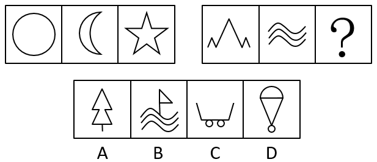

# 数量规律-面数量（封闭区域数）做和

考点：[[20-考点/判断推理/图形推理/数量规律-面数量（封闭区域数）做和|图形推理 / 数量规律-面数量（封闭区域数）做和]]

**问法模型**：两组类比型'填入问号处使之呈现一定规律性'→先用第一组三图归纳统一数量规律（此处为面数量之和），再套用到第二组确定问号图形

## 推理链
1. 第1步：第一组三图为圆、月牙、五角星，元素组成不同且无明显属性规律，转向数量规律
2. 第2步：三图封闭空间醒目，优先数面：圆、月牙、五角星的面数量均为1，第一组面数之和为1+1+1=3
3. 第3步：第二组前两图：山形为开放折线、0个面，三条波浪线为开放曲线、0个面
4. 第4步：沿用'三图面数量之和为3'的规律：0+0+？=3，问号处图形应含3个封闭区域
5. 第5步：逐项数面：A项树形封闭区域仅1个（并非3个独立三角形），B项仅三角旗1个面，C项车斗开口、两个车轮共2个面，D项热气球状图形含3个封闭区域
6. 第6步：仅D项面数量为3，可使第二组面数之和与第一组一致，故选D

**最快解法**：⚡ 数面法：第一组圆、月亮、五角星每图均为1个面→和为3；第二组山形折线0个面、三条波浪线0个面→问号需3个面；快速数选项封闭区域，A为1个、B为1个、C为2个，仅D（热气球）有3个面，锁定D

## 易错点
- ⚠ 图中圆、月亮等全曲线图形诱导先数曲线，'曲线数和为3'会推出A项，与官方给定答案D不一致，需再用面数量规律复核择优
- ⚠ A项松树易被脑补成三个独立三角形而误数成3个面，实际其封闭区域不足3个
- ⚠ 类比型两组图必须先用第一组建立规律再套用于第二组，不能只盯第二组两幅图单独找规律

## 母题抽象
> 🧩 当两组类比图形元素组成不同且封闭空间明显时，先数第一组三图的面数量并验证其'和/常数'规律，再在第二组中选使总和一致的选项

**同类特征**：类比型两组图（3+3）、元素组成不同、出现圆、月亮等全曲线图形、封闭空间明显、数量规律做和、问号求第三幅图

## 相关题
- [[10-真题/判断推理/图形推理/10204454 数量规律-部分数（黑白球连通区域数做和）|10204454]]（甘肃 2024，相关度1）
- [[10-真题/判断推理/图形推理/10204604 数量规律-线数量（汉字横线数）|10204604]]（辽宁 2024，相关度1）
- [[10-真题/判断推理/图形推理/10297050 数量规律-特殊计数（线条穿过小白球的数量）|10297050]]（天津 2025，相关度1）
- [[10-真题/判断推理/图形推理/10297127 图形间关系-相交图形中不相交边数量（黑白图形相交）|10297127]]（天津 2025，相关度1）
- [[10-真题/判断推理/图形推理/10297148 数量规律-线的细化（端点连线穿过线条数；备选：平行线组数）|10297148]]（天津 2025，相关度1）

---

### 题干

从所给四个选项中，选择最合适的一个填入问号处，使之呈现一定规律性：

### 选项
- A. A
- B. B
- C. C
- D. D　✅

### 官方解析
解析一：元素组成不同，且无明显属性规律，优先考虑数量规律。题干出现全曲线图形和单一曲线，考虑曲线数，第一组图中每幅图的曲线数分别为1、2、0，相加之和为3，第二组应用此规律，前两幅图的曲线数分别为0、3，故问号处图形的曲线数应为0，只有A项符合。
故正确答案为A。
解析二：元素组成不同，且无明显属性规律，优先考虑数量规律。题干图形存在明显的封闭空间，优先考虑面数量。第一组图中，面的数量都是1，面数量相加为3，第二组图遵循相同规律，前两幅图面数量均为0，故？处图形的面数量应为3，只有D项符合。
故正确答案为D。
注：该题中图形出现圆、月亮全曲线图形及多条单一曲线组成的图形，数曲线特征明显，故粉笔更倾向根据曲线数量的和择优选择A项，争议题大家了解基本解题思路即可。

### 给定材料
（无）

> [!warning] 疑点（官方解析可能有误，待人工复核）
> 官方注明本题为争议题：解析一按曲线数和（第一组1+2+0=3，第二组0+3+0）指向A项，粉笔更倾向A；题面给定答案为D，依据解析二'面数量之和为3'（第一组1+1+1=3，第二组0+0+3=3）自洽成立。以官方给定答案D为准。

<!-- CODEX-ANSWER-REVIEW:BEGIN -->
### 本次独立复核

**复核状态：** `resolved`（答案与解析已核定）

**计分答案：** D（可计分）

**复核解析：**

原题的官方解析列出“曲线数量”与“封闭面数量”两条规则，分别可能指向A和D。此修订明确只考封闭面数：第一组圆、月牙、星形均各1面，共3面；第二组前两图均0面，故问号处需3个封闭区域。只有D满足。修订条件已明确公开，不再把原题竞争规则藏作唯一答案。

**修订题干：**

【编辑修订】只按每幅图中封闭区域（面）的数量分类。选择封闭区域数符合“第一组各图面数之和等于第二组各图面数之和”的选项。

**相关信息：**

图形推理—封闭区域数；闭合曲线围成面数，不等同于曲线条数。

**题源依据：** [固定版本原题](https://github.com/Mentat-Uran/kaogongzhentizhengliu/blob/84ab93d4b64b61d897bece8a1c0a5bab06b4feb2/10-%E7%9C%9F%E9%A2%98/%E5%88%A4%E6%96%AD%E6%8E%A8%E7%90%86/%E5%9B%BE%E5%BD%A2%E6%8E%A8%E7%90%86/2461720%20%E6%95%B0%E9%87%8F%E8%A7%84%E5%BE%8B-%E9%9D%A2%E6%95%B0%E9%87%8F%EF%BC%88%E5%B0%81%E9%97%AD%E5%8C%BA%E5%9F%9F%E6%95%B0%EF%BC%89%E5%81%9A%E5%92%8C.md)；固定内容 commit `84ab93d4b64b61d897bece8a1c0a5bab06b4feb2`，Markdown blob `99f67c592c5d4e72647b64457128a8f0739f9869`。
<!-- CODEX-ANSWER-REVIEW:END -->
