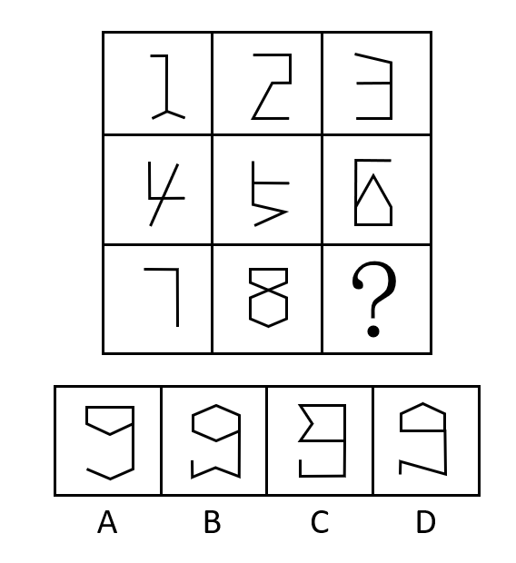

# 数量规律-角的数量（数直角）

考点：[[20-考点/判断推理/图形推理/数量规律-角的数量（数直角）|图形推理 / 数量规律-角的数量（数直角）]]

**问法模型**：九宫格图形'呈现一定规律性'且元素组成不同、无属性规律 → 按行数数量特征（本题数直角个数），验证等差规律后选缺失值

## 推理链
1. 第1步：九宫格图形，元素组成不同，观察对称、曲直、封闭等属性无明显统一规律；题干每幅图均由直线构成，且直线相交处出现明显直角
2. 第2步：转向数量规律，优先数直角个数；九宫格优先看横行，先在第一行找规律
3. 第3步：第一行三个图形的直角数依次为1、2、3，构成等差递增序列
4. 第4步：用第二行验证：三个图形直角数同样为1、2、3，规律成立
5. 第5步：第三行前两个图形直角数分别为1、2，故'？'处应选择直角数为3的图形
6. 第6步：逐项清点选项直角数：A为2、B为0、C为5、D为3，仅D项直角数为3，与规律吻合

**最快解法**：⚡ 数直角法+按行验证：第一行数出1、2、3，第二行快速验证仍为1、2、3，锁定第三行缺'3'；再直数四个选项的直角个数（A2、B0、C5、D3），直接选D

## 易错点
- ⚠ 误把锐角、钝角也计入直角，或漏数封闭图形内部的直角，导致计数偏差
- ⚠ 九宫格未先按横行验证而是按列或整体看，规律路径走偏浪费时间
- ⚠ C项直角数最多（5个），易被'数量最多/最复杂'的视觉误导而误选C

## 母题抽象
> 🧩 当九宫格图形元素组成不同、无属性规律，且图形全由直线构成并出现明显垂直相交时，按横行数直角个数，验证各行是否构成1、2、3式等差数列，选出补齐缺失数量的选项

**同类特征**：九宫格、元素组成不同、全直线图形、直线相交出现明显直角、按行呈1、2、3递增、问号处填缺失数量

## 相关题
- [[10-真题/判断推理/图形推理/2456418 数量规律-复合考点（面数量+直线数量，按行规律）|2456418]]（浙江 2020，相关度3）
- [[10-真题/判断推理/图形推理/4651671 数量规律-线的细化（平行线组数-线的方向）|4651671]]（江苏 2022，相关度3）
- [[10-真题/判断推理/图形推理/11367791 属性类-对称性（对称轴方向与条数、轴对称+中心对称）＋数量类-面数量（九宫格横行复合规律）|11367791]]（江苏 2025，相关度2）
- [[10-真题/判断推理/图形推理/11881082 属性规律-对称性（对称轴方向）|11881082]]（黑龙江 2024，相关度2）
- [[10-真题/判断推理/图形推理/12881896 属性规律-曲直性（九宫格横行遍历）|12881896]]（新疆 2025，相关度2）

---

### 题干

从所给的四个选项中，选择最合适的一个填入问号处，使之呈现一定的规律性：

### 选项
- A. A
- B. B
- C. C
- D. D　✅

### 官方解析

元素组成不同，无明显属性规律，考虑数量规律。题干每幅图都是由直线构成，存在直线相交且出现明显的直角，优先考虑数直角数。九宫格优先看横行，第一行中，三个图形的直角数分别为1、2、3；经验证，第二行中，三个图形的直角数分别为1、2、3；第三行前两个图形的直角数分别为1、2，故第三行应用此规律， “？”处应选择一个直角数为3的图形。A、B、C、D四项图形中的直角数分别为2、0、5、3，只有D项符合。

故正确答案为D。

### 给定材料
（无）
