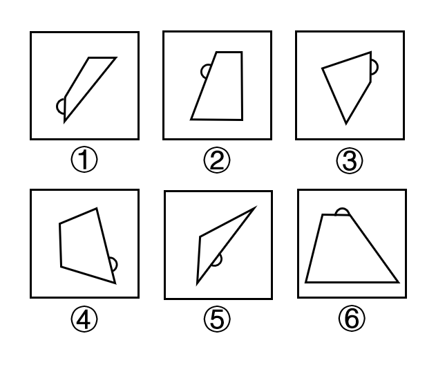

# 功能元素-小半圆标记边（标记最长边-最短边）

考点：[[20-考点/判断推理/图形推理/功能元素-小半圆标记边（标记最长边-最短边）|图形推理 / 功能元素-小半圆标记边（标记最长边/最短边）]]

**问法模型**：“六个图形分为两类，使每一类都有各自共同特征”→ 分组分类题，优先寻找各图共同含有的功能元素（小半圆）所标记对象的位置规律

## 推理链
1. 第1步：观察六个图形的共同组成——每个图形都由“一个小半圆 + 一个多边形”构成，且小半圆都紧贴在多边形的一条边上（功能元素标记特征明显）
2. 第2步：多边形边数、形状各不相同（有三角形、四边形），排除按面数量、线条数等常规数量规律分组的思路，转向比较小半圆所标记的边
3. 第3步：逐图比较小半圆所在边与该多边形其他边的长短：图①③⑥中，小半圆均贴在多边形边长最短的边上（如①贴在左侧短斜边、③贴在右上方短边、⑥贴在梯形的上底短边）
4. 第4步：图②④⑤中，小半圆均贴在多边形边长最长的边上（如②贴在左侧长斜边、④贴在右侧长边、⑤贴在细长图形的下侧长边、长边均明显长于其余边）
5. 第5步：按“标记最短边/最长边”将六图分为两组：①③⑥为一组，②④⑤为一组
6. 第6步：与选项对照，①③⑥、②④⑤对应B项，与官方答案一致

**最快解法**：⚡ 功能元素标记法：先锁定每图共有且位置特殊的小元素（小半圆），再看它“贴在哪条边上”，比较该边在各自图形中是最长边还是最短边，即可一眼分出①③⑥（最短边）与②④⑤（最长边）

## 易错点
- ⚠ 只看半圆朝向（朝上/朝下/朝左）或半圆在边的内外位置，误按位置朝向规律分组
- ⚠ 斜放的图形中斜边实际较长，目测易误判长短（如②⑤的长斜边易被当成普通边），需完整比较每条边
- ⚠ 忽视功能元素的“标记作用”这一高频考点，陷入数面、数线等数量规律的死胡同

## 母题抽象
> 🧩 当题干六个图形均由“一个小元素+一个多边形”组成且小元素位置各不相同时，用功能元素标记法，比较小元素所标记的边/角/点的特征（最长边/最短边、直角/锐角、交点/中点等），按标记对象分组

**同类特征**：每图由一个小半圆和一个多边形组成、小半圆紧贴多边形的一条边、多边形边长差异明显、小半圆在图中位置各不相同、分组分类问法

## 相关题
- [[10-真题/判断推理/图形推理/10297098 功能元素-黑点标记交点的发射线数|10297098]]（天津 2025，相关度1）
- [[10-真题/判断推理/图形推理/10297262 数量规律-面的形状种类（封闭面种类数分组）|10297262]]（浙江 2025，相关度1）
- [[10-真题/判断推理/图形推理/12019737 数量规律-相同元素的位置关系（相对-相邻）分组|12019737]]（浙江 2026，相关度1）
- [[10-真题/判断推理/图形推理/12536392 数量规律-黑色区域面积（宫格面积折算）|12536392]]（四川 2024，相关度1）
- [[10-真题/判断推理/图形推理/12882156 图形推理-对称性（仅轴对称 vs 既轴对称又中心对称）|12882156]]（黑龙江 2025，相关度1）

---

### 题干

把下面的六个图形分为两类，使每一类图形都有各自的共同特征或规律，分类正确的一项是：

### 选项
- A. ①②⑤，③④⑥
- B. ①③⑥，②④⑤　✅
- C. ①③④，②⑤⑥
- D. ①②④，③⑤⑥

### 官方解析
本题为分组分类题目。观察发现，每个图形都由一个小半圆和一个多边形组成，考虑功能元素的标记作用。观察发现，每个小半圆都在多边形的一条边上，图①③⑥中小半圆是在多边形的最短边上，图②④⑤中小半圆是在多边形的最长边上。即图①③⑥一组，图②④⑤一组。
故正确答案为B。

### 给定材料
（无）
