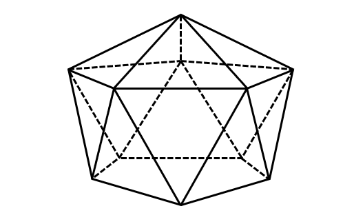
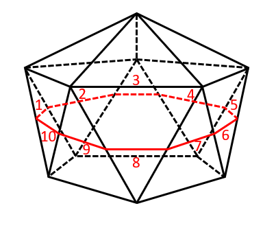
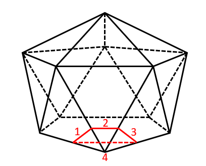

# 立体图形-截面图（截面边数判定，正二十面体）

考点：[[20-考点/判断推理/图形推理/立体图形-截面图（截面边数判定，正二十面体）|图形推理 / 立体图形-截面图（截面边数判定，正二十面体）]]

**问法模型**：题干问'从任一面切开，截面的边数不可能是'（选非）→ 用'横切/斜切+数所交棱数'的构造法逐一验证各选项边数，唯一构造不出的即为答案

## 推理链
1. 第1步：题干图形为正二十面体：上、下各一个顶点，中部上下两圈各5个顶点交错相连，每个顶点引出5条棱，表面全为三角形
2. 第2步：截面边数=切平面与立体棱相交的点数（每交一条棱，截面多一条边），故按'横切不同高度、斜切角部'分类构造验证
3. 第3步：验证B=5：横切上半部分，平面只与顶部顶点向下发出的5条棱相交→五边形，B可能
4. 第4步：验证A=10：横切下半部分（切在上下两圈顶点之间的斜棱带），平面与上下交错的10条斜棱全部相交→十边形，A可能
5. 第5步：验证C=4：斜切下半部的任意一个角，平面只与该角附近的4条棱相交→四边形，C可能
6. 第6步：验证D=3：每个顶点发出5条棱，斜切一角最少仍交4条棱；表面虽是三角形，但截面是平面切过立体内部所得，不能与表面三角形面重合，故任何切面都无法只与3条棱相交→三角形不可能
7. 第7步：本题为选非题，选'不可能'的项，故选D

**最快解法**：⚡ 构造法+数棱（排除法）：横切上半→交5条棱→五边形，横切中段→交10条斜棱→十边形，斜切一角→交4条棱→四边形，A、B、C均能切出；任一切面至少交4条棱，3不可能，选非选D

## 易错点
- ⚠ 忽略'不可能是'是选非问法，误把能切出的边数（如5或4）当作答案
- ⚠ 被表面全是三角形迷惑，误以为沿/平行三角形面能切出三角形（截面须切过立体内部，不能与表面重合）
- ⚠ 只想横切不试斜切，漏掉'斜切角得四边形'，误认为C也不可能

## 母题抽象
> 🧩 当题干给出规则多面体并问截面边数'不可能'为几时，用'切面数棱'构造法：横切不同高度数所交棱的条数得5/10等边数，再斜切角部减少所交棱数得4等，能构造出的全部排除，剩下的即为选非答案

**同类特征**：规则多面体（正二十面体：上下顶点+两圈五顶点）、选非问法：截面边数'不可能是'、选项边数为3/4/5/10、需同时考虑横切与斜切两种切法、截面边数=切面所交棱数

## 相关题
（暂无）

---

### 题干

下面给定的立体图形，将其从任一面切开，截面的边数不可能是：

### 选项
- A. 10
- B. 5
- C. 4
- D. 3　✅

### 官方解析

本题考查截面图，逐一分析选项。

A项：横切下半部分即可切出十边形；

B项：横切上半部分即可切出五边形；

C项：斜切下半部的任意一个角即可切出四边形；

D项：无法切出三角形。

本题为选非题，故正确答案为D。

### 给定材料
（无）
