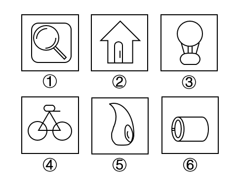

# 数量规律-部分数（一部分与多部分分组）

考点：[[20-考点/判断推理/图形推理/数量规律-部分数（一部分与多部分分组）|图形推理 / 数量规律-部分数（一部分与多部分分组）]]

**问法模型**：六图分两类、每组有共同规律 → 分组分类题，逐图提取可量化特征（部分数）后按'组内一致、组间对立'归组

## 推理链
1. 第1步：六图元素组成不同（放大镜、房子、热气球、自行车、水滴、圆柱），先排查对称、曲直、开闭等属性规律，均无明显共性
2. 第2步：图①放大镜、图②房子为典型生活化图形，提示转向数量规律中的'部分数'（独立不相连部分的个数）
3. 第3步：数图①：圆角外框、镜片圆、手柄等存在不相连部分，为多部分；图②：门（内部小框）与房屋轮廓构成不相连的多个部分，为多部分；图⑤：水滴轮廓与内部小弧不相连，为多部分
4. 第4步：数图③④⑥：热气球气球、吊绳与吊篮线条相连，自行车两轮与三角车架相交相连，圆柱身与左端椭圆轮廓相连，均只含一个连通部分，为一部分
5. 第5步：按'多部分'与'一部分'对立归组：①②⑤一组、③④⑥一组，与选项C完全对应
6. 第6步：反向验证：选项A/B/D的任一分组方式均无法使两组各自满足统一的图形规律，排除

**最快解法**：⚡ 部分数法＋生活化图形提示：见放大镜、房子等实物图且属性无规律，直接数不相连部分——①②⑤有分离的独立部分（外框/门/内部小弧），③④⑥线条全部相连成一体，即选C

## 易错点
- ⚠ 忽略生活化图形这一提示信号，执意找对称轴、曲直、封闭区域数而陷入僵局
- ⚠ 把相交相连误判为分离：④自行车两轮虽是两个圆，但与三角车架线条相交，连通后仍算一部分
- ⚠ 误以为部分数分组必须'数量相等'，不敢接受'一部分vs多部分'这种非常规分组，错选其他项

## 母题抽象
> 🧩 当分组分类题出现生活化实物图形且属性规律（对称/曲直/开闭）不明显时，优先数'部分数'，按'一部分'与'多部分'两组验证归类

**同类特征**：六图分两类、生活化实物图形（放大镜、房子、热气球）、元素组成不同、无明显属性规律、图形内部存在分离或相连结构、部分数分组

## 相关题
- [[10-真题/判断推理/图形推理/2136768 数量规律-部分数（连通部分数）|2136768]]（河南 2017，相关度3）
- [[10-真题/判断推理/图形推理/10204454 数量规律-部分数（黑白球连通区域数做和）|10204454]]（甘肃 2024，相关度2）
- [[10-真题/判断推理/图形推理/10297050 数量规律-特殊计数（线条穿过小白球的数量）|10297050]]（天津 2025，相关度2）
- [[10-真题/判断推理/图形推理/10297262 数量规律-面的形状种类（封闭面种类数分组）|10297262]]（浙江 2025，相关度2）
- [[10-真题/判断推理/图形推理/10297314 数量规律-交点数（曲直交点）|10297314]]（浙江 2025，相关度2）

---

### 题干

把下面的六个图形分为两类，使每一类图形都有各自的共同特征或规律，所给四个选项中分类正确的一项是：

### 选项
- A. ①②③；④⑤⑥
- B. ①②④；③⑤⑥
- C. ①②⑤；③④⑥　✅
- D. ①⑤⑥；②③④

### 官方解析
本题为分组分类题目。元素组成不同，且无明显属性规律，考虑数量规律。观察发现，图①、图②均为生活化图形，可以考虑部分数。其中，图①②⑤均由多部分组成，图③④⑥均由一部分组成。因此，图①②⑤为一组、图③④⑥为一组。
注：分组分类题目中一组为一部分、一组为多部分的规律并不严谨，但此题出现明显生活化图形，无其他明显规律，且在以往的考试中确有出现过在考查部分数的知识点时，分为一部分与多部分两组的情况，故此题粉笔倾向于根据部分数进行分组分类。
故正确答案为C。

### 给定材料
（无）

> [!note] 复核版本状态
> 原题可计分，答案为C；另提供编辑版，当前编辑版答案为C。
> 详细原题疑点、修订题面、解析和证据见下方独立复核记录。

<!-- CODEX-ANSWER-REVIEW:BEGIN -->
### 本次独立复核

**复核结论：** `resolved`（答案与解析已核定）

**原题计分状态：** 可计分；原题复核答案为 **C**。该题同时启用下述编辑版。

**原题疑点与处理：**

湖南 2020 〔20-考点/判断推理/图形推理/数量规律-部分数（一部分与多部分分组）〕 — 官方解析自己注明'一组一部分、一组多部分'的分组方式并不严谨（常规部分数考点要求两组部分数各自相等），属非常规考法；但因图形为生活化图形且无其他明显规律，该分组…

**当前计分版本：** 明确标注的编辑版；未列出的题干、材料或选项沿用固定题源。答案不回填为原题答案。

**计分答案：** C（可计分）

**复核解析：**

【编辑版】只按图形中互不连接的部分数分组。①、②、⑤各由多个彼此分离的部分组成；③、④、⑥各为一个连通部分，映射到C。编辑版明确采用部分数口径，避免把生活化图形的其他外观特征作为竞争规则。

**修订题干：**

把下面的六个图形分为两类，使每一类图形都有各自的共同特征或规律，所给四个选项中分类正确的一项是：

**【编者修订条件】** 【编辑版】本题仅按图形互不连接的部分数分为“一个连通部分”和“多个连通部分”两组。

**相关信息：**

图形数量规律—部分数；两个图元只在实际连通时才属于同一部分。

**核对依据与来源边界：**

- 固定题源：[原题文件](https://github.com/Mentat-Uran/kaogongzhentizhengliu/blob/84ab93d4b64b61d897bece8a1c0a5bab06b4feb2/10-%E7%9C%9F%E9%A2%98/%E5%88%A4%E6%96%AD%E6%8E%A8%E7%90%86/%E5%9B%BE%E5%BD%A2%E6%8E%A8%E7%90%86/2578095%20%E6%95%B0%E9%87%8F%E8%A7%84%E5%BE%8B-%E9%83%A8%E5%88%86%E6%95%B0%EF%BC%88%E4%B8%80%E9%83%A8%E5%88%86%E4%B8%8E%E5%A4%9A%E9%83%A8%E5%88%86%E5%88%86%E7%BB%84%EF%BC%89.md)；内容版本 `84ab93d4b64b61d897bece8a1c0a5bab06b4feb2`，源 Markdown blob `d9b7ede4403794830620be64f234f09010aca20d`.
- 固定题图/公式图：`90-图片/题目图/173860f7d92ca47.png`.

<!-- CODEX-ANSWER-REVIEW:END -->
