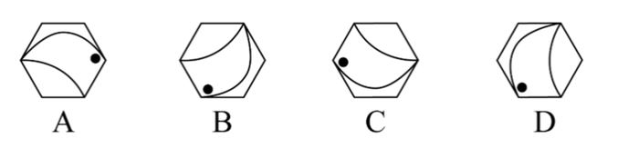

# 位置规律-旋转与翻转（手性-镜像检验）

考点：[[20-考点/判断推理/图形推理/位置规律-旋转与翻转（手性-镜像检验）|图形推理 / 位置规律-旋转与翻转（手性/镜像检验）]]

**问法模型**：找出与其他三个不同规律的图形（选非题）→ 元素组成完全相同时，优先检验位置规律：先用旋转归一，旋转不能重合而需翻转（镜像）者即为不同项

## 推理链
1. 第1步：A、B、C、D每幅图均由一个正六边形、一个小黑点和两条曲线构成，元素组成完全相同，排除数量与样式差异，锁定位置规律
2. 第2步：元素相同而各图方向不一，需检验能否仅通过平面旋转互相重合；旋转无法重合、必须翻转（镜像）才能重合的图形即违反共同规律
3. 第3步：以'两条曲线的走向+黑点相对位置'为整体基准，将A在平面内旋转一定角度，曲线与黑点的相对关系可与B重合，继续旋转可与C重合，即A、B、C同属一类
4. 第4步：对D作同样旋转尝试：无论旋转多少度，D中曲线走向与黑点位置的关系始终与A、B、C呈镜像（左右手性相反），只有将D翻转后才能与A、B、C旋转后的图形一致
5. 第5步：本题为选非题（找不同规律项），A、B、C满足'仅旋转即可互化'的共同规律，D需翻转才能归一，故D为不同规律的图形

**最快解法**：⚡ 旋转归一法（手性检验）：盯住'黑点+两条曲线'这个整体，把A在脑中（或草稿上）旋转，可依次转到B、C的形态；D无论怎么旋转都对不上，只有镜像翻转才与A/B/C一致→直接选D

## 易错点
- ⚠ 只看曲线整体倾斜角度不同就判定规律不同，忽略A、B、C旋转即可重合
- ⚠ 只盯曲线形状、忽略黑点与曲线的相对位置关系，漏看镜像（手性）差异
- ⚠ 忘记本题为选非题（找不同项），误选了与A、B、C同规律的项

## 母题抽象
> 🧩 当题干各图元素组成完全相同（如同一外框+点+线）而摆放方向各不相一时，用'旋转检验'分组：能通过旋转互相重合的归为一类，必须翻转（镜像）才能重合的那个即选非答案。

**同类特征**：元素组成相同、正六边形外框、黑点+两条曲线、各图方向不一致、选非题（找不同规律）、旋转与翻转手性检验

## 相关题
- [[10-真题/判断推理/图形推理/2172768 位置规律（旋转-翻转）|2172768]]（海南 2021，相关度1）
- [[10-真题/判断推理/图形推理/10204458 位置规律-平移（特征交点沿内圈循环平移）|10204458]]（甘肃 2024，相关度1）
- [[10-真题/判断推理/图形推理/10204614 图形推理-位置规律（旋转+翻转交替循环）|10204614]]（黑龙江 2024，相关度1）
- [[10-真题/判断推理/图形推理/10297399 位置规律—平移（多黑块分组循环平移）|10297399]]（四川 2025，相关度1）
- [[10-真题/判断推理/图形推理/11226892 位置规律-九宫格小元素沿固定循环链移动|11226892]]（上海 2025，相关度1）

---

### 题干

从下列四个图形中，找出一个和其他三个具有不同规律的图形：

### 选项
- A. A
- B. B
- C. C
- D. D　✅

### 官方解析
每幅图形都是由一个正六边形、小黑点和两条曲线构成，元素组成相同，考虑位置规律。观察发现，A、B、C三项均可以只通过旋转得出同一图形，而D项需经过翻转得出与其余三项旋转后相同的图形。
本题为选非题，故正确答案为D。

### 给定材料
（无）
