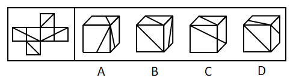

# 空间重构-六面体折纸盒（相对面排除+相邻面公共边定位）

考点：[[20-考点/判断推理/图形推理/空间重构-六面体折纸盒（相对面排除+相邻面公共边定位）|图形推理 / 空间重构-六面体折纸盒（相对面排除+相邻面公共边定位）]]

**问法模型**：“左边给定纸盒外表面，下列哪项能由它折叠而成”→ 空间折叠题：先用相对面不能同时出现的规则排除，再用相邻面公共边与图案的相对位置验证剩余选项

## 推理链
1. 第1步：给展开图标序号：中间一行四个面为面2、3、4、5（含三角形/梯形线条），上方面1、下方面6，三组相对面为1-6、2-4、3-5
2. 第2步：应用规则“相对面在立体图中不能同时出现”，并结合鸽巢原理：从两对相对面中任取三个面，必含一组完整相对面
3. 第3步：A项出现三个带三角形的面，取自面2、3、4、5中的三个，必同时含面2与面4或面3与面5这组相对面，排除
4. 第4步：B项正对的面和上面的面由面1、面6组成，而展开图中面1与面6是相对面，不能同时可见，排除
5. 第5步：C项三个面为面2、3、6，两两相邻无相对面冲突，且线条图案与相邻关系一致，当选
6. 第6步：D项两个小三角形面相邻且有公共边顶端交点，组合只有面2+5或面3+4两种可能，二者公共边在展开图中均为梯形的长底边，但D项公共边却挨着右边面小三角形的直角边，公共边特征不符，排除

**最快解法**：⚡ 相对面排除法+公共边验证：先标出三组相对面（1-6、2-4、3-5），A、B因同时出现相对面直接排除；再对C、D用公共边特征定位——两个三角形面相邻时公共边必为梯形长底边，C符合、D的公共边挨着直角边不符，锁定C

## 易错点
- ⚠ 只盯图案形状而不用相对面排除，A项取三个三角形面需用鸽巢原理看出必含一组相对面，易漏判
- ⚠ D项三角形面组合有两种可能（面2+5或面3+4），只验证其中一种就下结论易误判
- ⚠ 公共边细节看错：展开图中两三角形面的公共边是梯形长底边，D项却挨着小三角形直角边，这一微小差异才是排除D的关键

## 母题抽象
> 🧩 当折纸盒题干出现“多个面带线条图案且图案有长边/短边/直角/交点等可辨特征”时，先用相对面规则排除含相对面的选项，再用相邻面公共边与图案特征（长底边、直角边、顶点交点）的贴合关系验证剩余选项

**同类特征**：正方体外表面展开图、六面均带线条图案、含三角形面与梯形面、相对面间隔排列、问哪项能折叠而成、需比较公共边与图案相对位置

## 相关题
- [[10-真题/判断推理/图形推理/10297111 空间重构-展开图拼合（碎片旋转组合）|10297111]]（天津 2025，相关度1）
- [[10-真题/判断推理/图形推理/12304871 空间重构-六面体折叠（相对面排除+共顶点相邻面）|12304871]]（江苏 2024，相关度1）
- [[10-真题/判断推理/图形推理/13504536 空间重构-展开图拆分拼合（黑白图案旋转复原）|13504536]]（河南 2025，相关度1）
- [[10-真题/判断推理/图形推理/15419026 六面体展开图-展开图等同性判定（画边法-时针方向法）|15419026]]（湖北 2025，相关度1）
- [[10-真题/判断推理/图形推理/17097750 空间重构-相对面关系（展开图折纸盒）|17097750]]（山西 2024，相关度1）

---

### 题干

左边给定的是纸盒的外表面，下列哪项能由它折叠而成？

### 选项
- A. A
- B. B
- C. C　✅
- D. D

### 官方解析

将原展开图标上序号如下图，逐一进行分析。

A项：选项中出现三角形的面为面2、3、4、5其中的三个面，但在展开图中面2与面4、面3与面5都是相对面，相对面不能同时出现，选项和题干不一致，排除；

B项：选项中正对着的面和上边的面由面1、面6组成，右边的面为面2、3、4、5中的其中一个，而在展开图中面1与面6为相对面，相对面不能同时出现，选项和题干不一致，排除；

C项：选项面为面2、3、6，选项和题干一致，当选；

D项：选项中上边的面和右边的面由两个小三角形的面组成，并且两个小三角形面公共边顶端有交点，据此有两种可能，分别是面2与面5、面3与面4。但是无论是为面3与面4时，还是面2和面5时，两个面的公共边在展开图中都是梯形的长底边，而D项的公共边挨着右边面的小三角形直角边，选项和题干不一致，排除。

故正确答案为C。

### 给定材料
（无）
