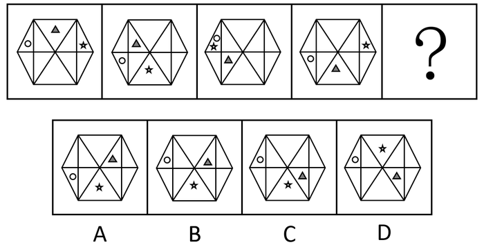

# 位置规律-平移（多元素分内外圈层移动）

考点：[[20-考点/判断推理/图形推理/位置规律-平移（多元素分内外圈层移动）|图形推理 / 位置规律-平移（多元素分内外圈层移动）]]

**问法模型**：'元素组成相同，选择最合适的一个填入问号处' → 优先考虑位置规律，按元素所在圈层分别追踪各自的平移轨迹（方向+步长）

## 推理链
1. 第1步：四幅图与选项的外框及内部线条完全相同，元素均为灰色三角形、五角星、小圆圈，元素组成相同→优先考虑位置规律而非样式规律
2. 第2步：内部结构分两个圈层：内圈为矩形区域分割出的六个面，外圈为与外框相连的六个面；灰色三角形位于内圈，五角星位于外圈，小圆圈轨迹可作辅助验证
3. 第3步：追踪灰色三角形：图1顶部→图2左上→图3左下→图4下方，规律为在内圈每次逆时针平移1格，故？处应移至内圈右下方
4. 第4步：追踪五角星：图1右侧→图2下方→图3左上→图4右上，规律为在外圈每次顺时针平移2格，故？处五角星应回到最下方的三角形中
5. 第5步：逐项对照：A、B两项的灰色三角形位于内圈右上方，不符合'逆时针1格到右下'的轨迹，排除A、B
6. 第6步：对比C、D两项：？处五角星应在最下方的三角形中，C项五角星在最下方三角形、D项在最上方，只有C项同时满足两个元素的轨迹

**最快解法**：⚡ 排除法+分圈追踪：先盯灰色三角形（内圈逆时针每次1格：顶→左上→左下→下→右下），排除A、B；再用五角星（外圈顺时针每次2格：右→下→左上→右上→最下方）对比C、D，C项五角星在最下方三角形，锁定C

## 易错点
- ⚠ 只追踪灰色三角形排除A、B后，未继续用五角星对比C、D，易在C、D之间误选D
- ⚠ 内外圈层划分不清：误将与外框相连的三角形当作内圈，导致灰色三角形与五角星的移动方向、格数判断颠倒
- ⚠ 五角星每次移动2格而非1格，若按1格推算，会得出？处五角星在错误位置（如最上方）而错选

## 母题抽象
> 🧩 当图形元素组成相同且小元素分布在内、外两个圈层时，用'分圈分元素追踪平移'法：先确定各元素所属圈层及步长（顺/逆时针、每次几格），逐项排除；当一个元素只剩两项候选时，用第二个元素定答案

**同类特征**：元素组成相同、一组序列图（图1至图4+？）、内外两圈层结构、灰色三角形在内圈、五角星在外圈、多元素按不同步长分别平移

## 相关题
- [[10-真题/判断推理/图形推理/2172768 位置规律（旋转-翻转）|2172768]]（海南 2021，相关度1）
- [[10-真题/判断推理/图形推理/10204458 位置规律-平移（特征交点沿内圈循环平移）|10204458]]（甘肃 2024，相关度1）
- [[10-真题/判断推理/图形推理/10204614 图形推理-位置规律（旋转+翻转交替循环）|10204614]]（黑龙江 2024，相关度1）
- [[10-真题/判断推理/图形推理/10297399 位置规律—平移（多黑块分组循环平移）|10297399]]（四川 2025，相关度1）
- [[10-真题/判断推理/图形推理/11226892 位置规律-九宫格小元素沿固定循环链移动|11226892]]（上海 2025，相关度1）

---

### 题干

从所给的四个选项中，选择最合适的一个填入问号处，使之呈现一定的规律性：

### 选项
- A. A
- B. B
- C. C　✅
- D. D

### 官方解析
元素组成相同，优先考虑位置规律。观察发现，灰色三角形在最内圈（矩形的六个面）中每次逆时针平移1格，排除A、B两项；对比C、D两项，观察发现五角星位置不同，题干中五角星在外圈（与外框相连的六个面中）每次顺时针移动2格，故？处五角星的位置应该在最下方的三角形中，只有C项符合。
故正确答案为C。

### 给定材料
（无）
