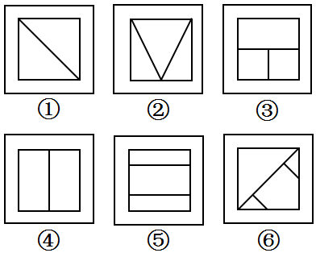

# 图形推理-对称性（对称轴数量分组）

考点：[[20-考点/判断推理/图形推理/图形推理-对称性（对称轴数量分组）|图形推理 / 图形推理-对称性（对称轴数量分组）]]

**问法模型**：“把六个图形分为两类，使每组各有共同特征”→ 分组分类题，元素组成不同时优先考虑属性规律（本题：数对称轴条数）

## 推理链
1. 第1步：元素组成不同，优先考虑属性规律；图②内部呈等腰三角形（V字）轮廓，是轴对称的特征图，优先考虑对称性
2. 第2步：对每个图形（外框+内部线条整体）逐条画对称轴并计数，按‘对称轴条数’这一数量规律分组
3. 第3步：图①正方形加一条对角线，沿该对角线和另一条对角线折叠均重合，有2条对称轴；图④中间竖线平分长方形，横轴、竖轴各1条，共2条；图⑤两条横线三等分正方形，横轴、竖轴各1条，共2条
4. 第4步：图②V字线仅沿竖直中线左右重合，有1条对称轴；图③上部整条横线、下部竖线居中，仅沿竖直中线重合，有1条；图⑥对角线及两端小线段仅沿该对角线方向重合，有1条
5. 第5步：①④⑤均为2条对称轴，②③⑥均为1条对称轴，与选项D“①④⑤，②③⑥”一致

**最快解法**：⚡ 对称轴计数法（特征图口诀：见等腰、日/田变形先数对称轴）：一眼看出④⑤为双轴（横+竖）、①沿对角线双轴；②③⑥仅单轴，直接按①④⑤/②③⑥选D

## 易错点
- ⚠ 图⑥含对角线易误以为对角线图形都有2条对称轴，实际小线段破坏了另一条对角线方向的对称，仅1条
- ⚠ 只判断出'都是轴对称图形'就匆忙分组，漏掉'对称轴数量'这一二级细分规律
- ⚠ 六图外框均为正方形，若只看外框会误判，须将内部线条与外框作为整体图形数对称轴

## 母题抽象
> 🧩 当分组分类题元素组成不同且出现等腰三角形、日/田字及对角线等轴对称特征图时，优先逐图数对称轴条数，按条数相同者归为一组验证选项

**同类特征**：六个图形分两类、元素组成不同、等腰三角形特征图、正方形外框加内部分割线、对称轴1条与2条之分

## 相关题
- [[10-真题/判断推理/图形推理/2616490 图形推理-对称性（对称轴数量分组）|2616490]]（深圳市考 2020，相关度3）
- [[10-真题/判断推理/图形推理/13504389 图形推理-笔画数（奇点数定一笔画-多笔画）|13504389]]（云南 2025，相关度2）
- [[10-真题/判断推理/图形推理/16593026 图形推理-对称性（轴对称判定，阴影斜线计入图形的干扰）|16593026]]（河北 2024，相关度2）
- [[10-真题/判断推理/图形推理/2423318 数量规律-面的位置关系（封闭面与外框是否相连）|2423318]]（甘肃 2019，相关度2）
- [[10-真题/判断推理/图形推理/2660488 数量规律-数面（封闭区域数）+奇偶性分组|2660488]]（选调 2018，相关度2）

---

### 题干

把下面的六个图形分为两类，使每一组图形都有各自的共同特征或规律。分类正确的一项是：

### 选项
- A. ①②③，④⑤⑥
- B. ①②⑤，③④⑥
- C. ①②④，③⑤⑥
- D. ①④⑤，②③⑥　✅

### 官方解析
本题为分组分类题。元素组成不同，优先考虑属性规律。观察可知，题干中出现了等腰三角形，是轴对称的特征图，优先考虑对称性。图①④⑤一组，有两条对称轴；图②③⑥一组，有一条对称轴，对应D项。
故正确答案为D。

### 给定材料
（无）
