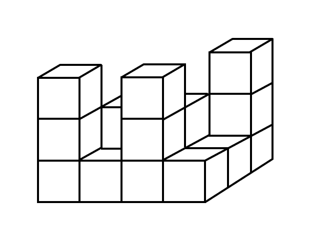

# 图形推理-立体图形小正方体堆积计数（最少方块-隐藏方块支撑问题）

考点：[[20-考点/判断推理/图形推理/图形推理-立体图形小正方体堆积计数（最少方块-隐藏方块支撑问题）|图形推理 / 图形推理-立体图形小正方体堆积计数（最少方块/隐藏方块支撑问题）]]

**问法模型**：问'至少由多少个小正方体堆积而成'→ 采用最少假设模型：被遮挡位置能省则省，但每个上层方块正下方必须保留支撑块，按层计数后求和

## 推理链
1. 第1步：题干问'至少'几个，意味着背面、下方等被遮挡处能不放就不放，只保留看得见的方块和支撑上层所必需的方块
2. 第2步：读图提取可见结构：前排各列高度从左到右约为3、1、3、1、1（左前柱与中前柱高3，其间及右侧有高1的矮块），后排可见两个高为2的方块顶面和右后一根高为3的柱子
3. 第3步：数顶层（第三层）：只有左前柱、中前柱、右后柱三处达到第三层，顶层至少3个
4. 第4步：数中间层（第二层）：三根高柱的第二层各1个（3个），加上后排两个高为2的方块（2个），中间层至少5个
5. 第5步：数底层：中间层5个方块的正下方必须各有1个方块支撑（5个），再加上前排3个高为1的独立矮块，底层至少5+3=8个
6. 第6步：合计3+5+8=16，对照选项A14、B15、C16、D17，选C

**最快解法**：⚡ 分层计数法+最少假设：顶层3个（三根高柱顶端）→中层5个（高柱第二层3个+后排高2方块2个）→底层8个（中层5个均需正下方支撑+前排3个独立矮块），3+5+8=16

## 易错点
- ⚠ 只数看得见的方块，漏掉背面/下方被遮挡但支撑上层所必需的隐藏方块
- ⚠ 误把'至少'理解为可以抽掉所有看不见的方块，忽略'上层方块正下方必须有支撑'的隐含条件
- ⚠ 把后排高为2的方块顶面误看成第一层方块，分层看错导致漏算或重复计数

## 母题抽象
> 🧩 当题干出现'立体堆叠图形至少由几个小正方体组成'的特征时，用'可见方块+隐藏支撑方块'的最少假设法，按顶层→中层→底层分层验证，底层≥中间层数（支撑）+前排独立矮块数

**同类特征**：问法含'至少'、小正方体堆积的等轴测立体图、存在被遮挡的背面与下方位置、上层方块需下层支撑、可分层计数、需想象三视图

## 相关题
（暂无）

---

### 题干

如图所示的物体至少由（    ）个小正方体堆积而成。

### 选项
- A. 14
- B. 15
- C. 16　✅
- D. 17

### 官方解析

用小正方体最少的情况，背面应如上图所示。即最上层有3个小正方体，中间层有5个小正方体，中间层小正方体下方都应有正方体支撑，所以最下层小正方体至少有8个，据此，题干物体至少由16个小正方体堆积而成。

故正确答案为C。

### 给定材料
（无）
