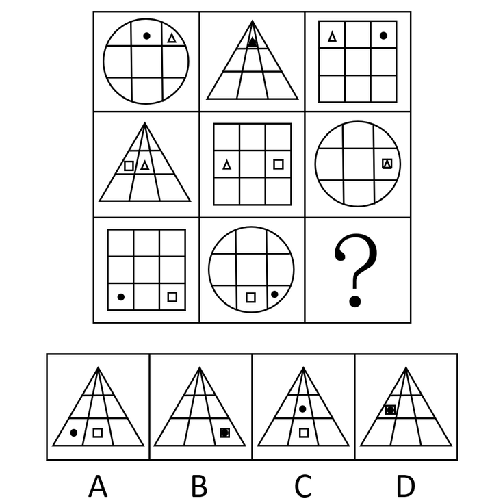

# 样式规律-小元素位置关系遍历（相邻-重合-相隔一格）

考点：[[20-考点/判断推理/图形推理/样式规律-小元素位置关系遍历（相邻-重合-相隔一格）|图形推理 / 样式规律-小元素位置关系遍历（相邻/重合/相隔一格）]]

**问法模型**：'最符合所给图形规律'→ 九宫格横向逐行观察小元素所在横行及两元素相对位置，找出每行缺失的位置关系

## 推理链
1. 第1步：九宫格中每格均为大框架图形（圆/三角形/正方形）内部划分区域并含两个小元素（●、△、□），元素组成相似，优先考虑样式规律
2. 第2步：九宫格优先横向看：第一横行三个图形中，内部小元素均位于第一横行，两元素位置关系依次为相邻（圆中●与△）、重合（三角形中△与●重叠）、相隔一格（正方形中△与●），三种关系各出现一次
3. 第3步：第二横行验证规律：小元素均在第二横行，位置关系依次为相邻（三角形中□与△）、相隔一格（正方形中△与□）、重合（圆中□与△重叠），同样是三种关系遍历
4. 第4步：第三横行应用规律：前两图小元素均在第三横行，位置关系为相隔一格（正方形中●与□隔一格）和相邻（圆形中□与●相邻）
5. 第5步：按每行'相邻、重合、相隔一格'遍历缺什么补什么，？处应为小元素在第三横行且两元素重合的图形
6. 第6步：对照选项（均为三角形框架）：A项两元素相隔、C项两元素不在同一横行、D项虽重合但在第二横行，仅B项小元素在第三横行且重合，故选B

**最快解法**：⚡ 位置遍历口诀法：横向看每行小元素所在横行一致、两元素关系'相邻/重合/相隔一格'每行各出现一次；第三行已现'相隔+相邻'，缺'重合'，直接锁定B（排除A相隔、C异行、D重合但在第二行）

## 易错点
- ⚠ 只关注小元素的形状种类或大框架形状，忽略'小元素所在横行'这一位置规律（D项即为重合但横行错误的陷阱）
- ⚠ 重合图形辨识不清：B项两元素重叠后看似单个填充小方块，易误判为'只有一个元素'而排除
- ⚠ 按纵向列或整体观察导致规律混乱，本题必须横向逐行比较才能发现遍历规律

## 母题抽象
> 🧩 当九宫格每格均为'大框架+两个小元素'且元素组成相似时，横向逐行观察小元素所在行列及两元素相对位置（相邻/重合/相隔一格），按每行遍历缺项补齐答案

**同类特征**：九宫格、元素组成相似、大框架内含两个小元素、小元素位置按横行分布、相邻/重合/相隔一格三种关系遍历、问号位于第三行

## 相关题
- [[10-真题/判断推理/图形推理/10204610 样式规律-加减同异（去同存异），九宫格列规律|10204610]]（辽宁 2024，相关度2）
- [[10-真题/判断推理/图形推理/10297349 样式规律-黑白运算|10297349]]（浙江 2025，相关度2）
- [[10-真题/判断推理/图形推理/10297407 样式规律-黑白运算（定义叠加）|10297407]]（四川 2025，相关度2）
- [[10-真题/判断推理/图形推理/12019768 样式规律-加减同异（求同）与位置旋转的复合规律|12019768]]（浙江 2026，相关度2）
- [[10-真题/判断推理/图形推理/12101004 样式规律-黑白运算（九宫格逐位置叠加）|12101004]]（江苏 2025，相关度2）

---

### 题干

下列选项中最符合所给图形规律的是（    ）。

### 选项
- A. A
- B. B　✅
- C. C
- D. D

### 官方解析
元素组成相似，优先考虑样式规律。九宫格优先横向看，第一横行中，内部小元素均在第一行，且两个小元素之间的位置关系分别为相邻、重合和相隔一格；第二横行中，内部小元素均在第二行，且两个小元素之间的位置关系分别为相邻、相隔一格和重合；第三横行应用规律，前两幅图中内部小元素均在第三横行，且两个小元素之间的位置关系分别为间隔一格和相邻，故？处应该选一个重合的，只有B项符合，当选。
故正确答案为B。

### 给定材料
（无）
