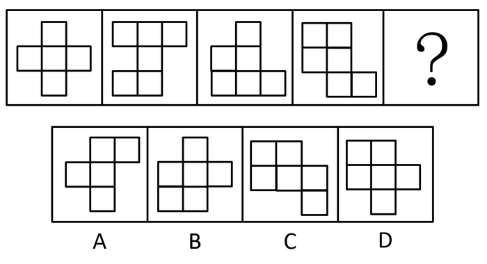

# 图形拼合（平面拼合·平行移动拼板）

考点：[[20-考点/判断推理/图形推理/图形拼合（平面拼合·平行移动拼板）|图形推理 / 图形拼合（平面拼合·平行移动拼板）]]

**问法模型**：题干给出4个由单位小方格拼成的不规则图形+'？'，问'最符合所给图形规律'→图形拼合模型：先数小方格定目标轮廓，再平行移动拼合验证凹凸互补

## 推理链
1. 第1步：观察题干前4个图形，均为由单位小方格拼成的不规则凹凸图形：图1为十字形（中行3格＋竖列），图2上排3格、下排2格，图3呈阶梯状且底排3格，图4带右凸尾部；第5格为'？'
2. 第2步：题干各图无位置移动、数量增减等常规规律，结合官方定位属'图形拼合'——4个原图形与正确选项应能拼成一个完整图形；先数小方格总数，锁定目标完整图形的面积与轮廓
3. 第3步：用'平行移动拼合法'（本题按题意直接平移拼合、不旋转翻转）将图1、2、3、4依次试拼：各图凸出与凹进部分互相咬合
4. 第4步：4个原图形拼合后余下的空缺轮廓呈'上排2格、中排3格、下排中间1格'的凹凸形状
5. 第5步：逐项对照：A上排右凸、B上排仅1格、C下排右凸，凹凸位置均与空缺对不上；D（上排2格、中排3格向右展开、下排1格居中）与空缺轮廓正好咬合
6. 第6步：将D补入空缺后无重叠无缝隙，拼成完整图形，故选D

**最快解法**：⚡ 图形拼合法＋数方格：先数小方格确定目标轮廓面积；再把4个原图按平移拼合看剩余空缺形状，直接找凹凸轮廓与空缺一致的选项——只有D（上2格、中3格、下1格）能填满空缺

## 易错点
- ⚠ 把题当成'类比外形'类规律题去找旋转/叠加/数量规律，忽略不规则方格图形暗示的'拼合'考点
- ⚠ 不数方格、不验证空缺轮廓，凭感觉比较凹凸；A的上排右凸、C的下排右凸与空缺位置不符易被误选
- ⚠ 忽略拼合默认平移（不旋转不翻转）的前提，误选与原图形旋转后相似的B

## 母题抽象
> 🧩 当题干出现'数个由单位小方格拼成的不规则图形＋问号'且找不到数量/位置规律时，考图形拼合：先数方格定目标面积，再平移拼原图看剩余空缺，选凹凸轮廓与空缺完全互补的选项

**同类特征**：由单位小方格拼成的不规则图形、4个已知图＋第5格问号、各图凹凸轮廓互补、无平移旋转数量等常规规律、问法为'最符合所给图形规律'实为拼合题、四个选项均为凹凸位置略有差异的相似方格图

## 相关题
（暂无）

---

### 题干

下列选项中最符合所给图形规律的是（    ）。

### 选项
- A. A
- B. B
- C. C
- D. D　✅

### 官方解析

本题考察图形拼合。将原图形所给的四个图形分别标记1、2、3、4，发现可以与D项拼接成一个完整的图形。

故正确答案为D。

### 给定材料
（无）
