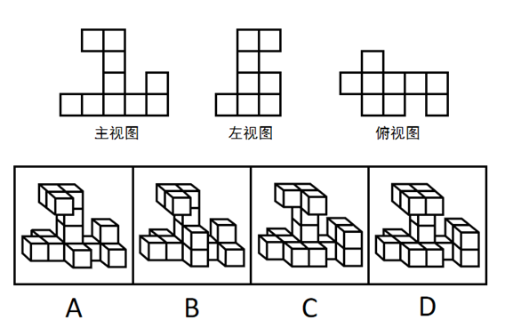
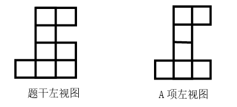

# 三视图-立体图形还原与视图匹配（选非）

考点：[[20-考点/判断推理/图形推理/三视图-立体图形还原与视图匹配（选非）|图形推理 / 三视图-立体图形还原与视图匹配（选非）]]

**问法模型**：给出主视图、左视图、俯视图三个视图，问立体图形'不可能是'哪一项 → 逐项还原选项立体图形的三视图并与题干比对，找出存在任一视图不符的选项

## 推理链
1. 第1步：提取题干三视图特征——主视图为底部一行4格、中列向上叠至顶层（顶部2格）、右端第2层1格；左视图为底部2格、高列至顶且顶部2格、中部另有外凸层；俯视图为横排5格且一端上凸1格、另一端下凸1格
2. 第2步：本题为选非题，解题方法是三视图逐项还原比对法：把每个选项的立体堆叠分别投影出主、左、俯三个视图，与题干逐一核对
3. 第3步：先核验A项的左视图——将A项立体图形的左视图按列拆分，其第三列的格数/层数分布与题干左视图第三列不一致
4. 第4步：再核验B、C、D项——三者投影得到的主视图、左视图、俯视图均与题干给定图形完全吻合
5. 第5步：只有A项存在视图不匹配，结合'不可能'的选非设问，确定答案为A

**最快解法**：⚡ 排除法+分列数层法：以左视图为突破口（轮廓特征最独特），将每个选项立体图形的左视图按列拆分、逐列数出层数，与题干左视图逐列对照；A项第三列层数不符即当场锁定，无需完整画出三视图

## 易错点
- ⚠ 选非题惯性思维：误选三视图均匹配的B/C/D，漏看'不可能是'设问
- ⚠ 只核对主视图或俯视图就匆忙排除，忽略左视图逐列细节（A项问题恰出在左视图第三列）
- ⚠ 立体图中被前排方块遮挡、但会影响左视图轮廓的隐藏小方块被漏数或多数，导致层数比对出错

## 母题抽象
> 🧩 当题干给出多面体三视图并问'不可能是'哪一项时，用'分列数层法'从轮廓最独特的视图（常为左视图或俯视图）入手，逐列比对各列层数，第一处不符者即为答案；其余选项只需抽查确认匹配即可

**同类特征**：三视图（主/左/俯）、选非题·不可能是、小方块堆叠多面体、四个立体选项逐一代入验证、左视图按列数层比对

## 相关题
（暂无）

---

### 题干

下列的三个视图是观察某一多面体得到的，则该立体图形不可能是（    ）。

### 选项
- A. A　✅
- B. B
- C. C
- D. D

### 官方解析

A项：左视图的第三列与题干图形不匹配，当选；

B项：三视图均符合题干给定图形，排除；

C项：三视图均符合题干给定图形，排除；

D项：三视图均符合题干给定图形，排除。

本题为选非题，故正确答案为A。

### 给定材料
（无）
