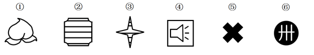

# 图形推理-对称性（对称轴数量分组）

考点：[[20-考点/判断推理/图形推理/图形推理-对称性（对称轴数量分组）|图形推理 / 图形推理-对称性（对称轴数量分组）]]

**问法模型**：六个图形分为两类、每类各有共同特征 → 分组分类题，先看属性规律（对称性），按对称轴条数二分

## 推理链
1. 第1步：六图元素组成不同（桃子、鼓形、四角星、喇叭、粗十字、圆内符号），优先考虑属性规律；题干图形含等腰、箭头、星形等元素，考虑对称性
2. 第2步：逐图清点对称轴——①桃子形歪斜无对称轴（0条）；②鼓形轮廓加横线仅1条竖直对称轴；③四角星仅1条对称轴；④方框内喇叭上尖下宽、左右出声波，仅1条（水平）对称轴；⑤粗十字形有4条对称轴；⑥黑圆内"卄"形符号不对称（0条）
3. 第3步：按对称轴数量归类——②③④均为"恰好1条对称轴"；①⑤⑥均"不是1条对称轴"（①⑥为0条，⑤为4条）
4. 第4步：两组各3个图形，分类标准统一为"对称轴是否恰为1条"，符合分组要求
5. 第5步：对照选项，①⑤⑥一组、②③④一组的只有B，故选B

**最快解法**：⚡ 对称轴计数法：逐图数对称轴条数，发现②③④都只有1条，①⑤⑥分别是0条、4条、0条，按"恰1条 vs 非1条"二分直接锁定B

## 易错点
- ⚠ ⑤粗十字易被只数出2条对称轴（忽视对角线方向）或按"是否轴对称"简单二分，导致无法3-3分组
- ⚠ ⑥外部黑色正圆有无数条对称轴，易误把整图当轴对称图形归入对称组，实际要看圆内"卄"形主体并不对称
- ⚠ 只停留在"是否轴对称"的定性层面，未下沉到"对称轴条数"的定量层面，找不到统一分组标准

## 母题抽象
> 🧩 当分组分类题元素组成不同且出现等腰、箭头、星形、十字等特征时，优先数每个图形的对称轴条数，按"恰好1条/0条或多条"二分验证

**同类特征**：元素组成不同、等腰/箭头/星形元素、轴对称图形混杂非轴对称图形、3-3分组分类、对称轴数量二分

## 相关题
- [[10-真题/判断推理/图形推理/2579760 图形推理-对称性（对称轴数量分组）|2579760]]（浙江 2020，相关度3）
- [[10-真题/判断推理/图形推理/10204454 数量规律-部分数（黑白球连通区域数做和）|10204454]]（甘肃 2024，相关度1）
- [[10-真题/判断推理/图形推理/10204604 数量规律-线数量（汉字横线数）|10204604]]（辽宁 2024，相关度1）
- [[10-真题/判断推理/图形推理/10297050 数量规律-特殊计数（线条穿过小白球的数量）|10297050]]（天津 2025，相关度1）
- [[10-真题/判断推理/图形推理/10297127 图形间关系-相交图形中不相交边数量（黑白图形相交）|10297127]]（天津 2025，相关度1）

---

### 题干

把下面的六个图形分为两类，使每一类都有各自的共同特征或规律，分类正确的一项是（    ）。

### 选项
- A. ①②④，③⑤⑥
- B. ①⑤⑥，②③④　✅
- C. ①③⑥，②④⑤
- D. ①②⑥，③④⑤

### 官方解析
本题为分组分类题目。元素组成不同，优先考虑属性规律。题干出现等腰元素，考虑对称性。观察发现，②③④三个图形均有一条对称轴，①⑥两个图形为非轴对称图形，没有对称轴，图⑤有四条对称轴，因此①⑤⑥三个图形都不为一条对称轴图形。即图①⑤⑥一组，图②③④一组。
故正确答案为B。

### 给定材料
（无）
