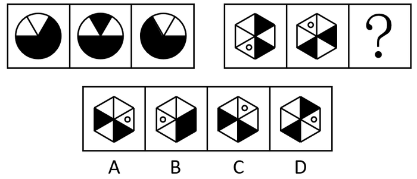

# 图形推理-位置规律（平移-旋转移动步数）

考点：[[20-考点/判断推理/图形推理/图形推理-位置规律（平移-旋转移动步数）|图形推理 / 图形推理-位置规律（平移/旋转移动步数）]]

**问法模型**：'两组图+选一个替代问号呈现规律'→ 先在第一组内逐元素数出移动格数，再将规律原样代入第二组推出问号图形

## 推理链
1. 第1步：两组图形元素组成相同（第一组均为六等分圆及黑色块，第二组均为六等分正六边形、黑色三角形与空白小圆圈），优先考虑位置规律
2. 第2步：追踪第一组黑色扇形①，从图1到图2再到图3，位置每次沿六等分格顺时针移动2格
3. 第3步：追踪第一组黑色半圆②，位置每次顺时针移动1格，确认'顺2、顺1'双元素规律
4. 第4步：将规律代入第二组：空白圆圈依次顺时针移动2格，黑色三角形依次顺时针移动1格
5. 第5步：以第二组图2中空白圆圈与黑色三角形的位置为起点，分别按'顺时针2格''顺时针1格'各推一步，得到问号处图形
6. 第6步：逐项对照，仅A项中小圆圈与黑色三角形的位置同时满足该规律，B、C、D位置均不符，故选A

**最快解法**：⚡ 位置规律追踪法（描点标记）：给'空白圆圈'和'黑色三角形'各设一个标记，记住口诀'圈顺2、角顺1'，从第二组图2出发各推一步，直接锁定A

## 易错点
- ⚠ 两组类比题误将第二组单独找规律（如看成黑块数量或黑白交替变化），忽略应迁移第一组的移动步数
- ⚠ 六等分图形中顺/逆时针方向数反，或把'移动2格'与'移动1格'对应的元素弄混
- ⚠ 只盯黑色三角形而漏追空白小圆圈的位置变化，导致误选其他选项

## 母题抽象
> 🧩 当题干出现'两组图、元素组成相同、仅位置不同'的特征时，用'逐元素追踪移动步数'法：先在第一组数出每个元素每次顺/逆时针移动几格，再原样代入第二组推出问号图形并验证选项。

**同类特征**：两组图类比、元素组成相同、六等分圆/正六边形分割、黑色色块+空白小圆圈、位置移动步数规律、顺时针移动

## 相关题
- [[10-真题/判断推理/图形推理/2172125 位置规律（翻转+平移，两组图类比）|2172125]]（广州市考 2018，相关度2）
- [[10-真题/判断推理/图形推理/2776045 位置规律-动态位置（多元素分轨道循环移动：内圈-外圈+不同步长）|2776045]]（浙江 2021，相关度2）
- [[10-真题/判断推理/图形推理/5660587 图形推理-位置规律（拆分后左右互换）|5660587]]（上海 2020，相关度2）
- [[10-真题/判断推理/图形推理/5893617 位置规律（平移-内外圈分层观察）|5893617]]（国考 2024，相关度2）
- [[10-真题/判断推理/图形推理/2172768 位置规律（旋转-翻转）|2172768]]（海南 2021，相关度1）

---

### 题干

从四个选项中选择一个替代问号，使之呈现出一定的规律性（   ）。

### 选项
- A. A　✅
- B. B
- C. C
- D. D

### 官方解析

元素组成相同，优先考虑位置规律。观察发现，题干第一组图形中，黑色扇形①依次顺时针移动2格；黑色半圆②依次顺时针移动1格，如下图所示：

将规律代入第二组图，空白圆依次顺时针移动2格，黑色三角形依次顺时针移动1格，对应A项。

故正确答案为A。

### 给定材料
（无）
