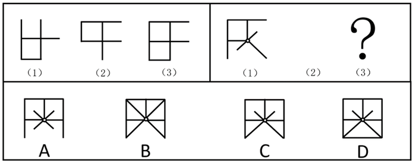

# 组合规律（位置规律-旋转 + 样式规律-图形相加叠加）

考点：[[20-考点/判断推理/图形推理/组合规律（位置规律-旋转 + 样式规律-图形相加叠加）|图形推理 / 组合规律（位置规律-旋转 + 样式规律-图形相加叠加）]]

**问法模型**：两组图形式，第一组找规律、第二组用规律求图（3）→ 先归纳第一组'图1旋转得图2、图1+图2叠加得图3'的双规律，再迁移验证选项

## 推理链
1. 第1步：第一组图（1）与图（2）元素组成相同、仅方向不同，考虑位置规律，图（1）顺时针旋转90°得到图（2）
2. 第2步：图（3）与前两幅图元素组成相似且有相同线条重复出现，考虑样式规律，图（1）与图（2）相加（叠加）得到图（3）
3. 第3步：第二组遵循同一规律，题干图（2）空缺，需先把图（1）顺时针旋转90°自行补出图（2）
4. 第4步：将第二组图（1）与旋转后得到的图（2）逐线直接叠加，保留所有出现过的线条，得到图（3）的外框轮廓与中心射线分布
5. 第5步：对照选项，C项线条与叠加结果完全一致；A项外框开口方向不符，B、D项多出图（1）及其旋转图中不存在的对角线，排除
6. 第6步：结论——只有C项符合'旋转+相加'规律，当选

**最快解法**：⚡ '旋转+叠加'两步法＋排除法：先把第二组图（1）顺时针旋转90°画出图（2），再与图（1）直接叠加描线，比对新图形的线条集合，仅C项吻合（B、D多对角线、A外框开口错误），快速锁定C

## 易错点
- ⚠ 只看到位置规律（旋转），误以为整组都是旋转规律，忽略图（3）须由图（1）图（2）叠加得到
- ⚠ 第二组图（2）空缺时跳过'先旋转补出图（2）'这一步，直接拿图（1）与选项硬凑
- ⚠ B、D项图形完整对称、线条更'齐'，易凭视觉对称误选；叠加只能保留图（1）（2）中实际出现的线条，不能凭对称补线

## 母题抽象
> 🧩 当两组图中'前两图元素组成相同、第三图出现相同线条重复'时，套用'图1顺时针旋转→图2，图1+图2叠加→图3'的双规律模板，第二组先补出图（2）再叠加比对选项

**同类特征**：两组图（1）（2）（3）形式、图（1）与图（2）元素组成相同、图（3）有相同线条重复出现、顺时针旋转、图形相加叠加、求第二组图（3）

## 相关题
- [[10-真题/判断推理/图形推理/16593143 位置规律（多元素分组追踪：平移+旋转）|16593143]]（甘肃 2024，相关度1）
- [[10-真题/判断推理/图形推理/5423831 样式规律-加减同异（线条求并+旋转+长短修正）|5423831]]（上海 2023，相关度1）

---

### 题干

下列两组图形均由（1）（2）（3）三个图形组成，三个图形之间存在一定变化规律。按其规律右边这组图形中，图（3）应为：

### 选项
- A. A
- B. B
- C. C　✅
- D. D

### 官方解析

本题为两组图形式，先看第一组图找规律。观察发现，图（1）和图（2）元素组成相同，考虑位置规律，图（1）顺时针旋转可以得到图（2）；图（3）与前两幅图元素组成相似，有相同线条重复出现，考虑样式规律，图（1）图（2）相加可以得到图（3）。第二组遵循此规律，图（1）旋转后得到图（2）如下图所示，图（1）图（2）相加得到图（3），只有C项符合，当选。

故正确答案为C。

### 给定材料
（无）
