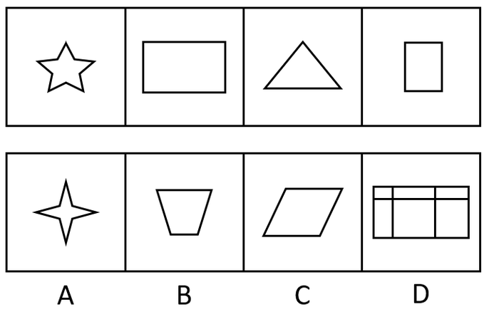

# 属性规律-对称性（轴对称与中心对称隔项交替）

考点：[[20-考点/判断推理/图形推理/属性规律-对称性（轴对称与中心对称隔项交替）|图形推理 / 属性规律-对称性（轴对称与中心对称隔项交替）]]

**问法模型**：题干给出四个图求第五个图呈现规律性 → 元素组成不同优先看属性，用'对称类型打标签法'找隔项交替规律

## 推理链
1. 第1步：题干四图依次为五角星、横放长方形、等腰三角形、竖放长方形，元素组成不同且无统一数量规律，考虑属性规律；等腰三角形、矩形为典型对称特征图，锁定对称性
2. 第2步：给图1～图4逐一定性打标签：图1五角星为奇数角星形，旋转180°不与自身重合，仅轴对称；图2横长方形既轴对称又中心对称；图3等腰三角形仅轴对称；图4竖长方形既轴对称又中心对称
3. 第3步：归纳规律为隔项交替：奇数项'仅轴对称'、偶数项'既轴对称又中心对称'，故第五图应为仅轴对称图形
4. 第4步：逐项对照：A四角星既轴对称又中心对称，排除；C一般平行四边形仅中心对称、非轴对称，排除；D为矩形加分割线的不规则网格，不满足仅轴对称，排除；B等腰梯形仅有1条竖直对称轴、旋转180°不重合，为仅轴对称图形，符合规律

**最快解法**：⚡ 对称类型标签法：对四个题干图快速标注'仅轴/双对称'，发现'仅轴→双→仅轴→双'交替，直接在选项中找'仅轴对称'图形，B等腰梯形即中

## 易错点
- ⚠ 误判五角星为中心对称图形：奇数角（5角）星形旋转180°无法与自身重合，仅是轴对称
- ⚠ 混淆'仅中心对称'与'轴对称'：一般平行四边形（C项）只是中心对称而非轴对称，易误当成轴对称而错选
- ⚠ 在D项网格图上纠结线条数、面数等数量规律，偏离对称性主线；或忽略A项四角星是双对称而非仅轴对称

## 母题抽象
> 🧩 当题干图形元素组成不同且出现等腰三角形、矩形、星形、梯形等对称特征图时，给每图标注'仅轴对称/仅中心对称/双对称'标签，验证是否呈隔项交替或循环规律后选对应项

**同类特征**：元素组成不同、五角星、等腰三角形、横竖两种长方形、梯形/平行四边形选项干扰、对称性交替规律

## 相关题
- [[10-真题/判断推理/图形推理/19591589 属性规律（轴对称）+数量规律（笔画数-两笔画）|19591589]]（选调 2025，相关度2）
- [[10-真题/判断推理/图形推理/2387642 数量规律-笔画数（一笔画-奇点数）|2387642]]（浙江 2019，相关度2）
- [[10-真题/判断推理/图形推理/2631957 图形推理-数量规律-笔画数（一笔画-奇点数）|2631957]]（天津 2017，相关度2）
- [[10-真题/判断推理/图形推理/5445778 属性规律-对称性（内外分层：外轴对称＋内中心对称）|5445778]]（国考 2023，相关度2）
- [[10-真题/判断推理/图形推理/10204454 数量规律-部分数（黑白球连通区域数做和）|10204454]]（甘肃 2024，相关度1）

---

### 题干

从所给四个选项中，选出唯一的一项作为题干的第五个图，使之呈现一定规律性：

### 选项
- A. A
- B. B　✅
- C. C
- D. D

### 官方解析
元素组成不同，优先考虑属性规律。观察发现，题干图形中出现等腰三角形，选项中出现等腰梯形和平行四边形，均为对称性特征图，因此考虑对称性。题干中第一、三个图形仅为轴对称图形，第二、四个图形既为轴对称又为中心对称图形，因此第五个图形应仅为轴对称图形，只有B项符合。
故正确答案为B。

### 给定材料
（无）
