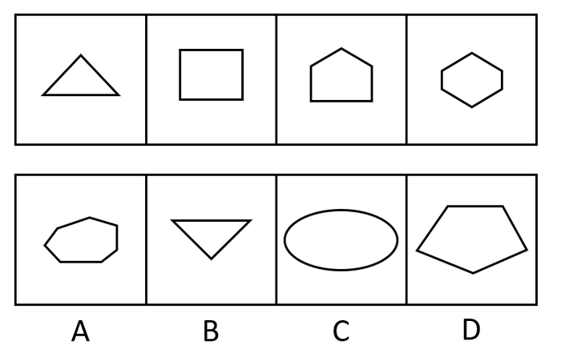

# 数量规律-线数量（直线数-边数等差递增）

考点：[[20-考点/判断推理/图形推理/数量规律-线数量（直线数-边数等差递增）|图形推理 / 数量规律-线数量（直线数/边数等差递增）]]

**问法模型**：'选出第五个图使之呈现规律性'→元素组成不同时优先看属性（对称/曲直/开闭），属性双解或矛盾时转数数量（线、面、点），本题以'多边形全直线'为信号数直线数。

## 推理链
1. 第1步：题干四图依次为三角形、正方形（四边形）、五边形（房形）、六边形，元素组成不同，无相同元素传递。
2. 第2步：先看属性规律：对称性呈'仅轴对称→轴对称+中心对称→仅轴对称→轴对称+中心对称'交替，按此规律第五图应为仅轴对称图形（该规律指向B项）。
3. 第3步：属性规律双解后转向数量规律：题干图形均为多边形且全部由直线组成，具备可数性，数每图直线数得3、4、5、6，为公差1的等差递增。
4. 第4步：按直线数规律，第五图应由7条直线（7条边）构成。
5. 第5步：逐项对照：A项为不规则七边形（7条直线），B项为倒置三角形（3条直线），C项为椭圆（1条曲线，非直线），D项为不规则五边形（5条直线）。
6. 第6步：仅A项满足'7条直线'规律，且C项曲线特征直接排除于全直线序列，故选A。

**最快解法**：⚡ 数线法（数边数）：题干全是规整多边形→直接数边数3、4、5、6→锁定7条边的A，并用'全直线'排除曲线C。

## 易错点
- ⚠ 先入为主发现对称性交替规律而误选B（仅轴对称），忽略数量规律的等差性及同套卷已考过对称性这一倾向信号。
- ⚠ 忽略'全由直线组成'这一曲直属性，未及时用C项（椭圆为曲线）与题干特征矛盾做排除。
- ⚠ 数A项不规则七边形边数时漏数短边或斜边，误判边数不符。

## 母题抽象
> 🧩 当题干图形均为规整多边形且元素组成不同时，优先数边数（直线数）找等差递增/递减规律；若对称性等属性规律同时成立且指向不同选项，优先采信数量递变规律并结合整体卷面考点分布定答案。

**同类特征**：元素组成不同、均为多边形且全由直线构成、直线数3、4、5、6等差递增、对称性呈'仅轴对称/轴+中心对称'交替、图形逐图边数加一、渐趋复杂

## 相关题
- [[10-真题/判断推理/图形推理/10204454 数量规律-部分数（黑白球连通区域数做和）|10204454]]（甘肃 2024，相关度1）
- [[10-真题/判断推理/图形推理/10204604 数量规律-线数量（汉字横线数）|10204604]]（辽宁 2024，相关度1）
- [[10-真题/判断推理/图形推理/10297050 数量规律-特殊计数（线条穿过小白球的数量）|10297050]]（天津 2025，相关度1）
- [[10-真题/判断推理/图形推理/10297127 图形间关系-相交图形中不相交边数量（黑白图形相交）|10297127]]（天津 2025，相关度1）
- [[10-真题/判断推理/图形推理/10297148 数量规律-线的细化（端点连线穿过线条数；备选：平行线组数）|10297148]]（天津 2025，相关度1）

---

### 题干

从所给四个选项中，选出唯一的一项作为题干的第五个图，使之呈现一定规律性：

### 选项
- A. A　✅
- B. B
- C. C
- D. D

### 官方解析
方法一：元素组成不同，优先考虑属性规律。观察发现，题干图形比较规整，考虑对称性。题干图形分别为仅轴对称，轴对称+中心对称，仅轴对称，轴对称+中心对称，接下来应为仅轴对称图形。
故正确答案为B。
方法二：元素组成不同，且出现较多的多边形，每个图形均由直线组成，考虑数直线数。题干图形直线数量分别为3、4、5、6，故第五个图应为直线数量为7的图形，A项为7条直线，B项为3条直线，C项为1条曲线，D项为5条直线。
故正确答案为A。
本题不是特别严谨，两种规律都有答案，考生重点学习解题思路即可。因多边形特征和直线数递减规律明显，且同套题目的五道题目中已经出现考查对称性的题目，因此粉笔更倾向于选A。

### 给定材料
（无）

> [!warning] 疑点（官方解析可能有误，待人工复核）
> 官方解析方法一（对称性交替：仅轴、轴+中心、仅轴、轴+中心→应为仅轴对称）指向B项，与给定正确答案A冲突；官方解析自述'两种规律都有答案、本题不严谨'，最终依直线数3→4→5→6→7递增规律并结合同套卷已考对称性倾向选A，作答时须以A为准。
