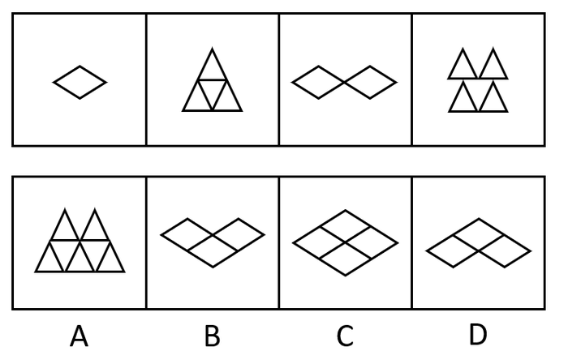

# 数量规律-元素个数（奇偶交替数素）＋位置规律（新增元素方位延续）

考点：[[20-考点/判断推理/图形推理/数量规律-元素个数（奇偶交替数素）＋位置规律（新增元素方位延续）|图形推理 / 数量规律-元素个数（奇偶交替数素）＋位置规律（新增元素方位延续）]]

**问法模型**：'选出第五个图使之呈现规律性'且元素组成不同→先看属性后数数量，本题菱形/三角形小元素特征明显，采用'奇偶交替数素＋方位辨析'模型

## 推理链
1. 第1步：提取图形构成——图一为1个菱形，图二为三角形组合（三角形面数为4），图三为2个菱形相接，图四为三角形组合（三角形面数为5）
2. 第2步：归纳规律——奇数项统一由菱形构成且个数1→2递增，偶数项统一由三角形构成且面数4→5递增，属奇偶交替数素规律，故图五应为3个菱形
3. 第3步：一级排除——A项为三角形组合、C项含4个菱形，均不符合'3个菱形'，排除A、C
4. 第4步：二级辨析——B、D均含3个菱形，依'图四中新增三角形出现在上方'的位置延续性，图五新增的第3个菱形也应出现在上方
5. 第5步：D项第3个菱形位于上方（^形排布），B项第3个菱形位于下方（V形排布），排除B，锁定D
6. 第6步：校验干扰规律——题干对称性呈'轴+中心、仅轴'交替，按该规律应选C，但官方以元素数素特征更明显且同套题已考对称性为由定D

**最快解法**：⚡ 数素法＋方位二级辨析：奇数项数菱形1、2→图五应为3个菱形，排除A（三角形）、C（4个菱形）；再比B、D新增菱形方位，'新增在上方'延续图四特征，D（上）胜B（下），秒选D

## 易错点
- ⚠ 对称性陷阱：题干图形规整，'轴+中心/仅轴'交替规律同样成立且指向C，脱离同套题语境易误选C
- ⚠ 二级辨析缺位：数出3个菱形排除A、C后，若不比较B、D中新增菱形的上下方位，仍会在B、D间误选B
- ⚠ 漏数隐含面：图四三角形面数为5而非直观的4个，错数会导致偶数项递增规律（4→5）判断失误

## 母题抽象
> 🧩 当题干图形由同类小元素拼合、元素种类按奇偶交替且个数递增时，先用'交替数素'定数量（1→2→3），再用'新增元素方位延续'做二级辨析；若对称性规律同时成立，以元素特征更明显的数素规律优先

**同类特征**：元素组成不同、菱形与三角形两类小元素、奇数项菱形个数1→2、偶数项三角形面数4→5、新增元素出现在上方、存在对称性交替的干扰规律

## 相关题
- [[10-真题/判断推理/图形推理/10204454 数量规律-部分数（黑白球连通区域数做和）|10204454]]（甘肃 2024，相关度1）
- [[10-真题/判断推理/图形推理/10204604 数量规律-线数量（汉字横线数）|10204604]]（辽宁 2024，相关度1）
- [[10-真题/判断推理/图形推理/10297050 数量规律-特殊计数（线条穿过小白球的数量）|10297050]]（天津 2025，相关度1）
- [[10-真题/判断推理/图形推理/10297127 图形间关系-相交图形中不相交边数量（黑白图形相交）|10297127]]（天津 2025，相关度1）
- [[10-真题/判断推理/图形推理/10297148 数量规律-线的细化（端点连线穿过线条数；备选：平行线组数）|10297148]]（天津 2025，相关度1）

---

### 题干

从所给四个选项中，选出唯一的一项作为题干的第五个图，使之呈现一定规律性：

### 选项
- A. A
- B. B
- C. C
- D. D　✅

### 官方解析

方法一：元素组成不同，优先考虑属性规律。观察发现题干图形比较规整，考虑对称性。题干图形分别为轴对称中心对称，仅轴对称，轴对称中心对称，仅轴对称，第五个图应为轴对称中心对称图形，只有C项符合。

故正确答案为C。

方法二：观察发现图中出现菱形和三角形两种小元素，图二和图四中三角形面数为4、5，图一和图三中菱形的个数依次为1、2，故第五个图应为3个菱形，排除A、C两项。再次观察，图四中增加的三角形出现在上方，排除B项。

故正确答案为D。

本题不是特别严谨，两种规律都有答案，考生重点学习解题思路即可。因相同元素特征比较明显，且同套题目的五道题目中已经出现考查对称性的题目，因此粉笔更倾向于选D。

### 给定材料
（无）

> [!warning] 疑点（官方解析可能有误，待人工复核）
> 官方解析自认本题不严谨：方法一按对称性'轴+中心/仅轴'交替推出第五图应为轴对称+中心对称图形，即C项符合，与正确答案D冲突，形成双重规律歧义；官方以'相同元素特征更明显、同套题目已考对称性'为由倾向D。此为命题瑕疵，考生需同时掌握两条规律并理解答案倾向理由，但不得据此改判答案

<!-- CODEX-ANSWER-REVIEW:BEGIN -->
### 本次独立复核

**复核状态：** `resolved`（答案与解析已核定）

**计分答案：** D（可计分）

**复核解析：**

【编辑版】只按相同小元素的数量和新增元素位置补图：①、③中的菱形数依次为1、2，因此第五图应有3个菱形；④中新增三角形位于上方，缺项沿用该方位。只有D同时满足。原题按对称性可导向C，编辑题干已限定数形规则。

**修订题干：**

从所给四个选项中，选出唯一的一项作为题干的第五个图，使之呈现一定规律性：

**【编者修订条件】** 【编辑版】只延续菱形数1、2、3递增，并令新增加的三角形保持在图形上方的规律；不按对称性补图。

**相关信息：**

图形推理—元素计数与新增位置要同时符合；只数元素数量而忽略方位会留下竞争选项。

**题源依据：** [固定版本原题](https://github.com/Mentat-Uran/kaogongzhentizhengliu/blob/84ab93d4b64b61d897bece8a1c0a5bab06b4feb2/10-%E7%9C%9F%E9%A2%98/%E5%88%A4%E6%96%AD%E6%8E%A8%E7%90%86/%E5%9B%BE%E5%BD%A2%E6%8E%A8%E7%90%86/2631971%20%E6%95%B0%E9%87%8F%E8%A7%84%E5%BE%8B-%E5%85%83%E7%B4%A0%E4%B8%AA%E6%95%B0%EF%BC%88%E5%A5%87%E5%81%B6%E4%BA%A4%E6%9B%BF%E6%95%B0%E7%B4%A0%EF%BC%89%EF%BC%8B%E4%BD%8D%E7%BD%AE%E8%A7%84%E5%BE%8B%EF%BC%88%E6%96%B0%E5%A2%9E%E5%85%83%E7%B4%A0%E6%96%B9%E4%BD%8D%E5%BB%B6%E7%BB%AD%EF%BC%89.md)；固定内容 commit `84ab93d4b64b61d897bece8a1c0a5bab06b4feb2`，Markdown blob `cff90ed9dce8a281ace4e444ee97cbb409e73f9b`。
<!-- CODEX-ANSWER-REVIEW:END -->
