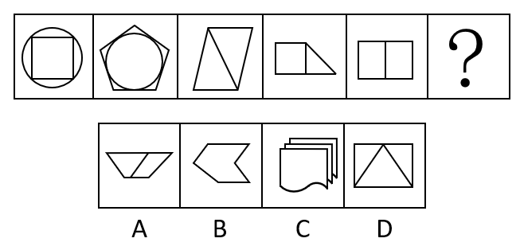

# 数量规律-数角（交点处分角计数）

考点：[[20-考点/判断推理/图形推理/数量规律-数角（交点处分角计数）|图形推理 / 数量规律-数角（交点处分角计数）]]

**问法模型**：六个图形元素组成不同且属性无规律 → 按'面→线→角'顺序递进数数量，找等差/递增规律

## 推理链
1. 第1步：题干五图加问号，元素组成不同（图1图2含圆、图3图5为纯直线图形），对称、曲直等属性无统一规律，优先考虑数量规律。
2. 第2步：图形均被明显分割，先数面：圆内接正方形为5个面、五边形内切圆为6个面、平行四边形加对角线为2个面、后两图各为2个面，序列5、6、2、2、2无规律，排除数面。
3. 第3步：每个图形均含直线构成的多边形，数直线：正方形4条、五边形5条、平行四边形加对角线5条、含内部竖线的分割图6条、矩形加中竖线5条，序列4、5、5、6、5无规律，排除数线。
4. 第4步：直线多边形间形成大量夹角，改数角：正方形4个角、五边形5个角、平行四边形被对角线在两个顶点处各多分出1个角共6个、分割图两个交接点各计2个角共7个、矩形中竖线与上下边形成两个T字交接各2个角加4个直角共8个，序列4、5、6、7、8成公差1的等差数列。
5. 第5步：问号处应选角数为9的图形，逐项验证：B为凹多边形角数不足、C含曲线不符合全直线多边形特征、A角数不为9；D项矩形内接三角形，顶部两角各1个、底部两顶点各被三角形边分割为2个角、三角形顶点与矩形上边相切处形成3个角，合计2+4+3=9个角。
6. 第6步：仅D项角数为9，可延续4、5、6、7、8、9的等差数列，故选D。

**最快解法**：⚡ 递进数数法（面→线→角）：面5、6、2、2、2无规律，线4、5、5、6、5无规律，角数4、5、6、7、8成等差，直接在选项中找9个角的图形——D项矩形+内接三角形（顶边两角2个+底部两顶点各2个+顶边切点3个）=9个角，选D。

## 易错点
- ⚠ 数面、数线均无规律后便放弃，未想到数量考点需继续递进到'角'这一层（面→线→角的考查阶梯）
- ⚠ 数角时漏数分割点/切点处新增的角：T字交接处应计2个角、D项三角形顶点与矩形上边相切处应计3个角，漏数则凑不出等差
- ⚠ 被图1、图2中的圆干扰，去数曲线数或纠结圆与多边形的内外位置关系，忽略圆不产生角、仅是干扰元素

## 母题抽象
> 🧩 当图形元素组成不同、属性无规律且图形被分割时，按'面→线→角'顺序逐层数数，哪一层呈等差/常数规律就按该规律选问号处图形；数角时每个交点按相交线段两两夹出的小于平角的角个数计数。

**同类特征**：元素组成不同、无明显属性规律、图形被明显分割、均含直线多边形、面数与线数均无规律、角数等差递增

## 相关题
- [[10-真题/判断推理/图形推理/10204454 数量规律-部分数（黑白球连通区域数做和）|10204454]]（甘肃 2024，相关度2）
- [[10-真题/判断推理/图形推理/10297050 数量规律-特殊计数（线条穿过小白球的数量）|10297050]]（天津 2025，相关度2）
- [[10-真题/判断推理/图形推理/10297262 数量规律-面的形状种类（封闭面种类数分组）|10297262]]（浙江 2025，相关度2）
- [[10-真题/判断推理/图形推理/10297314 数量规律-交点数（曲直交点）|10297314]]（浙江 2025，相关度2）
- [[10-真题/判断推理/图形推理/11454020 数量规律-小元素按行排布（每行个数自上而下递增1）|11454020]]（选调 2024，相关度2）

---

### 题干

从所给的四个图形中选择最合适的一个填入问号处，使之呈现一定的规律性。

### 选项
- A. A
- B. B
- C. C
- D. D　✅

### 官方解析
元素组成不同，且无明显属性规律，优先考虑数量规律。观察发现图形明显被分割，考虑数面。面的数量依次是5、6、2、2、2、?，无规律。继续观察，每个图形均含有直线构成的多边形，考虑数直线。直线数依次是4、5、5、6、5、?，无规律。继续观察，直线构成的多边形形成很多夹角，考虑数角。角的数量依次是4、5、6、7、8、?，“?”处应选择角数量为9的图形，只有D项符合规律。
故正确答案为D。

### 给定材料
（无）
