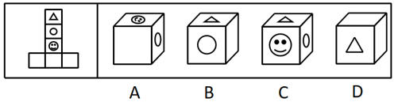
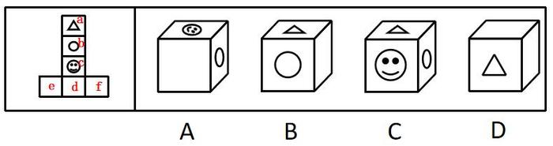

# 立体折叠-六面体展开图折叠（相对面排除法）

考点：[[20-考点/判断推理/图形推理/立体折叠-六面体展开图折叠（相对面排除法）|图形推理 / 立体折叠-六面体展开图折叠（相对面排除法）]]

**问法模型**：问'哪一项不能由展开图折叠而成'（选非题）→ 先给六面标号找三组相对面，凡选项同时出现一组相对面者即为不能折成的答案

## 推理链
1. 第1步：展开图为1-4-1型：竖列四面自上而下为△(a)、○(b)、☺(c)、空白(e)，最下面空白面(e)的左右两侧各接一个空白面d、f
2. 第2步：套用相对面判定规则——同行/同列中隔一个面的两面相对、左右突出的两个侧面相对：竖列中a与c中间只隔b，故a(△)与c(☺)为相对面；b(○)与e(空白)为相对面；d与f（两个空白面）为相对面
3. 第3步：立方体折成后，三组相对面各自不可能被同时看到，以此检验四个选项
4. 第4步：C项同时出现△(a)、☺(c)和○(b)，其中a与c是相对面，矛盾，C不能由展开图折成
5. 第5步：A项含面b、c、f（○、☺、空白），B项含面a、b、f（△、○、空白），D项含面a、d、f（△、两空白），三选项所含三面均无相对面且图案位置与展开图一致，可以折成，排除
6. 第6步：本题为选非题（选'不能'的一项），故正确答案为C

**最快解法**：⚡ 相对面排除法：在展开图竖列上直接看出△与☺中间只隔○一个面，二者为相对面；扫一眼选项，只有C同时画出△和☺，直接锁定C，无需验证其余选项

## 易错点
- ⚠ 忽略'不能由它折叠而成'的选非问法，误把能折成的A/B/D当作答案
- ⚠ 相对面误判：不确认两面处于同一直线就套'隔一个面相对'规则，或误以为△与☺中间隔了两个面而不敢判相对
- ⚠ 在A/B/D上逐一画时针方向验证相邻面关系，浪费时间——本题靠相对面即可秒杀

## 母题抽象
> 🧩 当六面体展开图题问'不能折成'时，先标号并用'同列隔一相对、Z字两端相对'找出三组相对面，选项中同时出现任一组相对面的即为答案

**同类特征**：正方体外表面展开图、问'不能由它折叠而成'（选非题）、展开图含△、○、☺等特征图案、含多个空白面、1-4-1型展开图、选项均为立方体直观图

## 相关题
- [[10-真题/判断推理/图形推理/10297111 空间重构-展开图拼合（碎片旋转组合）|10297111]]（天津 2025，相关度1）
- [[10-真题/判断推理/图形推理/12304871 空间重构-六面体折叠（相对面排除+共顶点相邻面）|12304871]]（江苏 2024，相关度1）
- [[10-真题/判断推理/图形推理/13504536 空间重构-展开图拆分拼合（黑白图案旋转复原）|13504536]]（河南 2025，相关度1）
- [[10-真题/判断推理/图形推理/15419026 六面体展开图-展开图等同性判定（画边法-时针方向法）|15419026]]（湖北 2025，相关度1）
- [[10-真题/判断推理/图形推理/17097750 空间重构-相对面关系（展开图折纸盒）|17097750]]（山西 2024，相关度1）

---

### 题干

左边给定的是正方体的外表面展开图，右边哪一项不能由它折叠而成？

### 选项
- A. A
- B. B
- C. C　✅
- D. D

### 官方解析

将展开图标上序号如下图，逐一进行分析。

A项：选项由面b、面c与面f构成，选项与展开图一致，排除；

B项：选项由面a、面b与面f构成，选项与展开图一致，排除；

C项：选项由面a、面b与面c构成，展开图中面a和面c为相对面，不能同时出现，选项与展开图不一致，当选；

D项：选项由面a、面d与面f构成，选项与展开图一致，排除。

本题为选非题，故正确答案为C。

### 给定材料
（无）
