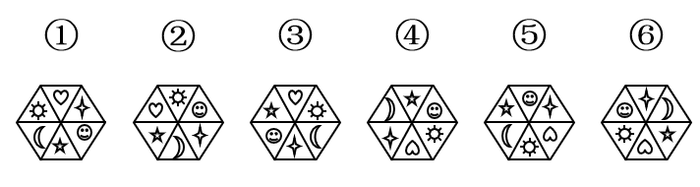
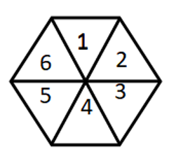

# 位置规律-两组元素奇偶格间隔分布（正六边形六分格编号）

考点：[[20-考点/判断推理/图形推理/位置规律-两组元素奇偶格间隔分布（正六边形六分格编号）|图形推理 / 位置规律-两组元素奇偶格间隔分布（正六边形六分格编号）]]

**问法模型**：六个图形分为两类→元素组成相同时，优先观察小元素在分格中的位置分布规律，寻找可把六图二分的共同特征

## 推理链
1. 第1步：每个图形均为正六边形被三条对角线分成6个三角形格，且都含同样6个小元素：心、月亮、笑脸、太阳、四角星、五角星，元素组成相同，考虑位置规律
2. 第2步：将6个小元素按形态分成两组：曲线类（心、月亮、笑脸）与尖角类（太阳、四角星、五角星），再顺时针给6个格编号1~6
3. 第3步：逐图核对两组元素所占格的奇偶性：①中心（1）、笑脸（3）、月亮（5），四角星（2）、五角星（4）、太阳（6）；③⑤与①一致
4. 第4步：核对②④⑥：②中太阳（1）、四角星（3）、五角星（5），笑脸（2）、月亮（4）、心（6），即曲线类占2、4、6，尖角类占1、3、5，与①③⑤正好互换
5. 第5步：据此①③⑤为一组（曲线类占奇数格），②④⑥为一组（曲线类占偶数格），对应选项B

**最快解法**：⚡ 元素分组法+奇偶编号：先把6个小元素按'曲线类（心/月亮/笑脸）'和'尖角类（太阳/四角星/五角星）'分成两类，顺时针编号后检查每图两类元素是否分别占1、3、5格与2、4、6格，占法相同的归一组

## 易错点
- ⚠ 只追踪某一个元素的位置变化，看不出'两组元素各占奇偶格'的整体间隔规律
- ⚠ 对小元素分类标准选错（如按对称性或大小分组），导致无法二分六图
- ⚠ 顺时针编号起点不统一，奇偶错位后误判①③⑤与②④⑥的归属

## 母题抽象
> 🧩 当题干出现'多幅图元素组成完全相同、且小元素可自然分成两类、排布在正多边形分格中'的特征时，给格子顺时针编号，验证两类元素是否分别占据奇数格（1、3、5）与偶数格（2、4、6），据此完成二分类

**同类特征**：元素组成相同、正六边形分6个三角格、6个小元素可分两类：曲线类与尖角类、奇偶格间隔分布、六图分两类问法、位置规律

## 相关题
- [[10-真题/判断推理/图形推理/2172768 位置规律（旋转-翻转）|2172768]]（海南 2021，相关度2）
- [[10-真题/判断推理/图形推理/1758954 图形推理-位置规律（翻转：先左右翻转、再上下翻转）|1758954]]（上海 2016，相关度2）
- [[10-真题/判断推理/图形推理/2166148 位置规律（旋转+翻转复合变换）|2166148]]（深圳市考 2018，相关度2）
- [[10-真题/判断推理/图形推理/2185066 位置规律-旋转（双图形分别旋转，一逆一顺）|2185066]]（广东 2018，相关度2）
- [[10-真题/判断推理/图形推理/2391849 位置规律-图形间相对位置（小元素与相交区域的关系）|2391849]]（黑龙江 2016，相关度2）

---

### 题干

把下面的六个图形分为两类，使每一类图形都具有共同的特征或规律，分类正确的是：

### 选项
- A. ①②③，④⑤⑥
- B. ①③⑤，②④⑥　✅
- C. ①②④，③⑤⑥
- D. ①⑤⑥，②③④

### 官方解析

元素组成相同，考虑样式规律。观察发现题干小图形都在正六边形格子中，如下图所示。其中①③⑤中“心”“月亮”“笑脸”在1、3、5的位置，“太阳”“四角星”“五角星”在2、4、6的位置，②④⑥中“心”“月亮”“笑脸”在2、4、6的位置，“太阳”“四角星”“五角星”在1、3、5的位置。

故正确答案为B。

### 给定材料
（无）
