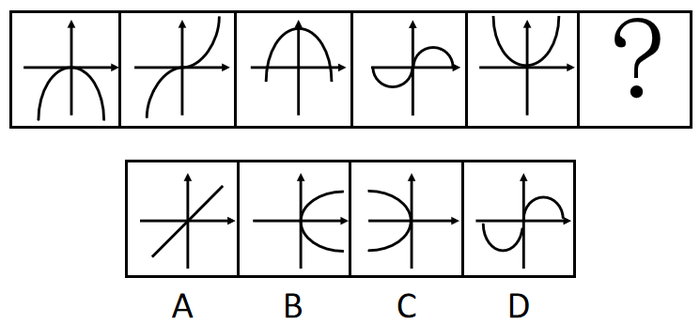

# 属性规律-对称性（轴对称与中心对称交替）+曲直属性二级辨析

考点：[[20-考点/判断推理/图形推理/属性规律-对称性（轴对称与中心对称交替）+曲直属性二级辨析|图形推理 / 属性规律-对称性（轴对称与中心对称交替）+曲直属性二级辨析]]

**问法模型**：问号处选图使整体呈现规律 → 元素组成不同时优先找属性规律，逐图判定对称性寻找交替规律，再用曲直等细节属性校验排除

## 推理链
1. 第1步：题干5幅图均含横纵坐标轴，轴上各有一条曲线，元素组成不同，优先考虑属性规律
2. 第2步：逐图判定曲线对称性：图1抛物线关于纵轴轴对称、图2类三次曲线关于原点中心对称、图3拱形曲线轴对称、图4类正弦曲线关于原点中心对称、图5开口向上抛物线轴对称
3. 第3步：归纳出'轴对称、中心对称、轴对称、中心对称、轴对称'的交替规律，故？处应为一条中心对称的曲线
4. 第4步：对照选项，B、C两项曲线均关于横轴轴对称，与'中心对称'要求不符，排除
5. 第5步：A项过原点直线虽为中心对称，但题干每幅图均为曲线，直线与曲线属性不符，排除
6. 第6步：D项曲线与图4同为关于原点中心对称的曲线，完全符合'中心对称+曲线'双重要求，当选

**最快解法**：⚡ 对称性交替规律+排除法：先看出'轴、中心'交替锁定？处应为中心对称→候选仅A、D→再用'题干全为曲线'这一细节属性排除直线A，秒选D

## 易错点
- ⚠ 只验证对称性而忽略曲直属性，误选中心对称的直线A项
- ⚠ 对图4类正弦曲线对称性判断失误，误当作轴对称，打乱交替规律
- ⚠ 被'每幅图都有横纵坐标'的共性迷惑，误去数点、数面而未先走属性规律

## 母题抽象
> 🧩 当题干出现'共同框架（坐标轴/外框）不变+框架内元素逐图变化'且元素组成不同时，优先逐图判定对称性找交替规律，并用曲直、开闭等细节属性作二级校验排除干扰项

**同类特征**：每幅图均含横纵坐标轴、坐标轴内各有一条曲线、元素组成不同、轴对称与中心对称交替出现、问号处需延续第6位规律

## 相关题
- [[10-真题/判断推理/图形推理/10204454 数量规律-部分数（黑白球连通区域数做和）|10204454]]（甘肃 2024，相关度1）
- [[10-真题/判断推理/图形推理/10204604 数量规律-线数量（汉字横线数）|10204604]]（辽宁 2024，相关度1）
- [[10-真题/判断推理/图形推理/10297050 数量规律-特殊计数（线条穿过小白球的数量）|10297050]]（天津 2025，相关度1）
- [[10-真题/判断推理/图形推理/10297127 图形间关系-相交图形中不相交边数量（黑白图形相交）|10297127]]（天津 2025，相关度1）
- [[10-真题/判断推理/图形推理/10297148 数量规律-线的细化（端点连线穿过线条数；备选：平行线组数）|10297148]]（天津 2025，相关度1）

---

### 题干

从所给的四个选项中，选择最合适的一个填入问号处，使图形呈现一定的规律性：

### 选项
- A. A
- B. B
- C. C
- D. D　✅

### 官方解析
题干元素组成不同，优先考虑属性规律。观察可知每幅图都有横纵坐标，不同的地方在于坐标轴上曲线的对称性分别是轴对称、中心对称、轴对称、中心对称、轴对称，为交替规律，所以？处应为一条中心对称的曲线。B项和C项的曲线都是轴对称，排除。A项虽为中心对称，但是直线不是曲线，排除。
故正确答案为D。

### 给定材料
（无）
